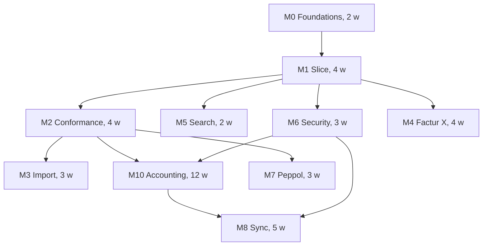

# Implementation Plan

**Project:** Bonk (working name; final name TBD) — local-first e-invoicing client
**Companion to:** `.agents/notes/technical-design.md` (v1.0),
`.agents/notes/accounting-design.md` (v1.1)
**Date:** 2026-10-27
**Assumed capacity:** 1 experienced Rust engineer, full time (adjust linearly)

---

## Contents

1. [Strategy](#1-strategy)
2. [Milestone overview](#2-milestone-overview)
3. [Release trains](#3-release-trains)
4. [Milestone detail](#4-milestone-detail)
5. [First two weeks, concretely](#5-first-two-weeks-concretely)
6. [Effort summary](#6-effort-summary)
7. [Critical path and parallelism](#7-critical-path-and-parallelism)
8. [Quality gates](#8-quality-gates)
9. [Test corpus acquisition](#9-test-corpus-acquisition)
10. [Packaging and release](#10-packaging-and-release)
11. [Operating rhythm](#11-operating-rhythm)

---

## 1. Strategy

Four principles drive the ordering:

1. **De-risk the things we cannot estimate.** PDF/A-3 conformance, official
   validation artefacts, and SQLCipher packaging are the three tasks most likely
   to blow up. Each gets a time-boxed spike in M0, before anything depends on
   it.
2. **Ship a thin vertical slice before building breadth.** One invoice type,
   one tax scenario, one template, end to end — draft, validate, issue, export,
   archive, verify. Breadth (more VAT schemes, more profiles, more languages)
   comes after the spine works.
3. **Never let a "later" feature corrupt the data model.** Multi-device sync,
   DRR reporting, credit notes, and the ledger are not implemented in v1.0, but
   their data requirements (immutability, HLC fields, sequence leasing,
   credit-note doc types, explicit tax codes) are present from the first
   migration. Retrofitting these is what usually kills local-first products.
4. **Finish the arc the user can feel.** v1.0 makes invoices provable; v1.1
   turns that archive into books (general ledger, VAT return preparation, bank
   reconciliation). This is the committed next step, not an option: it is why
   v1.0 records tax codes and party snapshots instead of only totals.

v1.1 is committed: the accounting layer, milestone M10, designed in
`accounting-design.md`. Everything else is deferred, with reasons:

| Deferred | Reason | Earliest |
|----------|--------|----------|
| Peppol sending | Requires a provider contract and accreditation; file export covers most Dutch SMEs today | v1.3 |
| Multi-device sync | Not needed to be useful; needs a relay or P2P stack, and the ledger needs single-writer periods first | v2.0 |
| DRR/ViDA reporting | Technical contract unpublished | On publication |
| QES | Requires qualified certificates and a QSCD | Customer-driven |
| OCR for paper | Separate product surface, different failure modes | After v1.3 |

---

## 2. Milestone overview

| ID | Milestone | Duration | Depends on | Produces |
|----|-----------|----------|------------|----------|
| M0 | Foundations and risk spikes | 2 w | — | Workspace, CI, encrypted DB opens, three spike reports, ADRs accepted |
| M1 | Vertical slice | 4 w | M0 | Draft → validate → issue → UBL + PDF → verify, one tax scenario |
| M2 | Conformance | 4 w | M1, spike 2 | Official EN 16931 + Peppol profile validation, codelists, findings UX |
| M3 | Import and payable register | 3 w | M1 | UBL/CII/Factur-X import, dedupe, supplier match, AP list |
| M4 | PDF/A-3 and Factur-X | 4 w | M0 spike 1, M1 | Conformant hybrid PDF, profiles, templates, veraPDF gate |
| M5 | Search, templates, polish | 2 w | M1 | FTS, saved views, template editor surface, i18n pass |
| M6 | Security, keys, audit, backup | 3 w | M1 | Key wrapping, passphrase UX, audit chain, backup/restore, evidence bundle |
| M7 | Peppol bridge | 3 w | M2, M6 | Connector port, outbox, one provider adapter, inbound poll, receipts |
| M8 | Sync Phase 2 | 5 w | M6, M10 | HLC/oplog, relay reference server, CRDT merge, period-lock convergence, conflict UX |
| M9 | DRR adapter skeleton | 1 w | M2 | Evidence packaging contract, null connector, feature flag |
| M10 | Accounting core (v1.1) | 12 w | M2, M6 | General ledger, periods, VAT return preparation, bank reconciliation, reports |

Durations are engineering time, not calendar time; add 20 % for the unknown.
Milestone IDs are stable handles, not a schedule: **M10 ships before M4.**

---

## 3. Release trains



| Release | Contents | Audience | Exit criterion |
|---------|----------|----------|----------------|
| **v0.1 internal** | M0 + first half of M1 | Developer | Can create and persist an invoice; DB encrypted |
| **v0.5 alpha** | M1 | 3–5 friendly users | 20 real invoices issued; UBL accepted by an external validator |
| **v1.0** | M1, M2, M3, M5, M6, non-hybrid PDF | Dutch SMEs, B2B | 3 pilot companies run a full quarter; zero data-loss incidents; audit chain verifies |
| **v1.1** | M10 | SMEs doing their own bookkeeping | One pilot quarter reconstructed: VAT return matches the accountant's filing, trial balance accepted without a spreadsheet |
| **v1.2** | M4 | Users whose customers demand Factur-X/ZUGFeRD | veraPDF pass on all templates × profiles |
| **v1.3** | M7 | Users with Peppol-mandated counterparties | 100 test messages acked end to end |
| **v2.0** | M8 (+ M9 when the DRR contract is published) | Multi-device users | Convergence property tests + 2-device soak test |

**MVP cut line: v1.0 = M0, M1, M2, M3, M5, M6 ≈ 18 person-weeks.** That is a
product a Dutch freelancer or small BV can actually use daily: correct invoices,
compliant UBL, reliable archive, provable audit trail, no network requirement.

**v1.1 = M10, the accounting layer ≈ 12 person-weeks.** It is the next logical
step because the invoice archive already contains the facts a ledger needs; see
`accounting-design.md`.

This ordering deliberately pushes Factur-X (M4) to v1.2 and Peppol (M7) to
v1.3. Factur-X is needed by a subset of counterparties and depends only on M1, so
if a pilot customer demands it, M4 can be pulled forward without disturbing M10.
Peppol is gated by a commercial provider contract, not by engineering.

---

## 4. Milestone detail

Sections are ordered by milestone ID, not by schedule: **M10 (v1.1) ships before
M4 (v1.2).**

### M0 — Foundations and risk spikes (2 weeks)

**Goal:** the bones are right and the three scary unknowns have answers.

Deliverables:

1. Workspace scaffold: 13 crates per design §5.2, `rust-toolchain.toml`,
   workspace lints, `cargo deny`, `cargo audit`, CI matrix on Windows/macOS/Linux.
2. `crux` first pass: `Money`, `Quantity`, `VatRate`, `Currency`,
   `DocumentId`, `DateTime`/`LocalDate`, error taxonomy, state machine skeleton.
   ~40 unit tests including proptest rounding invariants.
3. `store` first pass: SQLCipher open/close with raw key, `keystore.bin`
   with Argon2id-wrapped DEK, migration runner, smoke migration creating
   `seller` and `invoice_draft`.
4. `app` shell: eframe window, passphrase unlock screen, empty dashboard.
5. ADRs 001–012 recorded in `.agents/notes/adr/` (short form; the table in the design doc
   is the index).
6. **Spike 1 — PDF/A-3:** render a Typst document, attach an XML file, inject
   XMP, validate with veraPDF in a container. Output: yes/no on Typst alone, plus
   a fallback plan with `lopdf`.
7. **Spike 2 — official validation:** run the EN 16931 XSLT artefacts via
   `libxslt` on 5 sample invoices, on all three OSes. Output: packaging cost,
   build flags, and whether a WASM build is plausible.
8. **Spike 3 — SQLCipher packaging:** verify bundled SQLCipher builds and passes
   a torture test (crash during write, WAL recovery, `VACUUM INTO`, key rotation)
   on each OS. Output: known issues list.

Exit criteria:

- `cargo test` green on all three OSes in CI.
- Encrypted database opens, rejects a wrong passphrase, survives a kill -9
  during write, and restores from `VACUUM INTO`.
- All three spikes have a written conclusion and a go/no-go that either confirms
  the design or triggers an ADR revision.
- No `TODO` in the dependency graph: every crate compiles and has at least one
  test, even if trivial.

Risks to watch: SQLCipher + Windows static OpenSSL is the classic packaging
tarpit; budget the full day it usually takes.

**Status, 2026-10-27.** Implemented and green locally: workspace, `crux`
(54 tests), `store` (16 tests, including the plaintext canary, wrong-key
rejection, and an encrypted `VACUUM INTO` backup), `app`, `cli`, CI, and ADRs
001–012. Spike 3 is closed (`.agents/notes/spikes/sqlcipher.md`): the Windows
build needs Strawberry Perl, and `tools/cargo-strawberry.sh` is the documented
entry point. Spikes 1 and 2 remain open and are scheduled before M4 and M2.
Still open from the exit criteria: crash-during-write torture, and the CI run
on three OSes (workflow written, not yet executed).

---

### M1 — Vertical slice (4 weeks)

**Goal:** one complete path through the system, for one tax scenario (NL
domestic, 21 % VAT), with one template.

Work packages:

| WP | Content | Est. |
|----|---------|------|
| M1.1 | Seller/customer CRUD + address model + party snapshots | 4 d |
| M1.2 | Draft editor: header, line grid, live totals, findings drawer | 6 d |
| M1.3 | Totals engine per design §6.6 + property tests + BR-CO examples | 4 d |
| M1.4 | T1 invariant validation with BT-tagged findings (en/nl) | 3 d |
| M1.5 | Issue transaction: number allocation, snapshot, immutability triggers, audit chain | 4 d |
| M1.6 | UBL 2.1 writer for the supported subset; golden tests | 5 d |
| M1.7 | Visual PDF via Typst (no PDF/A yet); template "minimal" | 4 d |
| M1.8 | Artifact storage + hash manifest + `bonk verify` CLI | 2 d |

Deliberately excluded: credit notes, reverse charge, multiple VAT rates, foreign
customers, multiple currencies, discounts. They come with M2 because they are
where the rule complexity lives.

Exit criteria:

- Issue 20 varied invoices through the UI; each produces UBL that passes an
  external validator (Mustang or KoSIT via Docker) with zero errors.
- Re-rendering an issued invoice is byte-identical (hash equal).
- Kill the app mid-render; on restart the invoice exists, and artefacts
  regenerate correctly.
- `bonk verify <invoice-id>` recomputes and confirms every hash offline.
- Editor stays under 16 ms frame time on a 5 000-line database.

**Status, 2026-10-27.** Implementation of the slice is complete end to end.
Domain model and T1 validation, storage (parties, drafts with upsert, the issue
transaction with sequence allocation, immutable issued rows, hash-chained audit,
artefact blobs), a deterministic UBL 2.1 writer, and a Typst-rendered visual PDF
are in place. The CLI flow (`seller-add` → `customer-add` → `draft-new` →
`issue` → `verify`) writes both artefacts, and `verify` recomputes every hash
offline. The desktop editor (seller onboarding, customer creation, line grid
with live totals and BT-tagged findings, save, issue) shares the UBL renderer,
renders the same PDF, and can save it from the Issued screen. PDF bytes are
deterministic for the same input. 132 tests workspace-wide.

External validation: `tools/validate-m1.sh` generates 20 varied invoices and
runs Mustangproject 2.17.0 against every UBL file. **20/20 pass EN 16931 and
Peppol BIS 3.0 with zero failed rules.** The corpus is generated through the CLI
issue path, which shares `app::render_issue` with the GUI; GUI click automation
is not part of the harness. No Docker is required.

---

### M2 — Conformance (4 weeks)

**Goal:** the validation layer becomes the product's spine, not a checkbox.

Work packages:

| WP | Content | Est. |
|----|---------|------|
| M2.1 | `conformance`: EN 16931 semantic model, BT/BG registry, profile definitions | 5 d |
| M2.2 | Vendored codelists with version manifest and load-time integrity check | 2 d |
| M2.3 | Official artifact runner behind `official-validation` feature; CI packaging | 5 d |
| M2.4 | Rust re-implementation of high-frequency BR rules for live feedback | 5 d |
| M2.5 | Findings model → UI focus mapping, severity policy, suppression with reason | 3 d |
| M2.6 | Full tax scenario matrix: domestic, reverse charge, intra-EU B2B, export, exempt, zero-rated, multiple rates | 5 d |
| M2.7 | Credit notes (381) and corrective invoices, with reference rules | 3 d |
| M2.8 | Peppol BIS 3.0 profile layer (endpoint/party identifiers, extra rules) | 4 d |

**Status, 2026-10-27.** The conformance foundation is in place. `conformance`
now exposes EN 16931 and Peppol BIS 3.0 profiles, a BT/BG registry, a rule
catalogue with official codes, a semantic invoice view, and blocking checks for
BR-02, BR-16, BR-CO-10/13/14/15/16/17, BR-CO-26, the S/Z/E/AE/IC/G/O category
presence, rate, base, tax, and exemption rules, and the not-subject-to-VAT
exclusivity rule. 19 conformance tests cover clean invoices and each rule family.

The shared issue path (`app::render_issue`) runs the Peppol-profile rules after
number allocation and before any insert. Blocking findings abort the issue
transaction, so the allocated number is rolled back; the CLI prints the findings
and the GUI lists them with their field paths. A CLI regression test proves a
rejected issue does not consume `2026-0001`.

The UBL writer now emits BT-120/BT-121 at the VAT breakdown and omits the rate
for outside-scope lines and subtotals. CLI line specs accept exemption code and
text as optional seventh and eighth fields. Intra-community supply writes BT-72
from `--delivery` and BT-80 from the customer country; `BR-IC-11` blocks a
missing delivery date. T1-021 rejects conflicting exemption reasons within one
VAT breakdown. `tools/validate-vat-matrix.sh` validates standard, zero-rated,
exempt, reverse-charge, intra-community, export, and outside-scope invoices
against Mustang: **7/7 valid**.

Number allocation, issue-time conformance, finding paths, and click-to-focus are
in place. M2.5 is complete: non-blocking warnings can be suppressed with a
mandatory reason, stored in `validation_suppression`, and recorded on the audit
chain as `finding_suppressed`; blocking findings are never suppressible. Schema
version is now 3. Migrations carry optional down SQL: `bonk migrate-down --to 2
--yes` preflights the chain and rolls back 0003; 0001/0002 are deliberately
irreversible because they create legal evidence.

M2.2 is complete. `conformance::codelist` embeds eight code lists (UNTDID 1001
invoice and credit-note types, ISO 4217, ISO 3166-1, UNCL 5305, CEF VATEX, UN/ECE
Rec 20+21, CEF EAS) extracted from the official codelist Schematron by
`cargo run -p xtask -- codelists`, with a pinned source hash, a per-file
`manifest.json`, and a test that recomputes every hash and entry count. The rule
engine now emits BR-CL-04 (currency), BR-CL-14 (seller/buyer country, BT-40 and
BT-55), BR-CL-22 (VATEX), BR-CL-23 (unit code), and BR-CL-25 (endpoint scheme).
BR-CL-01/17/18 constrain codes that a closed enum already fixes, so their
membership is asserted by tests instead of unreachable findings. The update
procedure in `codelist-updates.md` was rehearsed on 2026-10-27 by injecting a
synthetic `ZZQ` unit code into a copy of the source: extraction produced exactly
that one-line diff, and re-running against the pinned source restored the
bundle.

M2.7 is complete. Credit notes carry BG-3 (`PrecedingInvoice`: identity, BT-25
number, BT-26 date), and the UBL writer emits the `CreditNote` binding with
`cac:BillingReference`, `cac:CreditNoteLine`, and `cbc:CreditedQuantity`, and no
`cbc:DueDate`. `credit_note_for` copies an issued invoice into a draft; issuing
re-verifies that the reference is an issued document of the same seller before
allocating a number, so a stale reference cannot be issued. Credit notes have
their own counter and a `-C` number prefix (`2026-C0001`). T1-022 (a credit note
needs a preceding invoice), T1-023 (no due date on a credit note), and T1-024 (an
invoice must not carry a preceding reference) are blocking.
The CLI gained `bonk credit-note <number>`, and the desktop Issued screen has a
Credit note action that copies the document into the editor. `validate-m1.sh`
now validates 20 invoices and one credit note against Mustang: **21/21 valid**.

M2.3 is complete, with a changed design. The validation spike closed the
question: the published `EN16931-UBL-validation.xslt` is XSLT 2.0 (184 uses of
`xsl:function`, `for-each-group`, and XPath 2.0 functions), and libxslt is XSLT
1.0 only, so a native binding cannot run it. ADR-006 was amended: the authority
path is an external validator behind the `official-validation` feature.
`conformance-official::report` turns the validator's report into typed failures
with the rule id, the first BT reference, the XPath, and the assertion text;
`conformance-official::oracle` runs the process. `cargo run -p xtask --
conformance <dir>` validates every document in a directory and exits non-zero on
any failure; `tools/validate-m1.sh` remains the end-to-end gate.

Running the oracle over the M1 corpus immediately found a real gap: BR-CO-25
("a positive amount due needs a payment due date or payment terms") was not
implemented, so an invoice issued without a due date passed our engine and
failed the official one. The rule is now implemented and blocking for invoices
(not for credit notes, which have no due date), with a catalogue entry, a BT-9
field path, and tests.

M2.8 is complete for the rules the domain can express. The Peppol BIS 3.0 layer
is transcribed from `PEPPOL-EN16931-UBL.sch` (release 3.0.20) and runs only when
the profile is Peppol: PEPPOL-EN16931-R003 (buyer or order reference),
R010/R020 (buyer and seller endpoint identifiers), NL-R-002 (a Dutch seller needs
a street and a post code), and P0104–P0111 (the VATEX code must match the VAT
category). NL-R-003 is satisfied structurally: the writer emits a Dutch KvK as
`cbc:CompanyID schemeID="0106"`, asserted by a syntax test. Rules about
allowances, payment mandates, invoice periods, and national DE/IT/SE/GR/IS/DK
rules are deliberately absent because the model does not carry those groups;
they are listed rather than assumed.

That change made the Peppol profile stricter, as the published artefact is: an
invoice now needs endpoint identifiers for both parties, a buyer or order
reference, and (for a Dutch seller) a street and post code. The CLI gained
`--peppol` on `seller-add` and `customer-add`, the desktop forms gained address
and Peppol fields, and the validation scripts were updated. Credit notes copy the
buyer and order reference from the document they correct, so the copied draft
still passes R003.

Remaining in M2: nothing blocking. Explicit deliver-to address fields beyond the
buyer country remain for a later slice. Workspace tests: 361 encrypted, 359 plain.

Exit criteria:

- Corpus of 60+ invoices with expected finding sets; our output matches the Java
  oracle on all of them (documented, allowed divergences only where the oracle
  itself is ambiguous).
- Every blocking finding in the UI points at a field; no "unknown error" paths.
- Codelist update procedure documented and rehearsed once (simulated release).
- Zero network access during the entire milestone's test suite (asserted in CI).

---

### M3 — Import and payable register (3 weeks)

| WP | Content | Est. |
|----|---------|------|
| M3.1 | Sniffer + UBL parser + CII parser, DTD/external-entity disabled | 5 d |
| M3.2 | Factur-X PDF extraction (name tree, XMP cross-check) | 3 d |
| M3.3 | Dedupe (supplier + number, payload hash fallback) and duplicate UI | 2 d |
| M3.4 | Supplier matching against customers, confidence scoring, manual override | 3 d |
| M3.5 | Payable register: list, filters, status transitions, settlement events | 3 d |
| M3.6 | Folder watcher (`notify`) with debounce and idempotent ingest | 2 d |
| M3.7 | Fuzz targets for all three parsers | 2 d |

**Status, 2026-10-27.** M3.1's UBL reader is in: `syntax::read_invoice` turns a
received Invoice or CreditNote into the terms the domain already models (header,
both parties, lines with their VAT treatment, totals, BG-3), rejects DTDs,
bounds size and depth, and resolves the document's own namespace prefix.
Round-trip tests prove the reader and the writer agree; error tests cover a
DTD, a foreign root, a missing number, a malformed date, and excessive nesting.

The schema now has one document model. `issued_invoice`/`issued_line` became
`document`/`document_line` with a `direction`, an `owner_id` (always our entity),
and a `counterparty_id` (buyer outbound, supplier inbound); `artefact` lost its
separate `imported_invoice_id`. Numbering is separated by two partial unique
indexes, so a supplier's `2026-0001` cannot collide with ours and the same
supplier number cannot be recorded twice. Because nothing has shipped, the
migrations were consolidated rather than stacked: 0001 parties and drafts, 0002
documents, 0003 suppression, schema version 3.

Not started: CII, Factur-X extraction, and the register's user interface beyond the CLI.

The inbound path is wired end to end. `bonk import <files…>` reads a UBL
document, matches the issuer against the party table (identical VAT identifier,
then identical Peppol endpoint, then legal name plus city), and records it as a
`document` row with `direction = 'inbound'`: the bytes in `blob`, the parsed
values in `document`/`document_line`, and the provenance in `import_record`
(source kind and path, payload hash, match status and confidence). An unmatched
supplier leaves `counterparty_id` null and `match_status = 'unmatched'`; no party
is invented. The same bytes, or the same supplier number, are reported as a
duplicate and write nothing. The parser's guarantees (no DTD, bounded size and
depth, UBL root) apply before anything is stored.

M3.1 is complete: CII D16B documents import through the same path. The two
readers share one bounded tree (`syntax::dom`) and produce the same
`ImportedInvoice`, so matching, dedupe, and the register are unaware of the
syntax; `read_document` selects the reader from the root element and the chosen
syntax is recorded as `source_kind` (`ubl` or `cii`). Dates, type codes, parties,
lines, and totals map from the same BT/BG numbers; `format="102"` is the only
CII date format accepted, and 380/384 read as an invoice while 381 reads as a
credit note.

M3.2 is in. A hybrid PDF/XML file is sniffed by its `%PDF-` header, the embedded
document is recovered through the catalog name tree (with a scan of
`/EmbeddedFile` streams as a fallback), and the bytes go through the same CII or
UBL reader as a bare XML file. The XMP packet is cross-checked: a
`fx:DocumentFileName` that disagrees with the attachment, or a
`fx:DocumentType` that is not `INVOICE`, is an error rather than a preference.
Encrypted containers, files over the size limit, and containers whose
attachments are not XML are refused with a precise reason. Bounds cover the
input, the attachment count, the name-tree depth, and every decoded stream; the
page content is never read. The blob keeps the PDF as received and the
provenance records `source_kind = 'pdf'`, so the same invoice arriving as XML and
as PDF is one record by supplier number.

M3.7's invariant is now enforced in the suite rather than only in a fuzz run:
property tests feed arbitrary bytes and structured token soup to both XML
readers and to the PDF extractor, a mutated real container and a truncation sweep
cover the container path, and a compressed stream that claims to inflate past the
limit must be refused. The parsers answer or refuse, never panic. libFuzzer
targets are not wired yet because they need nightly plus `cargo-fuzz` on the CI
runner; the property tests are the gate until that exists.

M3.5 is in as well. `bonk received` lists inbound documents with supplier, dates,
amount, and status; `bonk approve` and `bonk mark-paid` move a document forward.
Status is derived from append-only `document_event` rows, never written to the
document, so the document stays immutable and the reason for its status stays
readable. Transitions only move forward and a repeat is refused with a clear
message; `document_event` has triggers blocking updates and deletes. Outbound
documents are not part of the register, and asking to settle one is an error
rather than a silent no-op.

M3.4 closes with the manual override. `bonk match <document> <customer>` resolves
the document in the register and the party by identifier or display name, then
writes one `supplier_match` row and one `supplier_matched` audit event. The
document keeps the import-time `counterparty_id` and the issuer snapshot; the
register prefers the matched party's display name, so a human decision corrects
the view without rewriting history. Only inbound documents can be matched, and
the decision records who made it and when.

Exit criteria:

- 100 % of the corpus imports or fails with an actionable message.
- Truncated, zip-bombed, and entity-expansion inputs are rejected without
  crashing or hanging (fuzz run: 1 h clean).
- Importing the same file twice never creates two records.

---

### M4 — PDF/A-3 and Factur-X (4 weeks, v1.2)

| WP | Content | Est. |
|----|---------|------|
| M4.1 | Font pipeline: bundle, subset, verify `ToUnicode` for CJK/diacritics | 4 d |
| M4.2 | XMP + OutputIntent + EmbeddedFiles injection, deterministic PDF ID | 5 d |
| M4.3 | Profile levels MINIMUM, BASIC WL, BASIC, EN 16931, EXTENDED | 5 d |
| M4.4 | Multi-page layout, page numbering, continuation headers, long descriptions | 4 d |
| M4.5 | Templates: classic, modern; logo, accent, footer, payment block, EPC QR | 4 d |
| M4.6 | veraPDF gate on templates × profiles × edge cases in CI | 2 d |
| M4.7 | Preflight diagnostics surfaced in UI ("what exactly is non-conformant") | 2 d |

Exit criteria:

- veraPDF reports zero failures for every template × profile combination.
- External tools (at least two: one commercial validator, one open-source)
  extract the embedded XML and validate it as EN 16931.
- 40-page invoice with 300 lines renders under 1.5 s and stays conformant.
- Byte-identical output across two runs on two machines (fonts embedded, no
  timestamps).

---

### M5 — Search, templates, polish (2 weeks)

FTS5 with the design's ranking, saved filters, CSV/JSON export, keyboard
shortcuts, empty states, Dutch and English UI, document-language selection,
`bonk support-bundle`. Exit: 20 000-invoice database, typed queries under 30 ms
p95, no layout breakage at 125 %/150 % DPI scaling.

**Status, 2026-10-28.** Search is in. `invoice_fts` lives in migration 0002 and
is maintained by triggers, so it cannot drift from the documents: an insert
indexes the number, the party name, the buyer and order references, and the
note; a supplier decision rewrites the party column. `store::search` takes a
query plus optional direction, date window, and status filters, quotes and
prefix-matches each typed word so a search box can never produce an FTS5 syntax
error, and ranks with `bm25` weighting the number highest. `bonk search` exposes
it.

Export is the same rows in a shape someone else can read: `bonk export` writes
CSV or JSON over the same filters (an empty query means everything), with the
amount as a decimal string in both, because a JSON number is a float to most
parsers and money must not round-trip through a float. An empty export is a
header or `[]`, not an error. `SearchHit.status` now comes from the latest event
or, when there is none, from `document.state`, so an issued invoice reads as
`issued` rather than borrowing the register's initial `received`.

Remaining in M5: saved filters, keyboard shortcuts and empty states in the GUI,
the i18n pass, document-language selection, and `bonk support-bundle`.

**The find panel is in the workspace.** A group above the editor holds the query,
a side filter, a status filter, and Search/Clear; Enter in the field runs the
query and Ctrl+F focuses it. Nothing runs per keystroke: a search reads the whole
index, and work the user did not ask for is the wrong default. A blank query
lists what the filters allow, so the panel doubles as a browse view. The empty
states are distinct — "nothing asked yet", "nothing in this archive", and
"nothing matches, every word has to appear" — because the three mean different
things. Clicking a number opens the stored document beneath the list: parties as
snapshotted on the day, lines with their stored amounts, totals, status history,
and artefact hashes. It is read-only because the archive is write-once, and
`store::archive::load` rebuilds it from those rows rather than from today's
customer table — a rename after issue must not rewrite what the invoice says.
`SearchView` keeps the state apart from the drawing code, so a unit test drives
the panel against a real database, and a headless egui frame proves the workspace
draws without panicking, including with a result open.

Saved views are in. `saved_search` sits in migration 0002 with `(owner_id, name)`
unique, so saving under an existing name edits those filters instead of growing a
second row with the same label; `store::saved` has `save`, `list`, and `delete`,
and it is the one table in the archive without immutability triggers, because a
saved view is convenience rather than evidence. It stores only what the panel can
express — words, a side, a status — because a column nothing writes is a column
that lies. The panel's **Saved** list applies a view and runs it, so a stored view
shows results rather than only fields, and **Delete** removes the applied one.

Remaining in M5: the i18n pass and document-language selection.

The i18n groundwork is in, English first. `app::text` holds a `Language` enum and
the strings for the lock screen and the strength estimate, grouped by screen; each
function takes the language and ignores it today, so adding a second table changes
one module and no call sites. The strength estimate now returns a `Reason` code
rather than a sentence, which is what lets the wording live in the text table at
all. `BonkApp` and `Workspace` each hold the language, chosen once, so a second
table has a place to be selected from — the seller's locale is the obvious source.
The workspace body still has literals in its widgets; moving them is the rest of
the pass, and the boundary is deliberate rather than accidental: everything a
user can read in the shell is in `text`, and what is left is the editor.

---

### M6 — Security, keys, audit, backup (3 weeks, part of v1.0)

| WP | Content | Est. |
|----|---------|------|
| M6.1 | Passphrase UX: strength meter, recovery-key export, forced confirmation | 3 d |
| M6.2 | Key rotation (rewrap), lock on idle, zeroisation tests | 3 d |
| M6.3 | Audit chain: event coverage, verification CLI, chain-head display | 3 d |
| M6.4 | Encrypted rotating backups + restore with chain verification | 4 d |
| M6.5 | Evidence bundle export + offline verifier | 3 d |
| M6.6 | Log redaction layer + support bundle preview | 2 d |
| M6.7 | Integrity check screen (`PRAGMA integrity_check`, orphan blobs, hash audit) | 2 d |

**Status, 2026-10-28.** M6.4's storage half is in. `store::backup` writes a
`VACUUM INTO` copy, verifies it read-only (integrity plus the audit chain), and
only then prunes older copies beyond the retention limit; a copy that fails
verification is left in place and reported. `bonk backup` uses it (default
directory `backups` beside the database, `--keep` for retention) and
`bonk verify-backup` checks a copy without opening the live database. Tests cover
encryption, rotation, refusal before pruning, damage detection, and a restore on
a fresh path.

M6.3's chain-head display is in as well: `audit::head` returns the newest link,
and both `bonk verify` and `bonk verify-backup` print it, so comparing two copies
of an archive is a diff of sequence number, hash, and time rather than a guess.
Event coverage is unchanged and already tested (issue, import, status changes,
supplier decisions).

M6.7's data half is in. `store::integrity::audit` re-hashes every blob, cross-
checks each artefact's hash against its blob, confirms every import record still
has its payload, runs `PRAGMA foreign_key_check`, and counts blobs nothing refers
to. `bonk verify` reports all four; an orphan is wasted space, a mismatch or a
missing payload is corruption. `blob` now has the same write-once triggers as the
other evidence tables, since every recorded hash points at those bytes. The panel
that renders this arrived with M6.7's other half and is described below.

M6.2's rewrap is in as well. `bonk passphrase-change` opens the keystore and the
database with the current passphrase, seals the same data key under the new one,
unseals those bytes in memory and compares the key before the file is replaced,
then appends a `passphrase_changed` event. A wrong current passphrase or a
missing database leaves the keystore untouched.

M6.1's recovery key is in. Keystore format version 2 appends a second wrap of the
same data key under a 160-bit secret, shown once as Crockford base32 in eight
groups and never stored; the passphrase wrap keeps its version-1 layout and both
versions still open. `bonk recovery-add` requires the passphrase before adding a
route, replaces an existing key, verifies in memory that both routes unwrap the
same key before writing, and records `recovery_key_added`. A passphrase change
carries the recovery wrap over without holding the secret. `passphrase-reset`
uses the key to install a new passphrase when the old one is gone, then rotates
the key and prints the replacement, because the used key has now been typed
somewhere. Still open in M6.1: nothing.

M6.1's workspace prompts are in. A collapsed **Security** panel changes the
passphrase and adds a recovery key through `Session::add_recovery_key` and
`Session::change_passphrase`, which open the keystore with the passphrase typed
again instead of relying on the unlocked session, then append the same audit
events the CLI does. A new key is shown once in monospace and forgotten on Done;
the panel's fields are wiped after a successful change and when the workspace is
dropped, which locking does.

M6.1's recovery route on the lock screen is in too. **Forgotten the passphrase?**
asks for the recovery key and a new passphrase, calls
`Session::reset_passphrase` — which opens the database before rewrapping so a
wrong key changes nothing — and then shows the replacement key until it is
acknowledged, because the used key has been typed somewhere. Acknowledging unlocks
with the new phrase.

M6.1's strength estimate and confirmation are in. `app::strength` scores a phrase
on length, character variety, and a short list of common phrases, collapses a
repeated pattern to its period before counting, and returns a level, a floor on
the search space in bits, and one sentence of advice; the unlock screen shows it
under the field and the creation flow asks for the phrase twice. `bonk init` asks
twice at the prompt as well, while `--passphrase` and `BONK_PASSPHRASE` are single
sources and are taken as they stand. A weak phrase is reported on stderr rather
than refused: the estimate is a heuristic, and blocking an archive the user asked
for would be worse than telling them the truth once.

M6.5 is in. `store::evidence` writes a bundle directory — manifest with a SHA-256
per file, the stored semantic record, every artefact, the received bytes for an
imported document, and the whole audit chain — and verifies it without any
database: listed files must match, nothing unlisted may appear, manifest paths
must stay inside the bundle, the record must belong to the named document, and
the chain must recompute to the recorded head with at least one event naming the
document. Export verifies what it wrote before reporting success, and refuses a
number that matches both directions. `bonk evidence` and `bonk evidence-verify`
expose it. The chain travels whole, so bundles grow with the archive; the design
note records that trade-off and what a bundle does and does not prove.

M6.6's bundle is in. `store::support` collects counts, versions, sizes, the
integrity audit, the chain head, and per-kind audit counts, writes `summary.json`
and `summary.txt`, and `bonk support-bundle` prints exactly what it wrote. The
redaction policy is structural: the bundle is assembled from typed facts, so there
is no free text to filter, and paths are excluded because they carry the operating
system user name. A canary test seeds an archive with a distinctive seller name,
customer name, supplier number, amount, VAT identifier, document id, and temp
path, then asserts that none appears in either file while the counts do. Still
open in M6.6: a log redaction layer, since the product has no logs yet; when they
arrive they must go through a redacting writer rather than being filtered after
the fact.

M6.7 is in. `app::health` snapshots the cheap facts when the workspace opens —
schema, encryption, archive size, chain head, newest backup beside the archive —
and runs the expensive audit only when the Archive health panel asks: SQLite's
owner integrity check first, then every blob re-hashed, then orphaned payloads
counted. Damage shows as an error rather than a tick; orphans show as a warning
because they are wasted space, not corruption. Unit tests cover a damaged payload,
the newest-backup rule, and a short chain head; the headless draw test now draws
the panel contents even though the header is collapsed.

M6.2's idle lock is in. `app::idle` is a fire-once timer with the clock passed in,
so its behaviour is tested without a window: it fires once at the limit, re-arms
on activity, saturates a backwards clock, and clamps `BONK_IDLE_MINUTES` (default
15, allowed 1–1440). The app counts any egui event as activity and schedules a
repaint every 30 seconds while unlocked, because a reactive UI with no scheduled
frame would only notice the timeout on the next mouse move.

M6.2's zeroisation is in. The CLI's `resolve_passphrase`, `resolve_recovery_key`,
and `resolve_new_passphrase` return `Zeroizing<String>`, so every route — flag,
environment variable, or prompt — is wiped when it drops; a new test asserts that
a resolved value still compares as text, never prints itself through `{:?}`, and
refuses blank input. The desktop unlock and create paths copy the form's buffer
into a `Zeroizing` for the call and wipe the buffer itself once the credentials
are accepted, while a wrong passphrase stays in the form so a typo can be
corrected. The buffer has to remain a plain `String` because egui's `TextEdit`
writes into one, which is why it is wiped explicitly instead of on drop. A
passphrase passed as a flag is still in the process's argv, which belongs to the
operating system; the threat model records that as residual risk rather than as
something the code can fix.

The threat model is written: [`threat-model.md`](threat-model.md) covers assets,
trust boundaries, assumptions, threats by category with their residual risk,
what is out of scope, a claim-to-test table, and open items O1 and O3–O6. It is
candid
about the parts that are easy to oversell — a fully rewritten chain is
indistinguishable from the original without an outside record of a head; an
unlocked archive is readable by anything running as the user; and a recovery key
stored beside the archive turns two credentials into one.

Remaining in M6: nothing. The threat model still lists O3–O6 as open: an optional
keychain wrap, fuzz targets, tighter file permissions at creation, and a decision
on recording chain heads somewhere durable.

Exit criteria:

- Restore from backup on a clean machine yields identical artefacts and a valid
  chain.
- Tampering with any audit row is detected by the verifier.
- Support bundle contains no amounts, names, or identifiers (asserted by a
  redaction test fixture).
- Threat-model document published alongside the release.

---

### M7 — Peppol bridge (3 weeks, v1.3)

Connector port + manifest + capability prompt, outbox with idempotency and
backoff, mock provider for tests, one real provider adapter, inbound polling,
receipt storage, failure taxonomy in the UI, egress allow-list enforcement.
Exit: 100 test messages acked, duplicate send returns the same receipt, provider
outage produces a resumable `pending` state, no silent data loss.

---

### M8 — Sync Phase 2 (5 weeks, v2.0)

HLC implementation and tests, `sync_op` log, Merkle heads, relay reference
server (~600 lines: auth, append, fetch), group-key sealing, CRDT draft merge,
posting and period-lock convergence, three-pane conflict UI, lease-based sequence
blocks, two-device soak test.
Exit: 10 000 random operations applied in two different orders converge to
identical state (property test); 72-hour two-device soak with no divergence;
relay sees only ciphertext (verified by inspecting stored blobs); a posting made
offline into a period another device locked surfaces for review rather than
being dropped.

---

### M9 — DRR adapter skeleton (1 week, on demand)

`TaxReportingConnector` port with `contract_version`, evidence package builder,
null connector, feature flag, documentation of what we retain and why. Not
shipped until the published specification is available.

---

### M10 — Accounting core (12 weeks, v1.1)

Detailed design: `accounting-design.md`. This is the committed next step after
v1.0 and ships before M4/M7 despite its higher ID.

**Goal:** turn the issued-invoice archive into correct books, and produce a VAT
return a Dutch accountant will accept.

| WP | Content | Est. |
|----|---------|------|
| A1 | Chart of accounts (RGS-aligned starter), journals, posting engine, reversal | 3 w |
| A2 | Fiscal periods, period locks, opening balances, trial balance / P&L / balance sheet | 2 w |
| A3 | Tax-code mapping, VAT return preparation, ICP listing, reconciliation checks | 3 w |
| A4 | CAMT.053 / MT940 / CSV import, matching ladder, allocations, unmatched queue | 3 w |
| A5 | Accountant export package, hardening, pilot migration | 1 w |

Exit criteria:

- Posting every issued invoice in a pilot quarter yields a trial balance that nets
  to zero, and AR/AP control accounts equal their subledger sums.
- Re-posting is idempotent; posting into a locked period is rejected.
- The generated VAT return matches the accountant's filed return for the pilot
  period, with every difference explained and auditable.
- A bank statement imports without duplicates across overlapping ranges, and the
  unmatched queue is resolvable with keyboard only.
- Trial balance over 500k journal lines under 200 ms; 10k bank lines under 2 s.
- The evidence bundle verifies the ledger and the VAT basis offline.

Prerequisite acknowledged: this milestone assumes the v1.0 hooks from
technical-design §1.5 (explicit tax codes, party snapshots, business dates,
`posting_profile_id`). If they were skipped, add a week.

---

## 5. First two weeks, concretely

**Before code:** accept or amend ADRs 001–012; otherwise M0 will re-litigate
them in code review.

### Days 1–2 — Skeleton

```bash
cargo new --lib crates/crux
cargo new --lib crates/store
cargo new --lib crates/conformance
cargo new --lib crates/conformance-official
cargo new --lib crates/syntax
cargo new --lib crates/render
cargo new --lib crates/import
cargo new --lib crates/bridge
cargo new --lib crates/sync
cargo new --lib crates/testkit
cargo new --lib crates/app
cargo new --bin crates/cli
cargo new --bin xtask
```

Then: workspace manifest, `rust-toolchain.toml`, lints, `deny.toml`, CI workflow,
`README.md` with non-goals, `.agents/notes/adr/` with the 12 records.

### Days 3–5 — Core types

`Money`, `Currency`, `Quantity`, `UnitCode`, `VatRate`, `LocalDate`,
`DocumentId`, `Hlc` (placeholder), `DomainError`. Property tests:

```
∀ lines, currency: sum(line_net) == invoice_net
∀ m, n: format(parse(format(m))) == format(m)
∀ a, b: a + b - b == a
```

No serialisation derives on domain types; DTOs live in the adapter crates.

### Days 6–8 — Encrypted store

`keystore.bin` format (magic, version, Argon2 params, salt, nonce, wrapped DEK,
MAC), `Database::open(passphrase)`, migration runner, first migration, wrong-key
test, kill-during-write test. Write the key-format spec into the design doc
appendix before implementing it.

### Days 9–10 — Spikes

Run spikes 1–3, write `.agents/notes/spikes/{pdfa3,validation,sqlcipher}.md` with
findings, measurements, and a go/no-go. These documents decide whether M4 and
M2 keep their estimates.

---

## 6. Effort summary

| Milestone | Person-weeks | Confidence | Notes |
|-----------|--------------|------------|-------|
| M0 | 2 | Medium | Spikes can expand; cap them at 1.5 days each |
| M1 | 4 | Medium | UI work dominates |
| M2 | 4 | Low | Official artefacts + tax matrix are the risk |
| M3 | 3 | Medium | Parser work is predictable |
| M4 | 4 | Low | PDF/A-3 conformance is the highest-variance task |
| M5 | 2 | High | Well-understood work |
| M6 | 3 | Medium | Key handling + restore testing |
| M7 | 3 | Low | Depends entirely on provider API quality |
| M8 | 5 | Low | Distributed-systems correctness |
| M9 | 1 | Medium | Skeleton only |
| M10 | 12 | Low | VAT rubriek artefacts and bank format variance are the risks |
| **v1.0 (M0–M3, M5, M6)** | **18** | | ~4.5 months solo, ~5.5 with buffer |
| **v1.1 (add M10)** | **30** | | ~7 months solo; the point where it becomes a bookkeeping product |
| **through v1.3 (add M4, M7)** | **37** | | ~9 months solo |
| **full vision (add M8, M9)** | **43** | | ~10.5 months solo |

Multiply by 0.6 for two engineers on disjoint workstreams (UI/domain vs
compliance/render), not by 0.5 — integration costs are real.

---

## 7. Critical path and parallelism

```
M0 ──► M1 ──► M2 ──► M3
        │      │
        │      ├──► M10 ──► M8      (M10 also needs M6)
        │      ├──► M7
        │      ├──► M4              (independent of M2 after M1)
        │      └──► M5
        └──► M6
```

The critical path to a sellable v1.0 is `M0 → M1 → M2 → M3` (13 weeks) plus M6
(3 weeks) which can run in parallel with M2/M3 if a second pair of hands
exists.

The critical path to v1.1 is `M0 → M1 → M2 → M6 → M10` (2+4+4+3+12 = 25 weeks)
if M6 and M10 are serialised on one person. With two engineers, M6 runs beside
M2, and the accounting work can start on `ledger` types as soon as M2's tax-code
model settles.

Highest-leverage parallelisation with two engineers:

- Engineer A: core, storage, conformance, import, ledger (M2/M3/M10).
- Engineer B: render/PDF, UI, templates, packaging (M4/M5).
- Both: M6 security (pair on key handling — it is the place where "looks
  fine" and "is fine" diverge most).

Do not parallelise M8. Sync correctness needs one owner with a clear head. Do not
parallelise M10's posting engine and VAT mapping between two people either: the
rubriek semantics and the account rules must be designed by one head, or the two
halves will disagree about what a taxable base is.

---

## 8. Quality gates

Applicable at every milestone:

| Gate | Check |
|------|-------|
| Build | `cargo build --workspace --all-targets` on 3 OSes |
| Lint | `cargo clippy -- -D warnings`, `cargo fmt --check` |
| Tests | `cargo nextest run`, no ignored tests without a linked issue |
| Offline | test suite passes with networking disabled |
| Degraded | tests pass on an empty DB and on a 20k-invoice DB |
| Safety | `cargo deny` (licences), `cargo audit` (advisories), no `unsafe` outside approved crates |
| Determinism | artefact hashes stable across two runs and two machines |
| Docs | design doc or ADR updated in the same PR as the behaviour change |

Per-release gates:

| Release | Additional gate |
|---------|-----------------|
| v0.5 | External validator accepts every generated UBL |
| v1.0 | 3 pilot companies, one full quarter, zero data loss; chain verifies after restore |
| v1.1 | Trial balance nets to zero; VAT return matches the accountant's filing with explained differences; bank import dedupes across overlapping ranges |
| v1.2 | veraPDF zero failures, two independent extractors agree on embedded XML |
| v1.3 | Provider ack rate 100 % on test set; duplicate-send idempotency proven |
| v2.0 | Convergence property test + 72 h soak |

---

## 9. Test corpus acquisition

Start collecting in M0; waiting for fixtures in M2 costs a week.

| Source | Purpose |
|--------|---------|
| EN 16931 official test suite / validation artefacts | Rule coverage, expected findings |
| Peppol BIS Billing 3.0 validation artefacts + sample invoices | Profile rules |
| Factur-X sample files from the official specification package | Embedding, profiles |
| Mustang / KoSIT validator (Docker, CI only) | Independent oracle |
| NL VAT return rubriek tables (versioned artefacts) + filed-return samples | VAT preparation golden tests |
| CAMT.053 and MT940 samples from several Dutch banks, plus overlapping ranges | Reconciliation parsing and dedupe |
| CSV bank exports with comma/semicolon decimals, CRLF, Latin-1, BOM | Encoding and locale hardening |
| Own synthetic matrix: 7 tax scenarios × 3 currencies × 4 line types × edge amounts | Regression |
| Hostile inputs: truncated XML, billion laughs, zip bomb, 200 MB PDF, invalid UTF-8 | Robustness |

Fixtures live in `crates/testkit/fixtures/<source>/<case>/` with a
`expected.json` next to each. Reviewers must be able to add a case without
touching test code.

---

## 10. Packaging and release

| Platform | Format | Notes |
|----------|--------|-------|
| Windows | Signed MSI (WiX) | Code-signing certificate is a lead-time item; start procurement in M1 |
| macOS | Notarised universal DMG | Hardened runtime; entitlements for keychain and file access |
| Linux | AppImage + `.deb` | AppImage for support simplicity; deb for distro users |

Release mechanics:

- Signed update manifest (minisign or ed25519), updater verifies offline.
- Update policy: security fixes always; schema migrations forward-only; never
  auto-downgrade.
- Release artefacts include SBOM (CycloneDX) and SHA-256 sums.
- Before shipping a migration, generate a fixture DB with the *previous*
  release binary and add it to the migration test corpus.
- Support path: `bonk support-bundle` produces a redacted zip the user can
  inspect before sending.

Lead-time items to start early: Windows code-signing certificate, Apple
Developer ID, a company VAT number for the Peppol provider contract, and a
trademark/name check.

---

## 11. Operating rhythm

- **Weekly:** review the milestone's exit criteria; if a criterion is at risk,
  cut scope, not quality.
- **Per merged PR:** design doc or ADR touch if a decision changed; changelog
  entry.
- **Monthly:** re-check regulatory sources (OpenPeppol releases, EN 16931
  amendments, Dutch guidance, ViDA milestones) and update the artifact manifest
  plan.
- **Per release:** run the full gate set, tag, publish SBOM, archive the
  conformance report (it is itself evidence of quality).
- **Quarterly:** restore-from-backup drill on a clean machine; audit-chain
  verification of a real database; dependency licence review.

---

## Appendix A — Definition of done (feature)

A feature ships when: it has tests at the appropriate level; it works offline; it
works on an empty and a large database; findings and errors are localised (en +
nl) and point at a field; state changes emit audit events; money never touches a
float; no new `unwrap` in core; and the design doc or an ADR reflects the
decision.

## Appendix B — Open decisions blocking M0

1. Accept ADR-003 (money representation) — blocks the core types.
2. Accept ADR-002 (rusqlite + bundled SQLCipher) — blocks the store.
3. Accept ADR-009 (Typst + post-processing) provisionally — spike 1 confirms.
4. Accept ADR-010 (egui with documented accessibility limitation) — blocks the
   UI shell.
5. Confirm single-seller-per-database for v1 — blocks onboarding UX (schema
   already allows more).
6. Confirm the v1.0 hooks in technical-design §1.5 (explicit tax codes,
   `posting_profile_id`) — cheap now, expensive to retrofit before M10.

## Appendix C — Success metrics to instrument from v0.5

- Time from "new invoice" to "issued" (target median < 4 min for repeat
  customers).
- Percentage of issued invoices with zero blocking findings on first attempt
  (target > 80 %).
- Import success rate on the corpus (target 100 % with actionable failures).
- Crash-free sessions (target > 99.5 %).
- Verification: percentage of pilot databases with a valid audit chain on
  demand (target 100 %).

## Appendix D — Open decisions blocking M10 (v1.1)

1. Accept ADR-013 through ADR-017 (`accounting-design.md` §14).
2. Starter chart of accounts: ship an RGS-aligned ~60-account set, or import the
   user's chart first? (Recommendation: starter set plus CSV import.)
3. VAT filing route: portal export only, partner API, or accountant handoff.
4. Whether opening-balance import must support prior-year comparative figures in
   v1.1 or only a single opening entry.
