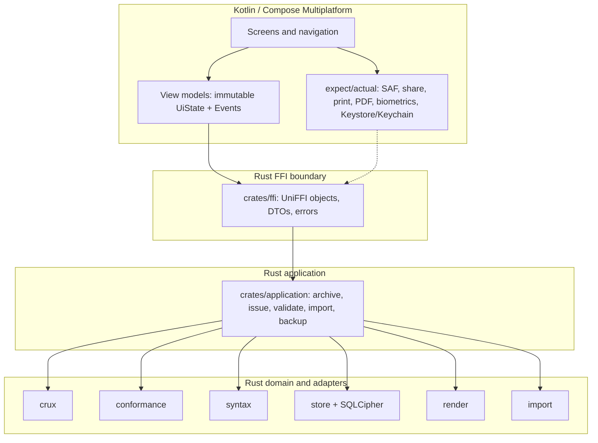

# Mobile client — implementation proposal

**Status:** Proposed, 2026-11-07. Not approved. No product code changes are
included; this document is the review artefact. Implementation starts only after
the spikes in §13 pass and the ADRs in §15 are accepted. Progress is tracked as
checkboxes in §10.1.

**Target:** Android first (phones, tablets, foldables), iOS kept open. Kotlin,
not Java. Local-first, using the same encrypted archive, validation, and
artefact pipeline as the desktop client.

---

## 1. Recommendation

Build the mobile client as a **Compose Multiplatform (Kotlin) app over a new
UI-agnostic Rust application crate and a UniFFI bridge**. Extract the reusable
application services out of `crates/app` first, then put both the Android UI and
the future iOS UI on top of that layer.

| Decision | Recommendation | Why |
|---|---|---|
| UI toolkit | Compose Multiplatform, Android first | Kotlin; the invoice editor is the expensive screen and is shared; Android Compose *is* native Compose; no webview or JS runtime |
| FFI | UniFFI 0.32.2 (Kotlin/JVM + Swift; JNA on Android) | one schema generates every binding; the maintained KMP generator is stale, so the shared module uses `expect/actual` |
| Shared logic | new `crates/application` | the issue/validate/audit pipeline must not be reimplemented in Kotlin |
| Secure storage | platform callback (`Android Keystore` / `iOS Keychain`) | `keyring` has no Android/iOS backend; `DeviceStore` is already a port |
| Database | keep `rusqlite` + SQLCipher | same at-rest design and same archive file; cross-build is the main spike |
| ABIs | `arm64-v8a` + `x86_64` (emulator) | 32-bit ARM adds build and dependency risk for very little reach |
| Minimum OS | Android 8.0 (API 26), iOS 16 | Keystore/file APIs, Compose support, and a reasonable test floor |
| v1 scope | create/unlock, customers, drafts, issue, PDF/UBL export, archive/search, import | a real local client, not a remote control for the desktop |

**Rejected alternatives**

- **egui/eframe on Android.** egui's IME, touch, and accessibility story is not
  good enough for a form-heavy financial app; ADR-010 already accepts an
  accessibility limitation on the desktop and explicitly names a native UI as
  the exit ramp. Mobile is where that exit ramp should start.
- **Hand-written JNI.** It would need a second, hand-maintained Swift bridge for
  iOS, and it is the one place in the workspace that would carry hand-written
  `unsafe`. UniFFI generates both bindings from one definition.
- **WebView / React Native / Flutter.** The first two put the UI behind a
  browser engine or add a JavaScript runtime; Flutter conflicts with the Kotlin
  requirement. `flutter_rust_bridge` is a good tool for the wrong stack here.
- **Calling `store` directly from Kotlin.** `store::issue_draft` is only part of
  issuing: `conformance::validate`, the UBL writer, the PDF renderer, artefact
  attachment, and audit events must happen in one place. Duplicating that in
  Kotlin (or in a thin FFI wrapper) forks the product's most important
  invariant.

---

## 2. What "mobile" means for this product

### 2.1 Product shape

A **first-class local client**, not a companion that needs a server:

- the archive lives on the device, encrypted with the same keystore format;
- a document issued on the phone is byte-identical to one issued on the
  desktop for the same input;
- the phone can act as the only device for a sole trader;
- the tablet is a comfortable review/issue surface, not a stretched phone.

There is no account, no tenant, no home server, and no network permission in
v1. Sync (M8) remains a later, optional feature.

### 2.2 Jobs to be done

| Persona | Situation | Mobile job |
|---|---|---|
| Sole trader | Between jobs, phone in hand | Create and issue an invoice, share the PDF |
| Sole trader | At a customer site | Capture a received invoice, check what is outstanding |
| Small team | Tablet at the counter | Review drafts, issue, show the PDF, take payment notes |
| Accountant | Reviewing on the move | Search the archive, inspect findings, verify the chain head |

### 2.3 Scope of v1

**P0 — required for the first beta**

- Create an archive, unlock with a passphrase, recovery-key reset.
- Biometric "remember this device" with a passphrase fallback.
- Dashboard: drafts, recent issued, outstanding, warnings.
- Customers: list, search, create, edit, CSV import/export.
- Drafts: list, open, edit, validate, save.
- Issue: allocate the number, write UBL + PDF, attach artefacts, audit.
- Document detail: facts, lines, totals, history, artefacts.
- Share/save PDF and UBL through the platform share sheet or SAF.
- Archive/search: filters, virtualised results, document detail.
- Settings: seller identity, UI language, document language, backup,
  recovery kit export, audit chain head.

**P1 — after the beta**

- Import received invoices from the file picker and from `ACTION_VIEW` /
  `ACTION_SEND` (PDF, UBL, CII).
- Received list, supplier matching, approve/mark-paid.
- Read-only summary panels (open items, VAT basis) without ledger writes.
- Print through the platform print service.

**P2 — later**

- Tablet preview pane, credit-note flow from a document, template selection,
  multi-window, stylus/annotation.
- Sync Phase 2 and conflict resolution adapted for a small screen.

**Out of scope for mobile v1**

- Ledger posting, VAT-return preparation, bank reconciliation, reclassification,
  period locks (the desktop's accounting workflows stay desktop-first).
- Peppol sending, plugins, folder watching.
- Official Schematron validation (`conformance-official`): its native XSLT
  binding is not a mobile dependency. Mobile validation is tier 1/2, and the UI
  must not claim official validation.
- OCR, multi-archive, and a server-side account.

---

## 3. What the current codebase gives us

The existing architecture is unusually well prepared for this. The mobile work
is mostly about adding a front end and a portable application layer, not about
rethinking the domain.

| Crate | Mobile role | Work needed |
|---|---|---|
| `crux` | domain, money, dates, draft state, validation | none; pure Rust |
| `conformance` | EN 16931 rules and findings | none; pure Rust |
| `syntax` | UBL/CII readers and writers | none |
| `store` | SQLCipher archive, keystore, repositories, audit | feature-gate `keyring`; cross-build SQLCipher; stable device account |
| `render` | PDF/A-3 layout with `krilla` and `harfrust` | verify the arm64 build and deterministic output |
| `import` | file sniffing, XML/PDF extraction | exclude folder watching from the mobile build |
| `app` | egui workspace and session | **not linked**; extract reusable services first |
| `cli` | desktop/CI binary | not linked; keep as the packaging and validator entry point |
| `conformance-official` | official validator binding | off for mobile |
| `sync` | HLC and future oplog | not in v1; same DB, enable later |
| `bridge` | connector ports | not in v1 |

### 3.1 The gap

`crates/app` is doing two jobs that should be separate:

1. **application services** — session lifecycle, issue pipeline, PDF rendering,
   customer CSV, export, health, templates, passphrase strength;
2. **egui presentation** — views, widgets, input handling, theme.

`app::Session` (`crates/app/src/lib.rs`) is the de facto application layer, but it
lives beside `eframe`, `egui`, and `rfd`. `crates/cli` duplicates some of the same
orchestration because it cannot depend on the egui internals. If mobile calls
`store` directly, there would be a third copy of the issue pipeline.

That is the refactor to do first.

### 3.2 What is already right

- **Money never touches floating point.** `Money` is integer micros and the
  workspace denies `clippy::float_arithmetic`. Kotlin never does amount
  arithmetic; it only displays Rust-formatted strings.
- **Artefacts are deterministic.** Fonts are compiled in, the creation date
  comes from the issue date, and `store::issue_draft` writes one transaction.
  This is exactly what makes cross-platform golden tests possible.
- **`DeviceStore` is already a port.** `crates/store/src/device.rs` defines
  `put`/`get`/`delete`; the desktop `Keychain` implementation is just one
  adapter. Mobile can supply another without touching the domain.
- **Validation findings already carry stable codes.** `Finding { severity, code,
  bt, path, message, source }` is the contract the mobile findings drawer needs.
- **The audit chain and evidence model are platform-neutral.** Mobile can record
  the same events with actor `android`/`ios`.

---

## 4. Target architecture



Rules that keep this honest:

- `crates/application` depends on no UI, no `eframe`, no `rfd`, no `keyring`, no
  network, and no `uniffi`.
- `crates/ffi` is the only crate allowed to touch `unsafe` (through
  generated scaffolding), and it contains no business logic.
- The Kotlin layer owns presentation and platform integration only. It does not
  compute totals, allocate numbers, or write XML.
- The desktop `app` and `cli` are refactored onto the same `application` crate,
  so there is one issue pipeline, not two.

### 4.1 Why Compose Multiplatform

"Native UI" on Android means Jetpack Compose, and Compose Multiplatform uses the
same Compose runtime on iOS. This is not a webview or a canvas imitation: the
same composables become platform UI.

The trade-off is honest:

| Concern | CMP | Jetpack Compose + SwiftUI |
|---|---|---|
| Code sharing | one editor, one design system | editor written twice |
| Android fidelity | native Compose | native Compose |
| iOS fidelity | Material 3 look, improving platform adaptations | fully native SwiftUI |
| Accessibility on iOS | improving, less mature than SwiftUI | best |
| Platform integration | small `expect/actual` surface | idiomatic per platform |
| Hiring | Kotlin everywhere | Kotlin + Swift |

**Decision:** CMP for v1, because the invoice editor and findings UI are the hard
part and sharing them is worth more than a pixel-perfect iOS look at this stage.
Keep the exit ramp: all state and use cases live in `commonMain` Kotlin classes
and the Rust core, so replacing `iosMain` UI with SwiftUI later costs only the
UI layer. If iOS becomes a primary market with strict design expectations, that
swap is a bounded project, not a rewrite.

---

## 5. Rust work

### 5.1 New crate: `crates/application`

**Responsibility:** UI-agnostic application services (the "L2 application"
layer from `technical-design.md` §5.1).

```
crates/application/
  src/lib.rs          Archive, Paths, AppError
  src/session.rs      create/open/reset/device/backup
  src/dashboard.rs    summary and counts
  src/customers.rs    list/search/create/update + CSV
  src/drafts.rs       load/save/list, build from DTO
  src/issue.rs        validate -> UBL -> PDF -> attach -> audit
  src/documents.rs    document views, search, artefacts
  src/import.rs       bytes -> received document
  src/export.rs       filtered export
  src/health.rs       integrity, chain verification
  src/templates.rs    template loading and selection
  src/passphrase.rs   strength estimate (moved from app)
  src/dto.rs          plain front-end DTOs
```

Dependencies: `crux`, `conformance`, `syntax`, `store`, `render`, `import`.
Forbidden: `egui`, `eframe`, `rfd`, `keyring`, `reqwest`, `tokio`, `uniffi`.

**What moves out of `crates/app`**

| Current item | Destination | Notes |
|---|---|---|
| `Session` (`app/src/lib.rs`) | `application::Archive` | keeps the DEK for backups; accepts a `&dyn DeviceStore` |
| `render_issue` | `application::issue::ubl` | same code, same error mapping |
| `invoice_pdf`, `pdf_data`, `party_data` | `application::issue::pdf` | one renderer for both front ends |
| `customers` CSV | `application::customers` | already UI-free |
| `export` | `application::export` | already UI-free |
| `health` | `application::health` | already UI-free |
| `load_templates`, `default_template`, `renderer_for` | `application::templates` | file paths supplied by the caller |
| `strength` | `application::passphrase` | pure scoring; UI words stay in each front end |
| `default_paths` | stays in `app` | desktop uses `%APPDATA%`/`XDG`; mobile passes paths |

**API shape (illustrative)**

```rust
pub struct Paths {
    pub database: PathBuf,
    pub keystore: PathBuf,
    pub backup_dir: PathBuf,
}

pub struct Archive {
    session: store::Database,
    keystore: store::KeyStore,
    dek: zeroize::Zeroizing<[u8; 32]>,
    paths: Paths,
}

impl Archive {
    pub fn create(paths: &Paths, passphrase: &str) -> Result<Self, AppError>;
    pub fn open(paths: &Paths, passphrase: &str) -> Result<Self, AppError>;
    pub fn open_with_device(paths: &Paths, device: &dyn store::DeviceStore) -> Result<Self, AppError>;
    pub fn reset_passphrase(paths: &Paths, recovery: &str, new: &str) -> Result<(Self, String), AppError>;

    pub fn summary(&self) -> Result<Summary, AppError>;
    pub fn issue(&mut self, draft: DocumentId, opts: IssueOptions<'_>) -> Result<IssueOutcome, AppError>;
    pub fn render_pdf(&self, document: DocumentId) -> Result<Vec<u8>, AppError>;
    pub fn export_ubl(&self, document: DocumentId) -> Result<Vec<u8>, AppError>;
    pub fn backup(&self, destination: &Path) -> Result<BackupReport, AppError>;
    // ...
}
```

**DTO rules**

- `application` returns its own plain structs (`Summary`, `DocumentSummary`,
  `DraftDto`, `FindingDto`, `IssueOutcome`), not `crux` types with lifetimes and
  not `serde`-derived public domain types.
- Money crosses as `micros: i64` plus `currency: String` (or a pre-formatted
  string when the UI only displays it). Dates cross as ISO strings.
- IDs cross as strings. The UI never constructs a `DocumentId` from raw bytes.
- Validation findings are **data**, not exceptions. `issue` returns an
  `IssueOutcome { issued: Option<...>, findings: Vec<FindingDto> }` so the UI can
  show blocking findings without parsing an error string.
- Errors carry a stable code plus a human-readable fallback message. The UI
  localizes by code and uses the message only as a last resort.

**Actor and clock**

- `IssueOptions` carries `actor` (`"android"`/`"ios"`), `device` (a user-visible
  name), `now` (RFC 3339), and the document language. The application layer never
  reads the wall clock directly for an artefact; the front end supplies it, which
  keeps golden tests reproducible.
- The audit event kinds stay identical to the desktop's.

**Refactor sequence (must not change behaviour)**

1. Create the crate and move the pure functions (`render_issue`, `invoice_pdf`,
   `pdf_data`, `customers`, `export`, `health`, `templates`, `strength`).
2. Make `app` and `cli` delegate; run `just gate`; compare CLI output before and
   after on a demo archive.
3. Move `Session` to `application::Archive`; make `BonkApp` hold an `Archive` and
   a `DeviceStore` implementation instead of hardcoding `store::device::Keychain`.
4. Add integration tests for the extracted use cases (create/unlock/issue/
   backup/recovery), using `MemoryStore` and `KdfParams::TEST`.
5. Only then add `ffi`.

The extraction is 2–3 weeks of careful work, but it removes the largest
correctness risk in the project: two issue pipelines that drift.

### 5.2 New crate: `crates/ffi`

**Responsibility:** the only Rust surface foreign callers see. Kotlin and Swift
are the first consumers; a Python caller is a plausible later one, so nothing in
this crate may be mobile-specific.

The exported object is `Archive`, not `MobileArchive`. The application type is
referred to as `application::Archive` inside the FFI crate, which keeps the
public name the domain word and the two types unambiguous. The boundary error is
`AppError`; it is mapped from `application::AppError`, which is aliased
internally when both are in scope.

The directory and package are `ffi`, matching the workspace's unprefixed naming
convention. The native library is `bonkc`, so the build emits `libbonkc.so` rather
than a `libffi.so` that could be confused with the system libffi. `crates/uniffi`
was rejected because it would shadow the `uniffi` dependency.

```toml
[package]
name = "ffi"

[lib]
name = "bonkc"
crate-type = ["lib", "cdylib", "staticlib"]

[dependencies]
application = { path = "../application" }
uniffi = { version = "0.32.2", features = ["cli"] }
thiserror.workspace = true
```

- `cdylib` for Android (`libbonkc.so`), `staticlib` for the iOS
  XCFramework (`libbonkc.a`), `lib` so host tests can call it without a dynamic
  load.
- `uniffi::setup_scaffolding!()` in a dedicated module.
- UniFFI 0.32.2's Kotlin generator produces a property named after each error
  field; a field named `message` collides with `Throwable.message` and fails to
  compile. Use `detail` for error payloads. S3 hit this and renamed the fields.
- UniFFI 0.32.2's Kotlin bindings are JVM/Android and use JNA. The maintained
  Kotlin Multiplatform generator (`uniffi_bindgen_kotlin_multiplatform` 0.1.0,
  2023) does not track current UniFFI, so the shared module keeps the FFI behind
  `expect/actual`: `androidMain` calls the JNA bindings, `iosMain` calls the
  Swift bindings.
- Language-neutral DTOs are defined here and mapped from `application` DTOs.
  This is boilerplate, but it keeps `uniffi` out of the application and domain
  crates, and it is what lets a second binding be generated without redesigning
  the surface.
- A `uniffi-bindgen` binary target in the same crate, pinned by `Cargo.lock`.

**Threading and lifecycle**

- `pub struct Archive { inner: Mutex<application::Archive> }`.
- Every exported method takes `&self`; the mutex serialises writes, matching
  SQLite's single-writer model.
- Kotlin calls every method off the UI thread on `Dispatchers.IO`. No host
  should block its UI thread on Rust.
- `close()` drops the archive and zeroizes the DEK. `Drop` is a backstop.
- No callback may re-enter the archive. Progress is a pollable object
  (`Arc<Progress>` with an atomic fraction), not a callback, so a UI refresh
  cannot deadlock the mutex.
- Cancellation for import/backup is an `Arc<AtomicBool>` token checked between
  files; PDF rendering is not interruptible and does not need to be.

**Lint policy**

The workspace forbids `unsafe_code`. UniFFI's generated scaffolding contains
`unsafe`; the exact lint interaction depends on the crate version and macro
spans. The plan:

- keep `crates/ffi` at `#![deny(unsafe_code)]`;
- put `uniffi::setup_scaffolding!()` and any generated glue in a submodule with
  a scoped `#[allow(unsafe_code)]` and a comment naming the generator version;
- if the lint still fires through macro expansion, relax **only this crate** to
  `warn` and record why in ADR-024. Never relax `crux`, `store`, `syntax`,
  `render`, or `application`.

Hand-written code in the FFI crate stays safe. The rule is "one crate, generated
only, reviewed".

**API sketch**

```rust
#[derive(uniffi::Record)]
pub struct ArchivePaths {
    pub database: String,
    pub keystore: String,
    pub backup_dir: String,
}

#[derive(uniffi::Error, Debug, thiserror::Error)]
pub enum AppError {
    #[error("wrong passphrase")]
    WrongPassphrase,
    #[error("the archive is locked")]
    Locked,
    #[error("{code}: {detail}")]
    Operation { code: String, detail: String },
}

#[derive(uniffi::Object)]
pub struct Archive {
    inner: std::sync::Mutex<application::Archive>,
}

#[uniffi::export]
impl Archive {
    #[uniffi::constructor]
    pub fn create(paths: ArchivePaths, passphrase: String) -> Result<Arc<Self>, AppError>;

    #[uniffi::constructor]
    pub fn open(paths: ArchivePaths, passphrase: String) -> Result<Arc<Self>, AppError>;

    #[uniffi::constructor]
    pub fn open_with_device(
        paths: ArchivePaths,
        device: Box<dyn DeviceSecretStore>,
    ) -> Result<Arc<Self>, AppError>;

    pub fn summary(&self) -> Result<SummaryDto, AppError>;
    pub fn drafts(&self) -> Result<Vec<DocumentSummaryDto>, AppError>;
    pub fn load_draft(&self, id: String) -> Result<DraftDto, AppError>;
    pub fn save_draft(&self, draft: DraftDto) -> Result<DraftDto, AppError>;
    pub fn validate(&self, draft: DraftDto) -> Result<Vec<FindingDto>, AppError>;
    pub fn issue(&self, draft_id: String, options: IssueOptionsDto) -> Result<IssueOutcomeDto, AppError>;
    pub fn pdf(&self, document_id: String) -> Result<Vec<u8>, AppError>;
    pub fn ubl(&self, document_id: String) -> Result<Vec<u8>, AppError>;
    pub fn import(&self, name: String, bytes: Vec<u8>) -> Result<ImportOutcomeDto, AppError>;
    pub fn backup(&self, destination: String) -> Result<BackupReportDto, AppError>;
    pub fn close(&self);
}

#[uniffi::export(callback_interface)]
pub trait DeviceSecretStore: Send + Sync {
    fn put(&self, account: String, secret: Vec<u8>) -> Result<(), AppError>;
    fn get(&self, account: String) -> Result<Option<Vec<u8>>, AppError>;
    fn delete(&self, account: String) -> Result<bool, AppError>;
}
```

**Data volume rules**

- Never pass the database through the FFI. Paths only.
- PDFs and UBL are small and cross as `Vec<u8>`.
- Imports are capped at the parser's existing 10 MiB limit; reject larger input
  before copying it across the boundary.
- Backups can be hundreds of megabytes: write to an app cache path in Rust,
  verify there, then stream the file to the platform destination (SAF/UIDocument)
  in the host language, and delete the cache copy.

**Other callers**

- The surface is deliberately language-neutral. `Archive`, the DTO records,
  `AppError`, and the `DeviceSecretStore` callback are plain UniFFI types;
  generating Python, Ruby, or another language's binding later is a build step,
  not an API redesign.
- `DeviceSecretStore` is optional. A caller without a platform credential store
  uses passphrase unlock and never calls `open_with_device`. The FFI crate must
  not ship a plaintext file-backed implementation; a caller that wants one can
  provide it and accept the risk explicitly.
- The C ABI is versioned with the crate. Bump the library version and regenerate
  the bindings together; a stale `libbonkc.so` must not meet new bindings.
- Python packaging (a wheel containing `libbonkc.so`) is a later packaging task.
  It must not introduce mobile-only assumptions into the API.
- No `SAF`, `Activity`, or `UIViewController` concepts belong in this crate;
  platform integration stays in the host language.

### 5.3 Portability changes in existing crates

#### `store`: remove the desktop credential store from mobile builds

`keyring` 4 has no Android or iOS backend. Add a feature:

```toml
[features]
default = ["sqlcipher", "keychain"]
sqlcipher = ["rusqlite/bundled-sqlcipher-vendored-openssl"]
plain = ["rusqlite/bundled"]
keychain = ["dep:keyring"]

[dependencies]
keyring = { workspace = true, optional = true }
```

- `device::Keychain` and `device::available()` are `#[cfg(feature = "keychain")]`.
- Mobile builds with `default-features = false, features = ["sqlcipher"]` and
  supplies `DeviceSecretStore` from Kotlin/Swift.
- `app` and `cli` keep the feature on; `application` exposes it for desktop and
  omits it for mobile. Concretely, `app`'s `cipher` and `plain` features (and the
  matching `cli` features) must enable `store/keychain` alongside
  `store/sqlcipher` / `store/plain`. A mobile build depends on `store` with
  `default-features = false, features = ["sqlcipher"]`, so `keyring` never enters
  the graph.

#### `device`: a stable account name

`store::device::account` hashes the absolute keystore path. That is stable on
Windows and Linux, but an iOS app container path can change across installs and
updates, and Android paths are stable only within the current install. The path
hash would orphan the key after an iOS update.

Add an explicit identifier:

```rust
pub fn remember_for(store: &dyn DeviceStore, archive_id: &str, dek: &[u8; KEY_LEN]) -> Result<(), StoreError>;
pub fn recall_for(store: &dyn DeviceStore, archive_id: &str) -> Result<Option<Zeroizing<[u8; KEY_LEN]>>, StoreError>;
pub fn forget_for(store: &dyn DeviceStore, archive_id: &str) -> Result<bool, StoreError>;
```

Desktop keeps the path-based wrappers (`account(keystore)`), so ADR-021 is
unchanged. Mobile passes a stable `archive_id` stored in the app's no-backup
preferences (`"default"` is enough while the app supports one archive; a UUID is
better when multi-archive lands). The security property is unchanged: a stored
DEK that does not match the database fails at SQLCipher before anything is read.

#### SQLCipher and OpenSSL

`rusqlite/bundled-sqlcipher-vendored-openssl` compiles OpenSSL from source. It
works on the desktop because the build has Perl and a host compiler. For
Android/iOS it needs the NDK/SDK toolchains and a cross-compiling Perl.

Plan:

1. Spike the vendored build for `aarch64-linux-android` and
   `x86_64-linux-android` with NDK r30 (r28+ expected) and `cargo-ndk`. Measure
   build time, binary size, and runtime.
2. If `openssl-src` cross-compiles cleanly (it supports Android and iOS targets),
   keep the current feature and document the required environment.
3. If it does not, fall back to a **prebuilt `libsqlcipher` static library per
   ABI**, vendored with checksums and a documented build recipe. This is a
   supply-chain change: record it in `deny.toml`/the SBOM and add a review step.
4. Do not replace SQLCipher with application-level field encryption. It would
   invalidate the threat model and the canary tests.

**Result (2026-11-07):** the vendored build works for both Android ABIs; see
`spikes/mobile.md`. Windows hosts need Cygwin Perl plus pure-Perl modules staged
from Strawberry and `MSYS_NO_PATHCONV=1`; Linux is the recommended CI host.
`libsqlite3-sys` 0.39.1 does not wire `sqlcipher-src`'s libtomcrypt provider, so
the no-OpenSSL path is not available without an upgrade or patch.

Other SQLCipher notes:

- Keep `PRAGMA cipher_memory_security = ON`; measure the cost on a low-end phone.
- Keep `secure_delete`, `temp_store = MEMORY`, `synchronous = FULL`, WAL, and the
  5-second busy timeout. They are part of the financial-data contract; do not
  lower them silently for battery.
- Backups use `VACUUM INTO`; preflight free space (about 2× the database) and
  report a clear error instead of failing midway.

#### 16 KB page sizes

Android 15+ requires native libraries to support 16 KB page sizes. S1 verified
that NDK r30 emits `0x4000`-aligned `LOAD` segments by default, and the x86_64
canary ran on a 16 KB AVD. Keep the `llvm-readelf -l` check (`LOAD` alignment
`0x4000`) in CI; add `-C link-arg=-Wl,-z,max-page-size=16384` only if a toolchain
or linker setting regresses. A 4 KB-aligned library may install but fail on a
16 KB device.

#### `import`: no folder watching on mobile

`import::watch` polls a directory with a background thread. Mobile has no
user-visible folder to watch and should not run a poller. Feature-gate the
module (`watch` feature, default on for desktop) or simply do not call it from
`application` on mobile. Imports arrive through SAF/`ACTION_VIEW` as bytes.

#### `conformance-official`: off

The official Schematron/XSLT path uses an isolated native binding that is not
worth cross-compiling and would add a large, platform-specific artefact. Mobile
ships tiers 1/2 only. The UI must say "validated against the built-in rules",
never "officially validated".

#### `render`: deterministic and portable

`krilla` and `harfrust` are pure Rust; the bundled font is compiled in. Verify
the `harfrust` build on `aarch64-linux-android` and `aarch64-apple-ios` early.
If a 32-bit ARM build fails, drop `armeabi-v7a` (see §8.1) rather than patching
the shaper.

#### `time`, `uuid`, `zeroize`, `argon2`, `aes-gcm`

All are pure Rust and already used by the core. No platform backend is needed.
Keep `time` without `local-offset`; the domain stores `LocalDate` and the UI
formats dates.

#### Panics across the FFI

Keep `panic = "unwind"` for the mobile release profile. UniFFI catches panics at
the boundary and turns them into errors. `panic = "abort"` would make a parser
bug kill the app and would prevent the boundary from reporting anything.

### 5.4 Determinism across targets

The product invariant is "UBL output must be byte-deterministic". Mobile must
prove it, not assume it.

Test: on a fresh archive, with a fixed `now`, fixed seller/customer, fixed draft
content, and a fixed sequence, compute SHA-256 of the UBL and the PDF on:

1. the host (Linux CI and macOS CI),
2. the Android emulator/device,
3. the iOS simulator (when the target exists).

All hashes must match. If they do not, the culprit is almost always a
target-specific font/shaper path or an accidental clock read, not money
arithmetic (floats are denied workspace-wide).

Locale formatting stays in the UI; artefacts use ISO dates, fixed decimals, and
the document language chosen by the user.

---

## 6. Kotlin / Compose Multiplatform app

### 6.1 Module layout

```
mobile/
  settings.gradle.kts
  build.gradle.kts
  gradle/libs.versions.toml
  shared/                          KMP library: com.android.kotlin.multiplatform.library
    src/commonMain/kotlin/...      UI, view models, navigation, theme, resources
    src/androidMain/kotlin/...     expect/actual adapters: SAF, share, biometrics, PDF, Keystore
    src/iosMain/kotlin/...         expect/actual adapters: Keychain, pickers, PDFKit
    src/commonTest/kotlin/...      view-model and formatting tests
  androidApp/                      thin com.android.application module
    src/main/AndroidManifest.xml
    src/main/kotlin/...            MainActivity and Android-only wiring
    src/main/jniLibs/...           libbonkc.so per ABI
  iosApp/                          Xcode project (when M11.8 starts)
```

AGP 9.5 rejects the Kotlin Multiplatform plugin in a `com.android.application`
module. S2 used `android.builtInKotlin=false` and `android.newDsl=false` only to
prove the stack; production is the two-module layout above. Keeping the shared
UI and platform adapters in a KMP library also makes the SwiftUI exit ramp
smaller, because the application module owns almost nothing.

- Generated UniFFI bindings go to `shared/build/generated/uniffi` and are added
  to `androidMain`. Do not commit generated bindings; regenerate in CI. Pin
  `uniffi-bindgen` through `Cargo.lock`.
- The Android native library is copied into `androidApp/src/main/jniLibs`, not
  the shared module: the application packages it, the library only calls it.
- Use a version catalog for Kotlin, AGP, Compose, coroutines, lifecycle, and
  navigation.
- No Hilt or Koin. A small `AppContainer` with manual construction is enough and
  keeps `commonMain` free of Android-only DI.
- Prefer plain `StateFlow` holders in `commonMain` over Android `ViewModel`
  unless the multiplatform lifecycle artifacts are used consistently on iOS.
- No Java sources. Kotlin only, including the platform adapters.

### 6.2 UI architecture

Unidirectional flow, mirroring the desktop's Elm-style shape:

```
User event -> UiEvent -> ViewModel -> application/FFI (IO dispatcher)
                                 -> new UiState (StateFlow)
                                 -> one-shot Effect (Channel)
```

- `ArchiveHolder` owns `Archive?` and a `LockState`. It exposes
  `lock()`, `open(passphrase)`, `openWithBiometric()`, and `close()`.
- Every FFI call is wrapped in a repository with `withContext(Dispatchers.IO)`
  and a `runCatching` that maps `AppError` to a typed `UiError(code, message)`.
- `UiState` is immutable data classes; no mutable lists or `LiveData`.
- One-shot effects (navigation, snackbar, share sheet) use a `Channel`, not
  state, so rotation does not replay them.
- Draft edits are saved with a 500 ms debounce. `SavedStateHandle` /
  `rememberSaveable` stores the route, draft ID, and form text so process death
  returns to the same screen. Nothing sensitive is saved in plaintext state.
- Locking is a state transition, not a navigation trick: the back stack is
  cleared, the archive is closed, and the UI shows the lock screen.

### 6.3 Screens

| Screen | Compact (phone) | Medium/Expanded (tablet) |
|---|---|---|
| Lock / Create / Reset | single column, thumb-reachable primary action | centered card, max width 480 dp |
| Dashboard | cards: drafts, outstanding, recent, warnings | two-column card grid |
| Invoices | tabs: Drafts / Issued; search bar | list-detail: list left, detail right |
| Editor | four-step stepper | single form + sticky totals; preview pane on expanded |
| Customers | list + bottom-sheet editor | list-detail |
| Archive / Search | search bar + filter sheet + result cards | filter rail + virtualised table + detail |
| Incoming | import queue cards | list-detail with supplier match |
| Document detail | PDF page pager, facts, history | PDF + facts side by side |
| Settings | grouped list | two-column settings with a section rail |

The desktop screens in `technical-design.md` §14.3 map one-to-one; nothing in
the desktop workflow needs to be removed, only re-flowed.

### 6.4 Adaptive layout

Use window size classes, not device type checks:

| Width | Navigation | Content | Editor |
|---|---|---|---|
| compact `< 600 dp` | bottom navigation (4 destinations) | single pane, cards | stepper; sticky totals bar; findings as a bottom sheet |
| medium `600–839 dp` | navigation rail | single pane or collapsible list-detail | form + collapsible preview |
| expanded `>= 840 dp` | permanent rail | two-pane list-detail | form + live preview + inline findings |

Details:

- **Foldables:** read `FoldingFeature`; avoid placing a field or a primary action
  across the hinge. Tabletop posture puts preview on top, controls below.
- **Multi-window / split-screen:** recompute the size class on configuration
  change and restore selection; never assume portrait.
- **Large tablets:** cap form width (about 720 dp) and center it. A stretched
  single-column form is worse than two panes.
- **Landscape phones:** medium layout; do not force the phone stepper into two
  columns if the height is short.
- **Touch targets:** at least 48 dp, with 8 dp spacing; primary actions at the
  bottom where a thumb reaches.
- **Insets:** edge-to-edge, `safeDrawing`, `imePadding`, and
  `BringIntoViewRequester` so a focused field is never behind the keyboard.
- **Predictive back:** enable it; custom back handlers must save the draft first.

### 6.5 Editor specifics

**Compact stepper**

1. **Customer** — search, recent customers, create inline.
2. **Details** — issue/due/delivery dates, references, note, currency, document
   language, layout.
3. **Lines** — one card per line: name, quantity, unit price, VAT category/rate,
   line net. Add, duplicate, reorder (drag handle), delete with undo.
4. **Review** — totals, breakdown, findings, issue action.

**Medium/Expanded**

- Single scrolling form with a sticky totals card.
- Expanded adds a PDF preview pane and an inline findings panel.
- The preview is rendered by the platform from the PDF bytes, not by a second
  layout engine. `AndroidView(PdfRenderer)` and `UIKitView(PDFKit)`.

**Numbers**

- Quantity and amount fields use a decimal keyboard and select-all on focus.
- `Money::parse_fixed` is the canonical parser. If the design wants `1.234,56`
  input, add a shared `parse_user_amount` to `application` with tests; do not
  implement locale parsing in Kotlin only. This also fixes the current desktop
  gap where the design says both separators are accepted but `parse_fixed`
  accepts only the canonical dot form.
- Show inline errors on blur and on review, keyed by field path. Do not block
  typing.
- Never compute totals in Kotlin. Display strings from Rust, or micros plus a
  currency; the review step re-validates through the domain.

**Dates**

- Material 3 date picker; display according to locale; store ISO.
- "Due date" defaults from the seller's terms; if none, leave empty rather than
  inventing a date.
- Delivery date is optional; credit notes require the preceding invoice.

**Findings**

- Severity chips (`blocking`, `warning`, `info`), stable code, BT reference, and
  the field path.
- Tap focuses the field; on compact, the sheet collapses and the field scrolls
  into view.
- Suppressing a warning requires a reason and writes the same audit/record as
  the desktop. Only non-blocking findings can be suppressed.

**Issue**

- The number is allocated inside the issue transaction; the UI says "assigned
  when issued", never showing a promised number.
- Blocking findings prevent issue and are shown as a list, not a toast.
- On success: show number, totals, UBL hash, PDF hash; offer Share PDF, Share
  UBL, and Save a copy.
- If PDF rendering fails, the document is still issued with UBL; the UI says so
  explicitly, matching the desktop.

### 6.6 Platform integration (`expect/actual`)

| Capability | Android | iOS |
|---|---|---|
| Open file | `ActivityResultContracts.OpenDocument` (PDF/XML) | `UIDocumentPickerViewController` |
| Save file | `CreateDocument("application/pdf")`, `("text/xml")` | `UIDocumentPickerViewController(forExporting:)` |
| Share | `FileProvider` + `Intent.ACTION_SEND` | `UIActivityViewController` |
| Print | `PrintManager` + `PdfDocument` | `UIPrintInteractionController` |
| PDF preview | `android.graphics.pdf.PdfRenderer` in `AndroidView` | `PDFKit` in `UIKitView` |
| Biometrics | `androidx.biometric` + `CryptoObject` | `LocalAuthentication` |
| Device secret | Android Keystore + `noBackupFilesDir` | Keychain with access control |
| Settings | `SharedPreferences`/DataStore | `NSUserDefaults` |
| Device name | `Build.MODEL` | `UIDevice.name` (may be "iPhone") |
| Lifecycle lock | `ProcessLifecycleOwner` / activity callbacks | scene phase |
| Haptics | `HapticFeedback` | `UIImpactFeedbackGenerator` |

No storage permission is needed: SAF and the document picker grant access per
file. No `INTERNET` permission in v1. No analytics SDK.

### 6.7 Design system, localization, accessibility

- Material 3 tokens; a BONK palette shared with the desktop theme. Dynamic color
  off by default so the brand and contrast stay predictable.
- System UI fonts (`FontFamily.Default`), not bundled fonts. The PDF keeps its
  own bundled font; UI and document typography are separate decisions.
- Compose resources for UI strings. English and Dutch first. The invoice's
  printed language is a document property (`render::Language`), independent of
  the UI language, exactly as on the desktop.
- Findings and errors are localized by stable code, falling back to the Rust
  message.
- Accessibility: semantics for every control, content descriptions for icons,
  logical reading order, 48 dp targets, 200% font scale, high contrast, and no
  information conveyed by color alone. Test with TalkBack and VoiceOver.
- Layout must survive RTL even if RTL locales are not translated yet; use
  `start`/`end`, not `left`/`right`.
- Respect reduced-motion settings; no continuous animations or clocks.

### 6.8 Performance budgets

| Metric | Budget | Measurement |
|---|---|---|
| Cold start to lock screen | < 2.0 s | Macrobenchmark, mid-range device |
| Unlock (Argon2 + DB open) | < 2.5 s | instrumented timing |
| Draft list first page | < 200 ms for 10k documents | benchmark |
| Issue + PDF | < 1.5 s | instrumented timing |
| Scroll jank | < 1% skipped frames | Macrobenchmark |
| Download size (AAB, arm64) | < 30 MB | CI size check |
| RSS while editing | < 150 MB | profiler |
| Argon2 peak | +64 MiB transient | documented, measured |

If the budgets miss, the order of attack is: drop 32-bit ARM, enable LTO and R8,
profile the editor, then consider lowering Argon2 only for newly created
archives (never silently for existing ones).

---

## 7. Security and keys on mobile

### 7.1 Threats added by a phone

| Threat | Mitigation | Residual |
|---|---|---|
| Lost or stolen phone | SQLCipher at rest, Keystore/Keychain-gated biometric unlock, auto-lock, no cloud backup of the archive | A weak passphrase; a compromised OS |
| Shoulder surfing / screenshots | `FLAG_SECURE` on document screens (setting, default on), recents snapshot disabled | Photos of the screen by another person |
| App switcher snapshot | Cover screen on background; `setRecentsScreenshotEnabled(false)`; iOS blur overlay | Brief snapshot timing |
| Cloud or adb backup | `allowBackup=false`, `dataExtractionRules` exclude the archive; iOS file excluded from backup | User-initiated export to an unsafe place |
| Malicious keyboard / IME | Cannot be fully mitigated; recommend the system keyboard, never log field content, disable suggestions on the recovery-key field | A compromised system IME |
| Clipboard leakage | Do not copy sensitive data automatically; mark copies sensitive on Android 13+ | Other apps reading the clipboard |
| Rooted / jailbroken device | Out of scope, as on desktop; warn only, do not pretend to detect reliably | Full compromise |
| Overlay / tapjacking | `filterTouchesWhenObscured` on sensitive actions; Android overlay protections | Sophisticated overlay attacks |
| Biometric enrollment change | Keystore key invalidation / Keychain `.biometryCurrentSet`; fall back to passphrase; record the revocation after the next unlock | A user who ignores the fallback |
| App killed while editing | Debounced save, `SavedStateHandle`, transactions | The last <500 ms of typing |
| Clock manipulation | HLC ordering is total; issue dates are user-entered, not clock-derived | Mis-set dates are a user error |
| Crash logs | No automatic crash reporting; opt-in only; redaction layer | A user pasting a screenshot |

The desktop threat model's boundary still applies: encryption protects a copy
that leaves the device, not a device an attacker is already using while
unlocked.

### 7.2 Unlock flows

**Passphrase unlock**

1. Argon2id with the parameters recorded in the keystore (default 64 MiB, t=3,
   p=1). Run it in the foreground with a progress indicator; do not move it to a
   background service where the OS may kill it. S4 measured 428 ms cold and
   143–299 ms warm on a 2-vCPU AVD; keep the indicator because physical
   low-end hardware may be slower.
2. Open SQLCipher with the raw key, run migrations, verify the key with a
   `sqlite_master` read, then show the dashboard.
3. Zeroize the passphrase field and the transient buffers on success and on
   failure. Kotlin `String` cannot be wiped; keep its lifetime short and do not
   put it in saved state or logs. This is a known residual, same as the desktop.

**Biometric "remember this device"**

- Android: generate an AES-256-GCM key in the Keystore with
  `setUserAuthenticationRequired(true)` and
  `setInvalidatedByBiometricEnrollment(true)`. Wrap the 32-byte DEK with a random
  IV and store `iv || ciphertext` in `noBackupFilesDir/device/<account>.bin`.
  `BiometricPrompt` receives the `Cipher` as a `CryptoObject`.
- S3 implemented this and proved put/get/forget plus a simulated invalidation on
  API 37. On 2026-11-08 an emulator fingerprint (enrolled through Settings and
  driven with `adb emu finger touch`) authenticated both the create flow and
  **Unlock with device**. Two findings came out of that run: adding a second
  fingerprint did not invalidate the key, because the key also allows
  `AUTH_DEVICE_CREDENTIAL` and `setInvalidatedByBiometricEnrollment` only takes
  effect for biometric-only keys; and a cold start calls `device_ready`, which
  unwraps the key and shows the prompt before the user asks for the device route.
  Both are fixed: the key is biometric-only with the passphrase as the
  fallback, and `device_ready` asks the store whether an entry exists without
  reading it (`DeviceStore::has`, added to the FFI port). Adding a third
  fingerprint on the emulator then invalidated the key, the device route
  disappeared, and the passphrase opened the archive.
- The invalidated path surfaces `AppException.Invalidated` to the host. The app
  deletes the wrapped copy, hides the device route, and marks a revocation; the
  revocation is written to the audit chain after the next successful passphrase
  unlock, because the chain needs the open archive.
- iOS: store the DEK in the Keychain with
  `kSecAttrAccessibleWhenUnlockedThisDeviceOnly` and an access control of
  `.biometryCurrentSet` (or `.userPresence` if passcode fallback is acceptable).
- The DEK still reaches process memory after unwrap. Say so in the docs; the
  benefit is that a stolen, powered-off device does not yield the key, and a
  copied archive is still protected by the passphrase.
- Enabling the feature requires the passphrase again, exactly as on the desktop,
  and writes `device_trusted` to the audit chain. Disabling writes
  `device_forgotten`.
- If the key is invalidated (new fingerprint/face), delete the entry, show the
  passphrase form, and record the revocation after the next successful unlock.
  The audit needs the database, which needs the DEK, so the event cannot be
  written at invalidation time; document that gap.

**Auto-lock**

- Default: lock 30 seconds after the app leaves the foreground. Options: 0 s
  (immediately), 30 s, 1 min, 5 min.
- Lock clears the archive, zeroizes the DEK, clears the UI state, and returns to
  the lock screen. The back stack is cleared.
- A "Lock now" action is always available in the top bar.

**Recovery key**

- Shown once at creation or on demand, in the existing Crockford base32 groups.
- Screenshot blocking is on while it is visible; copy/share is explicit and
  warns that the key is now outside the app.
- Resetting a passphrase requires the recovery key, produces a replacement key,
  and writes `passphrase_reset`, matching the desktop.

### 7.3 Android manifest checklist

```xml
<application
    android:allowBackup="false"
    android:fullBackupContent="false"
    android:dataExtractionRules="@xml/data_extraction_rules"
    android:usesCleartextTraffic="false"
    android:networkSecurityConfig="@xml/network_security_config"
    android:enableOnBackInvokedCallback="true"
    android:debuggable="false">
    <activity android:exported="true" ...>
        <intent-filter>
            <action android:name="android.intent.action.VIEW" />
            <category android:name="android.intent.category.DEFAULT" />
            <data android:mimeType="application/pdf" />
            <data android:mimeType="text/xml" />
        </intent-filter>
        <intent-filter>
            <action android:name="android.intent.action.SEND" />
            <category android:name="android.intent.category.DEFAULT" />
            <data android:mimeType="application/pdf" />
            <data android:mimeType="text/xml" />
        </intent-filter>
    </activity>
</application>
```

- No `READ_EXTERNAL_STORAGE` / `WRITE_EXTERNAL_STORAGE`.
- `USE_BIOMETRIC` only.
- `FLAG_SECURE` on document and recovery-key screens.
- R8 minification and resource shrinking on; keep rules for `uniffi.**` and
  `com.sun.jna.**`.
- 16 KB-aligned native libraries (§5.3).
- Release builds signed with the upload key; the debug keystore never ships.

### 7.4 iOS checklist

- Keychain items are `WhenUnlockedThisDeviceOnly`, app access group only.
- Database and keystore files have `NSFileProtectionComplete` and are excluded
  from iCloud backup; the user can still export an encrypted backup explicitly.
- Blur/cover view when the scene is inactive; optional screen-capture warning.
- No analytics, no IDFA, no tracking permission.
- `ITSAppUsesNonExemptEncryption` declared; standard AES/Argon2, self-classify.
- Document types for PDF and XML; share extension is P2.
- App Store privacy label: "Data not collected".

### 7.5 Backup, restore, and destructive actions

The archive is **two files**: `bonk.db` (encrypted database) and `keystore.bin`
(wrapped DEK). A backup is the database; the recovery kit is the keystore. This
split is a security feature and must not be hidden.

- **Backup:** `VACUUM INTO` a cache path, verify integrity and the audit chain
  by reopening read-only, then stream the file to the SAF/UIDocument destination
  and delete the cache copy. Preflight free space.
- **Restore:** pick both files, copy them into app-private storage, verify the
  chain, then unlock. The onboarding flow must explain that a backup alone is not
  enough. A single-file `.bonk` container is a possible later convenience, but it
  is a new format and needs an ADR.
- **Delete archive:** verified backup, typed confirmation, audit event. The OS
  "clear app data" action cannot be prevented; the privacy note says so.
- **Cloud backup:** excluded. The user can still put the encrypted backup in a
  cloud folder deliberately; that is their choice and the file is encrypted.

**Review (2026-11-08).** Keep the two-file split. A backup is `bonk.db` and the
recovery kit is `keystore.bin`. The export writes a `VACUUM INTO` copy to a cache
path, reopens it read-only, and checks the integrity and the audit chain before
streaming it to the destination and deleting the cache; the restore copies both
files into app-private storage and verifies again before unlock. A single-file
`.bonk` container stays a later convenience behind an ADR. The export and restore
screens land with the import and settings milestone; this review fixes the format
and the safety checks, not the UI.

### 7.6 Audit and evidence

- Actors: `android` and `ios`; device name recorded where the desktop records
  it. Event kinds are unchanged.
- The chain head is visible in Settings and can be exported as text/QR later.
- Evidence bundles are assembled in Rust and streamed out through SAF; the
  verifier remains the CLI/desktop tool, not a mobile claim.
- Support bundles contain counts, versions, sizes, and hashes only; no names,
  amounts, numbers, identifiers, or paths. Opt-in.

### 7.7 Privacy and data safety

The app states one posture in the store listing, the Play data-safety form, and
an in-app note when Settings lands:

- **No account and no server.** Everything runs on the device; the app makes no
  network requests.
- **No telemetry, analytics, or crash reporting.** Nothing is collected or
  uploaded, so the data-safety form reports "No data collected".
- **Data stays in app-private storage.** The encrypted database and keystore live
  under the app's private files, and the archive is excluded from Google backup
  and device transfer.
- **No permissions beyond what the feature needs.** `USE_BIOMETRIC` for device
  unlock, and no storage permission because import and export go through the
  system file picker.
- **The OS can still clear app data.** Uninstall, "Clear storage", or a lost
  device with no export removes the archive; a verified export plus the recovery
  kit is the only durable copy.
- **Share and export are explicit.** A PDF, UBL, or backup leaves the app only
  when the user chooses a destination, and a backup is encrypted.
- **Crash logs are off.** If reporting is ever added, it is opt-in, redacted, and
  never automatic.

The listing and the in-app note must say that a backup file alone cannot restore
the archive: it needs the matching keystore, and the recovery kit is where that
comes from.

---

## 8. Build, packaging, and CI

### 8.1 Toolchain and targets

| Item | Choice |
|---|---|
| Rust | workspace 1.98+, `resolver = "3"`, edition 2024 |
| Android SDK | `compileSdk = 37` (S2 verified); target the current Play requirement |
| Android NDK | r30 verified (r28+ expected; 16 KB default) |
| Kotlin | 2.4.21 (pinned with Gradle 9.9) |
| Compose Multiplatform | 1.12.2 |
| Gradle / AGP | 9.9.0 / 9.5.1 |
| JNA | 5.19.1 (UniFFI Kotlin bindings) |
| Android ABIs | `arm64-v8a`, `x86_64` (emulator) |
| iOS | `aarch64-apple-ios`, `aarch64-apple-ios-sim`; deployment target 16.0 |
| Bindings | UniFFI 0.32.2; `uniffi-bindgen` pinned through `Cargo.lock` |

`armeabi-v7a` is deliberately not in v1. It doubles the native build matrix,
adds risk in `harfrust`/SQLCipher, and covers a shrinking share. Add it only if
analytics or a distributor requires it; the architecture does not change.

### 8.2 Gradle wiring

AGP 9.5 rejects the KMP plugin in a `com.android.application` module. The
production layout is two modules: `shared` (KMP library, Compose UI and the
`expect/actual` adapters) and `androidApp` (application, manifest, `MainActivity`,
native libraries). The sketch below shows the `androidApp` side; the binding
generation belongs to `shared`. Do not carry the S2 compatibility flags
(`android.builtInKotlin=false`, `android.newDsl=false`) into production.

```kotlin
// androidApp/build.gradle.kts (sketch)
android {
    ndkVersion = "30.0.16248370"
    defaultConfig {
        minSdk = 26
        targetSdk = 35
        ndk { abiFilters += listOf("arm64-v8a", "x86_64") }
        versionCode = gitCommitCount()
        versionName = cargoWorkspaceVersion()
    }
    packaging { jniLibs { useLegacyPackaging = false } }
    buildTypes {
        release {
            isMinifyEnabled = true
            isShrinkResources = true
            proguardFiles("proguard-rules.pro")
        }
    }
}

val repoRoot = rootProject.projectDir.parentFile

val cargoNdk = tasks.register<Exec>("cargoNdk") {
    workingDir = repoRoot
    commandLine(
        "cargo", "ndk",
        "-t", "arm64-v8a", "-t", "x86_64",
        "-o", "mobile/androidApp/src/main/jniLibs",
        "build", "--release", "-p", "ffi",
    )
}

val uniffi = tasks.register<Exec>("uniffiBindings") {
    dependsOn(cargoNdk)
    workingDir = repoRoot
    commandLine(
        "cargo", "run", "-p", "ffi", "--bin", "uniffi-bindgen", "--",
        "generate", "--library", "target/aarch64-linux-android/release/libbonkc.so",
        "--language", "kotlin", "--out-dir", "mobile/shared/build/generated/uniffi",
    )
}

tasks.named("preBuild") { dependsOn(uniffi) }
```

- Keep the exact NDK and tool versions in one place (`libs.versions.toml`,
  `Cargo.toml`, `rust-toolchain.toml`).
- `versionCode` from a monotonic source (`git rev-list --count HEAD` or an
  `xtask` command); `versionName` from `workspace.package.version`. Do not let
  the two drift.
- Signing config reads `keystore.properties` from the environment or a
  gitignored file. Never commit a keystore or password.
- R8 keep rules:

```
-keep class uniffi.** { *; }
-keep class com.sun.jna.** { *; }
-keepclassmembers class * extends com.sun.jna.** { public *; }
```

### 8.3 CI

Add mobile jobs without changing the existing desktop pipeline's meaning:

| Job | Runner | What it proves |
|---|---|---|
| `mobile-rust` | ubuntu | `clippy`/tests for `application` and `ffi`; Android cross-build; `cargo deny`; SBOM per ABI |
| `mobile-android` | ubuntu + emulator | Gradle lint, unit tests, `assembleDebug`, instrumented smoke on API 34/35 x86_64 |
| `mobile-golden` | ubuntu + emulator | UBL/PDF hashes equal the host's |
| `mobile-size` | ubuntu | AAB/native size budget and 16 KB alignment (`llvm-readelf`) |
| `mobile-ios` | macOS | XCFramework build and simulator tests, once M11.8 starts |

- Cache Cargo, Gradle, and the NDK; the SQLCipher/OpenSSL build is the expensive
  step.
- Upload the AAB, `mapping.txt`, SBOM, and test reports as artefacts.
- Keep signing keys and Play credentials in CI secrets; never echo them.
- The existing `checks`, `deny`, `test`, `plain`, `build`, and `conformance` jobs
  stay as they are. `cargo test --workspace` must still pass with the new crates
  on the host; if the Android-only crates slow the desktop suite, use
  `--exclude ffi` for the host test job and add a dedicated FFI test job.

### 8.4 Justfile additions

```make
# Android debug build (requires ANDROID_NDK_HOME and cargo-ndk).
mobile-android:
    cargo ndk -t arm64-v8a -t x86_64 -o mobile/androidApp/src/main/jniLibs \
        build -p ffi
    cd mobile && ./gradlew :androidApp:assembleDebug

# Host-side FFI and view-model tests.
mobile-test:
    {{cargo}} test -p application
    {{cargo}} test -p ffi
    cd mobile && ./gradlew :shared:testDebugUnitTest

# Full mobile gate: Rust, bindings, lint, unit tests, size.
gate-mobile: mobile-test mobile-android
```

Keep `just gate` as the desktop gate. AGENTS.md should say that `gate-mobile`
needs the Android SDK/NDK and is not required for a desktop-only change.

### 8.5 Distribution

- **Android:** Play internal testing → closed → production. Generate an AAB,
  upload the mapping file, and keep the upload key separate from the app signing
  key (Play App Signing). After the Play release is stable, evaluate F-Droid;
  the app has no Play Services dependency (androidx.biometric is a library, not
  Play Services), so F-Droid is feasible, but reproducible-build work is a real
  cost.
- **iOS:** TestFlight → App Store. Requires an Apple Developer account and a
  privacy label of "Data not collected".
- **Store listing:** phone and tablet screenshots, a privacy policy that states
  local-only/no account/no telemetry, a data-safety form of "no data collected",
  and an export-compliance note.
- **Versioning:** one version stream for Rust and Kotlin; the mobile
  `versionName` is the workspace version. Tagging a release builds the desktop
  binaries and the mobile artefacts from the same commit.

---

## 9. Test strategy

### 9.1 Layers

| Layer | What | Where |
|---|---|---|
| Domain | existing `crux`/`conformance`/`syntax` tests | unchanged |
| Application | create/unlock/reset/issue/backup/import, `MemoryStore`, `KdfParams::TEST` | `crates/application` |
| FFI contract | DTO mapping, error codes, object lifecycle, double-close | host Rust tests + JVM tests loading the host `cdylib` |
| Golden artefacts | UBL/PDF SHA-256 equal across host, emulator, simulator | CI |
| View models | state transitions, validation display, lock behavior | `commonTest` with `kotlinx-coroutines-test` |
| Compose UI | navigation, forms, findings focus, adaptive layouts | `androidInstrumentedTest` + screenshot tests |
| Security | canary scan of DB/WAL, backup exclusion, screenshot blocking, keystore invalidation | instrumented + manual |
| Performance | startup, unlock, scroll, issue | Macrobenchmark |
| Fuzz | existing parsers; input size cap at the FFI boundary | unchanged + one boundary test |

### 9.2 Determinism test

A dedicated test issues the same draft twice on a fresh archive with a fixed
`now` and sequence, then compares SHA-256 on the host and the emulator. It also
renders the same document through the CLI on the host and compares the hash with
the mobile one. This is the single most important cross-platform test because it
proves the "one semantic model, two writers" invariant survives the port.

### 9.3 Device matrix

- Pixel 9 / current API, Pixel 6a / API 33.
- A low-RAM device (2–3 GB) for Argon2 and memory pressure.
- Samsung One UI and Xiaomi/HyperOS for Keystore/biometric differences.
- A tablet (Pixel Tablet/Tab class) and a foldable emulator.
- API 26 emulator for the floor.
- iPhone SE (small), current iPhone, iPad, iPad Pro (when iOS starts).

Biometric and Keystore behavior must be tested on physical devices; emulators
fake it and hide OEM differences.

### 9.4 Accessibility and configuration

- TalkBack/VoiceOver traversal on the editor, findings, and lock screen.
- Font scale 200%, display size large, dark/light, high contrast.
- RTL layout (Arabic/Hebrew) even before translation, to catch `left`/`right`.
- Landscape, split-screen, foldable posture, and process death.
- Keyboard types and the decimal separator on a comma-locale device.

---

## 10. Milestones and effort

Assume one senior mobile engineer, one Rust engineer at ~50%, and design support.
Estimates are calendar weeks; they include review and test time but not App
Store review latency.

| Milestone | Weeks | Deliverables | Exit criterion |
|---|---|---|---|
| **M11.0 Spikes** | 2 | SQLCipher cross-build, UniFFI/CMP hello world, Keystore device store, Argon2 timing, determinism probe | All §13 spikes pass or have a documented fallback |
| **M11.1 Foundation** | 3 | `crates/application` extraction, `crates/ffi` skeleton, two-module Gradle/CMP project, CI job | Desktop `just gate` green; Android app opens and locks; no duplicated issue pipeline |
| **M11.2 Unlock and security** | 2 | create/unlock/reset, biometric remember, auto-lock, manifest hardening, backup exclusion | Can create, lock, unlock with passphrase and biometric; canary test passes on device |
| **M11.3 Customers and drafts** | 3 | customer list/edit/CSV, draft list, compact editor, validation findings, debounced save | A draft can be created, edited, validated, and reopened after process death |
| **M11.4 Issue and archive** | 2 | issue, UBL/PDF, share/save, document detail, search | Golden hashes match host; PDF opens in a platform viewer; UBL shares |
| **M11.5 Import and settings** | 2 | SAF/share-target import, received list, supplier match, backup/recovery kit, settings | A received invoice can be imported and matched; a verified backup can be exported |
| **M11.6 Tablet, a11y, performance** | 2 | medium/expanded layouts, two-pane, findings panel, font scale, screenshots, baseline profile | Tablet layout passes UI tests; budgets in §6.8 met on a mid-range device |
| **M11.7 Beta** | 2 | Play internal track, privacy/data-safety, store assets, crash triage, docs | Beta users complete the P0 flows; crash-free sessions above target |
| **M11.8 iOS** | 4–6 | XCFramework, Swift bindings, `iosMain` platform adapters, TestFlight | Same golden hashes on the simulator; P0 flows on an iPhone and iPad |

**Android total:** 14–16 weeks to a public beta, assuming the spikes land.

**Critical path:** SQLCipher cross-build → application extraction → FFI → issue/
PDF → adaptive UI. The customer/editor work can proceed in parallel with the
import/settings work once the FFI shape is stable. iOS should not start before
M11.4, so the shared UI has settled.

**Parallel work that is safe:** design tokens and screen specs, CI wiring, store
listing/privacy copy, and the device test matrix. Avoid building UI against a
guessed FFI; freeze the DTOs at the end of M11.1.

### 10.1 Progress tracker

Tick an item when it is done, not when it is started. A milestone is only
complete when its exit criterion in the table above is met. This section is the
single place to update progress; the tables stay as the plan.

#### M11.0 — Spikes (2 weeks)

- [x] S1: SQLCipher cross-build for `aarch64-linux-android` and `x86_64-linux-android`; canary test on the emulator
- [x] 16 KB `LOAD` alignment verified on both ABIs (NDK r30 default)
- [x] S2: UniFFI + CMP hello world; APK size, JNA, and R8 keep rules measured
- [x] Kotlin and Swift bindings generated from one Rust surface
- [x] Release APK 2.3 MB with JNA / 1.1 MB without; R8 release ran on API 37
- [x] AGP 9 two-module structure identified (`shared` + `androidApp`)
- [x] S3: Android Keystore callback; put/get/forget, invalidation detected, debug and R8 release
- [x] PIN/device-credential auth exercised on the emulator; physical fingerprint test pending
- [ ] S3: Android Keystore device store; biometric unlock, fallback, invalidation
- [x] S4: Argon2 64 MiB timing on a 2–3 GB device
- [x] 428 ms cold / 143–299 ms warm on a 2-vCPU AVD; maxRSS 272 MiB; physical low-end remains
- [x] S5: host vs emulator UBL/PDF SHA-256 equality
- [x] Host and x86_64 API 37 emulator agree on both artefacts (4 305-byte UBL, 25 846-byte PDF); arm64 built, not run
- [x] Spike report written to `.agents/notes/spikes/mobile.md`
- [ ] CMP-vs-native and arm64-only decisions recorded in ADRs

#### M11.1 — Foundation (3 weeks)

- [x] `crates/application` created with the session, issue, export, health, customer, template, and passphrase services
- [x] `render_issue`, `invoice_pdf`, `pdf_data`, `customers`, `export`, `health`, `templates`, and `strength` moved out of `app`
- [x] `app` and `cli` delegate to `application`; `just gate` green; the CLI integration suite is unchanged
- [x] `app::Session` moved to `application::Archive`; `DeviceStore` is a parameter of the session methods
- [x] `crates/ffi` skeleton: `Archive`, `AppError`, `DeviceSecretStore`, `uniffi-bindgen`
- [x] `mobile/` Gradle + Compose Multiplatform project builds
- [x] Gradle `cargoNdk`, `uniffiBindings`, and `stripNdk` tasks wired (opt in with `-Pnative`)
- [x] CI `mobile-rust` host-tests job added
- [x] Two-module `shared` + `androidApp` split, using `com.android.kotlin.multiplatform.library`; the AGP 9 compatibility flags are gone
- [x] Android archive probe on API 37 x86_64: `create=ok schema=17 locked open=ok drafts=0`; golden artefact hashes unchanged
- [x] Import service (`application::import`) wraps bytes and files; `app` and `cli` call it for received documents
- [x] `BonkApp` owns a `Box<dyn DeviceStore>`; `Workspace::with_device` and `ui_with_device` take the injected store
- [x] Android cross-build job (`mobile-cross`) with NDK r30, cargo-ndk, and a symbol check
- [x] DTOs frozen: `Summary`, `DraftDto`, `DraftLineDto`, `FindingDto`, `DocumentSummary`, `IssueOutcome`

**Status 2026-11-07:** M11.1 is complete. `just gate` is green; debug and release APKs build with `-Pnative`; archive create/lock/open and remember-device ran on the API 37 x86_64 emulator. The two mobile CI jobs are added but have not run on GitHub yet.

#### M11.2 — Unlock and security (2 weeks)

**Status 2026-11-08:** Locking, backup exclusion, the canary scan, the backup/restore review, and the privacy and threat-model text are done. Auto-lock runs five minutes after the last interaction and on `ON_STOP`; device extraction rules exclude the archive from cloud backup and device transfer; the canary scan reported clean DB, WAL, and keystore on the API 37 x86_64 emulator. A simulated fingerprint authenticated create and device unlock; the device key is now biometric-only, so adding a fingerprint invalidates it, and the readiness check no longer prompts. A physical fingerprint and an enrolment-change test on real hardware remain.

- [x] Create and open with a passphrase; create twice-checks the phrase, and a wrong passphrase is reported by variant
- [x] Passphrase reset with the recovery key; a used key is spent and the replacement is shown once
- [x] Recovery-key flow: generated at create, rotatable from the unlocked screen, reset from the lock screen
- [x] Remember-device through the Android Keystore; passphrase fallback, and forget records the audit event
- [x] Enrolment-change invalidation and a non-prompting readiness check; the key is biometric-only with a passphrase fallback
- [ ] Physical fingerprint and enrolment-change invalidation on a real device
- [x] Lock drops the archive and zeroizes the DEK; activity destruction closes the handle
- [x] Five-minute auto-lock while the archive is unlocked, reset on interaction
- [x] Background lock on `ON_STOP`; the single state machine has no screen back stack, so Back exits and `onDestroy` closes the handle
- [x] Manifest `allowBackup=false`
- [x] `FLAG_SECURE` and recents screenshot disabled
- [x] Data extraction rules review; the archive is excluded from cloud backup and device transfer
- [x] Explicit encrypted backup export and restore review; the export and restore screens land with the import and settings milestone
- [x] Canary scan of DB/WAL and keystore on a device
- [x] Audit events for device trust and forget

#### M11.3 — Customers and drafts (3 weeks)

**Status 2026-11-08:** Customers and drafts are usable: list, search, create, edit, a draft list, and a compact editor with domain-computed totals and inline findings. Customer CSV imports and exports through the system file picker. The suppressions, the tap-to-focus findings sheet, and the desktop parity test remain.

- [x] Customer list, search, create, edit
- [x] CSV import/export through SAF
- [x] Draft list
- [x] Compact editor: customer, details, lines, review
- [x] Findings with code, BT reference, field path, and message inline
- [ ] Findings sheet that focuses the field on tap
- [ ] Suppression flow for non-blocking warnings
- [x] 500 ms debounced save and draft reload after process death
- [ ] Validation parity test against the desktop

#### M11.4 — Issue and archive (2 weeks)

- [ ] Issue through `application`: validate → UBL → PDF → artefacts → audit
- [ ] Number assigned inside the transaction; no promised number in the UI
- [ ] Share/save PDF and UBL
- [ ] Document detail: facts, lines, totals, history, artefacts
- [ ] Search/filter with virtualised results
- [ ] Golden hash test host vs emulator
- [ ] PDF opens in the platform viewer

#### M11.5 — Import and settings (2 weeks)

- [ ] SAF import and `ACTION_VIEW` / `ACTION_SEND` import
- [ ] Received list and supplier match
- [ ] Approve and mark-paid actions
- [ ] Backup export (verify, then stream) and two-file restore
- [ ] Recovery-kit export
- [ ] Settings: seller, UI language, document language, audit chain head
- [ ] Free-space preflight for backup

#### M11.6 — Tablet, accessibility, performance (2 weeks)

- [ ] Medium layout: navigation rail and collapsible list-detail
- [ ] Expanded layout: two-pane, preview, inline findings
- [ ] Foldable hinge avoidance and multi-window handling
- [ ] Font scale 200%, dark/light, RTL layout
- [ ] TalkBack traversal and 48 dp targets
- [ ] Screenshot tests for phone and tablet sizes
- [ ] Baseline profile and §6.8 budgets met
- [ ] 16 KB native page alignment check

#### M11.7 — Beta (2 weeks)

- [ ] Play internal track live
- [ ] Privacy policy and data-safety form
- [ ] Store assets for phone and tablet
- [ ] Export-compliance note
- [ ] Crash triage process
- [ ] README, `technical-design.md`, `threat-model.md`, and `implementation-plan.md` updated
- [ ] ADRs 022–026 accepted
- [ ] `just gate` and `gate-mobile` green on the release commit

#### M11.8 — iOS (4–6 weeks)

- [ ] `libbonkc.a` XCFramework built
- [ ] Swift bindings generated
- [ ] Keychain device store
- [ ] Document picker, share sheet, PDFKit
- [ ] `iosMain` adaptive UI
- [ ] Simulator golden hashes match the host
- [ ] P0 flows on an iPhone and an iPad
- [ ] TestFlight build

#### Post-beta (optional)

- [ ] `armeabi-v7a` if a distributor requires it
- [ ] F-Droid reproducible build
- [ ] Single-file `.bonk` restore container
- [ ] Read-only reports (open items, VAT basis)
- [ ] Sync Phase 2 with sequence leases before multi-device issuing
- [ ] Print flow
- [ ] Credit-note flow from a document

---

## 11. Risks

| Risk | Likelihood | Impact | Mitigation | Early warning |
|---|---|---|---|---|
| SQLCipher/OpenSSL cross-compile regresses | Medium | High | S1 passed for both ABIs; Linux CI is the authoritative build; fallback to prebuilt per-ABI `libsqlcipher` with checksums | Build fails or produces a wrong-architecture library |
| UniFFI/JNA bloats the APK or breaks R8 | Reduced (S2: 2.2 MB release, R8 passed) | Medium | keep the JNA keep rules; no JNI shim needed for size | APK > 30 MB or `NoClassDefFoundError` after minification |
| AGP 9 removes KMP-in-application support | High (confirmed in S2) | Medium | split into `shared` (KMP library) + `androidApp` (application); do not rely on `android.builtInKotlin=false` | AGP 10 removes the bypass |
| CMP iOS loses too much platform fidelity | Medium | Medium | shared view models + Rust core make a SwiftUI shell a bounded replacement | design review on the first iOS build |
| Keystore/biometric OEM differences | Medium | High | S3 passed on the emulator via the device-credential path; test fingerprint on Pixel/Samsung/Xiaomi; always offer passphrase fallback; handle invalidation | biometric unlock fails on one OEM |
| Argon2 is too slow or OOMs on low-end phones | Reduced (S4: 428 ms cold, 143–299 ms warm on 2 vCPU) | Medium | physical low-end test remains; keep 64 MiB; show progress; fail clearly | unlock > 3 s or OOM on a 2 GB device |
| Artefact bytes differ across targets | Medium | High | golden hash test from day one; inspect shaper/font paths | CI hash mismatch |
| App size grows past the budget | Medium | Medium | arm64-only, LTO, R8, no bundled UI font, baseline profile | size job fails |
| Data loss on process death | Medium | High | 500 ms debounced save, `SavedStateHandle`, transactions | user reports a lost edit |
| 16 KB page requirement missed | Low | High (Play rejection) | NDK r30 emits `0x4000` by default (S1); keep the CI `readelf` check | alignment check fails |
| Legal/export classification missed | Low | Medium | declare encryption, self-classify, privacy policy, data-safety form | store review question |
| Multi-device number collisions after sync | Low in v1, high later | High | do not enable issuing on multiple devices before sequence leases; document | sync Phase 2 design review |
| Scope creep into accounting | Medium | Medium | v1 is explicitly invoice-centric; ledger/reconciliation stay desktop | backlog items appear before beta |

---

## 12. Open decisions

Each needs a decision before the milestone named, not before the whole project.

1. **CMP vs Jetpack Compose + SwiftUI.** Recommendation: CMP, with the
   SwiftUI exit ramp. Decide before M11.1.
2. **32-bit ARM.** Recommendation: no for v1. Revisit only if distribution
   demands it. Decide before M11.7.
3. **Biometric default.** Decided in ADR-025: offer it during onboarding, off
   until the user enables it. The key is biometric-only and the passphrase is
   always the fallback.
4. **Cloud backup.** Recommendation: exclude the archive from Google/iCloud
   backup; provide explicit encrypted export. Decide before M11.2.
5. **Mobile issuing.** Recommendation: allow it for a single device. Multi-device
   issuing waits for sequence leases. Decide before M11.4.
6. **Restore format.** Recommendation: two-file restore (database + keystore)
   first; a single `.bonk` container is a later convenience. Decide before
   M11.5.
7. **Minimum OS.** Recommendation: Android 8.0 (API 26), iOS 16. Confirm before
   M11.2.
8. **App/package name.** Decided 2026-11-07: `com.github.sdgoij.bonk` for the
   Gradle namespace and the Play application id. It is declared only in
   `mobile/composeApp/build.gradle.kts`; Kotlin files use the same package.
9. **F-Droid.** Recommendation: after the Play beta; confirm no Play Services
   dependency and budget reproducible-build work.
10. **Read-only reports in v1.** Recommendation: only open items and outstanding
    totals; no ledger writes or VAT returns.
11. **Crash reporting.** Recommendation: none by default; if added, opt-in,
    redacted, and never automatic.
12. **Device name in the audit.** Recommendation: record a user-editable device
    name; default to the model, not a unique hardware id.

---

## 13. Spike plan (M11.0)

Each spike is time-boxed and has a pass/fail result. Do not start M11.1 until
all five have a result.

### S1 — SQLCipher cross-build (3 days)

**Result (2026-11-07):** passed. The x86_64 canary ran on an API 37 16 KB AVD;
arm64 builds; host↔device archives interoperate. Details in `spikes/mobile.md`.

- Build `store` for `aarch64-linux-android` and `x86_64-linux-android` with NDK
  r30 (r28+ expected) and `cargo-ndk`.
- Run on an emulator: create an archive, write a canary, close, scan the DB/WAL
  for the canary, reopen.
- Record build time, native library size, and any Perl/OpenSSL environment
  requirements.
- **Pass:** canary absent, reopen works, build reproducible on a clean runner.
- **Fallback:** prebuilt `libsqlcipher` per ABI with checksums and a build recipe.

### S2 — UniFFI + CMP hello world (3 days)

**Result (2026-11-07):** passed. Debug and R8/minified release run on API 37;
release APK is 2.3 MB with JNA and 1.1 MB without; Kotlin and Swift bindings
generate from one Rust surface. The maintained KMP generator is stale, so the
shared module uses `expect/actual` over JVM Kotlin (JNA) on Android and Swift on
iOS. AGP 9.5 requires the two-module split. Details in `spikes/mobile-ffi.md`.

- Generate Kotlin bindings from a one-object crate; call it from a CMP app on
  an emulator.
- Measure APK size with and without JNA; verify R8 keep rules.
- Check whether the current UniFFI Kotlin Multiplatform mode fits the shared
  module; if not, use JVM Kotlin bindings on Android and Swift bindings on iOS.
- **Pass:** app calls Rust, returns a string and bytes, survives minification.

### S3 — Device secret store (2 days)

**Result (2026-11-07):** passed for the device store. Debug and R8 release
report `put=ok get=ok invalidated=detected delete=true after=none`. The emulator
used the device-credential path (PIN), not a fingerprint; a physical biometric
test and a real enrolment-change invalidation remain. The archive-unlock
integration is M11.1. Details in `spikes/mobile-keystore.md`.

- Android: generate a Keystore AES key, wrap/unwrap a 32-byte secret, require
  biometric auth, handle invalidation.
- Call it through the `DeviceStore` callback from Rust.
- **Pass:** unlock without a passphrase after biometric; passphrase fallback
  works; invalidation is detected.
- **Optional:** repeat on the iOS simulator with Keychain.

### S4 — Argon2 on a low-end device (1 day)

**Result (2026-11-07):** passed on a 2-vCPU AVD. The cold run was 428 ms, the
warm runs 143–299 ms, peak RSS 272 224 KiB, and there was no OOM. The AVD runs
on the host x86_64 CPU, so a physical 2–3 GB ARM test remains; the margin to the
3 s budget is large. Details in `spikes/mobile-argon2.md`.

- Time `KdfParams::DEFAULT` (64 MiB, t=3, p=1) on a 2–3 GB device.
- **Pass:** completes in under ~3 s with no OOM; progress UI is feasible.

### S5 — Determinism probe (2 days)

**Result (2026-11-07):** passed. The fixed sample invoice produces the same UBL
SHA-256 (`7d7f70eb…7020`, 4 305 bytes) and PDF SHA-256 (`b81c0e35…e512`,
25 846 bytes) on the Windows host and on a x86_64 API 37 emulator. The arm64
library builds and is packaged but was not executed; Linux/macOS CI and a real
arm64 device remain. Details in `spikes/mobile-determinism.md`.

- Issue the same draft on the host and the emulator with a fixed `now`.
- Compare SHA-256 of UBL and PDF.
- **Pass:** hashes equal. **Fail:** identify whether the difference is the
  shaper, the font, or a clock read before writing more code.

---

## 14. Definition of done (Android beta)

- All P0 flows work on a phone and a tablet; the compact/medium/expanded layouts
  pass UI tests.
- `just gate` (desktop) and `gate-mobile` are green in CI.
- Golden UBL/PDF hashes match across host and emulator.
- The app creates, unlocks, locks, and recovers an archive; biometric unlock
  falls back cleanly when invalidated.
- No plaintext archive can be produced by a release build; the `plain` feature
  is absent from the mobile dependency graph.
- Backup/restore is verified end-to-end; the archive is excluded from platform
  cloud backup.
- TalkBack traversal and 200% font scale are usable; no blocking findings are
  hidden.
- Privacy policy, data-safety form, export classification, SBOM, and store
  screenshots are ready.
- `README.md`, `implementation-plan.md`, `technical-design.md`, and
  `threat-model.md` reflect the mobile surface; ADRs 022–026 are accepted.

---

## 15. ADRs and documentation to add

| ADR | Decision |
|---|---|
| ADR-022 | Mobile client is a Kotlin/Compose Multiplatform shell over the Rust core |
| ADR-023 | A UI-agnostic `application` crate owns sessions and use cases |
| ADR-024 | UniFFI 0.32.2 generates Kotlin/JVM (JNA) and Swift bindings; the stale KMP generator is not used; `unsafe` is confined to generated scaffolding in `ffi` |
| ADR-025 | Mobile device secrets use Android Keystore / iOS Keychain through the `DeviceStore` port; the key is biometric-only with a passphrase fallback; `keyring` is desktop-only; UniFFI error fields use `detail`, not `message`. Accepted 2026-11-08 |
| ADR-026 | Mobile ships arm64 (and x86_64 for emulators); SQLCipher is cross-built from source or vendored per ABI with checksums |

Also update:

- `technical-design.md` §5.2 (crate table), §7.2 (key wrapping on mobile), §13
  (threat model), §14 (UI architecture now has two front ends).
- `threat-model.md` with the mobile threats in §7.1.
- `implementation-plan.md` with the M11 track and release-train placement.
- `README.md` status and build instructions.
- `.agents/notes/README.md` index with this document.

---

## 16. Non-goals

- A mobile web app or a server-rendered UI.
- A cloud account, tenant, or remote archive.
- Running the official validator on the phone.
- Ledger, VAT-return, bank-reconciliation, or Peppol workflows in v1.
- Background sync, push notifications, or a background issuing service.
- Multiple archives or multiple companies in v1.
- OCR of paper invoices.
- A second invoice layout engine; the PDF is rendered by `render` and displayed
  by the platform.

---

## Appendix A — First two weeks, concretely

**Days 1–2**

- Create `crates/application`; move `render_issue`, `invoice_pdf`, `pdf_data`,
  `customers`, `export`, `health`, `templates`, and `strength`.
- Make `app` and `cli` delegate; run `just gate`.
- Record a before/after CLI transcript on the demo archive.

**Days 3–5**

- Start S1 (SQLCipher cross-build) on a clean machine.
- Start S2 (UniFFI + CMP hello world) in a branch.
- Draft ADR-022 through ADR-026.

**Days 6–8**

- Move `Session` to `application::Archive`; introduce the `DeviceStore`
  injection and `archive_id` account functions.
- Add application integration tests with `MemoryStore` and `KdfParams::TEST`.

**Days 9–10**

- Finish S1–S5; write the spike report in `.agents/notes/spikes/mobile.md`.
- Decide the CMP/native question and the arm64-only question.
- Only then scaffold `mobile/` and `crates/ffi`.

---

## Appendix B — Why not reuse `egui` on mobile

`eframe` can run on Android, but the result is a custom-painted UI with weak IME
integration, incomplete accessibility, and no native text-selection or form
semantics. For an invoice editor where a mistyped amount matters, that is the
wrong trade. The desktop can keep egui because it has a keyboard, a large screen,
and an accepted ADR-010 limitation; mobile is where that limitation is least
acceptable.

`egui` also cannot share code with the Kotlin UI layer, so choosing it would
mean either shipping an egui app on both platforms (and accepting the same
limitations on iOS) or maintaining a second UI anyway. Compose Multiplatform
gives the same "one UI codebase" benefit with a better mobile input story.

---

## Appendix C — Mapping the desktop screens

| Desktop (`technical-design.md` §14.3) | Mobile |
|---|---|
| Dashboard | Home tab; cards on compact, grid on tablet |
| Invoice editor | Stepper on phone; form + preview on tablet |
| Customer list/detail | List + sheet on phone; list-detail on tablet |
| Archive/search | Search tab; filters in a sheet; cards/table |
| Incoming | Incoming tab; import queue and supplier match |
| Settings | Settings tab; grouped list |
| Diagnostics | Settings → Diagnostics; support bundle and integrity check |

The mobile app does not need a separate "desktop-only" screen for these; it
needs a smaller composition of the same information.
