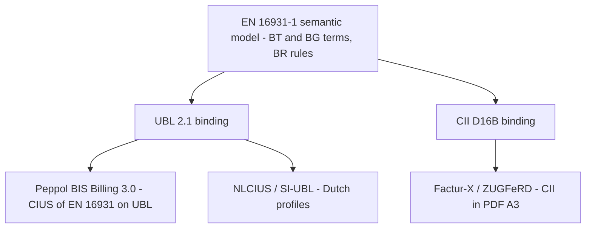
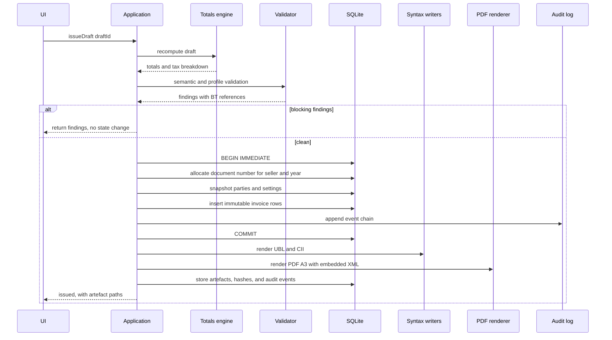
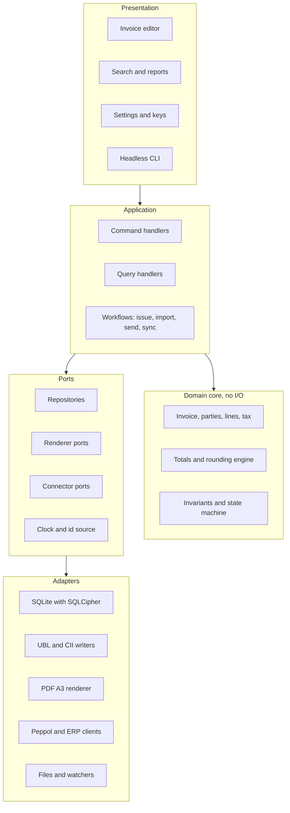
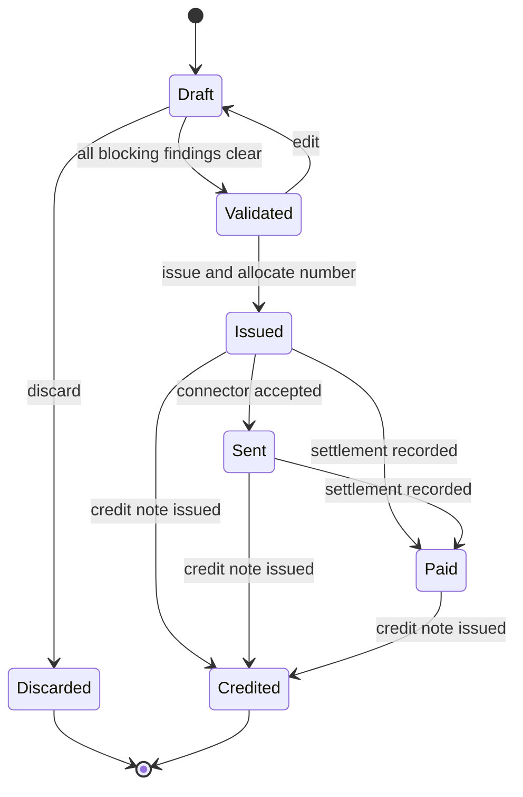
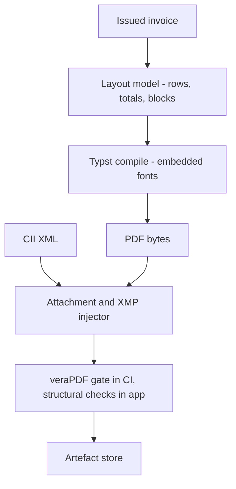

# Technical Design Document

**Project:** Bonk (working name; final name TBD) — local-first e-invoicing client
**Status:** Draft 0.3 for review
**Date:** 2026-10-27
**Supersedes:** `../../spec.md` where the two documents disagree
**Audience:** implementing engineer(s), technical reviewer, future maintainers

---

## Contents

1. [Purpose and scope](#1-purpose-and-scope)
2. [Refinements to the original brief](#2-refinements-to-the-original-brief)
3. [Regulatory reality check](#3-regulatory-reality-check)
4. [Users and workflows](#4-users-and-workflows)
5. [System architecture](#5-system-architecture)
6. [Domain model](#6-domain-model)
7. [Storage design](#7-storage-design)
8. [Validation strategy](#8-validation-strategy)
9. [Invoice syntaxes and export](#9-invoice-syntaxes-and-export)
10. [PDF and Factur-X](#10-pdf-and-factur-x)
11. [Bridge layer and integrations](#11-bridge-layer-and-integrations)
12. [Synchronisation and CRDTs](#12-synchronisation-and-crdts)
13. [Security, privacy, and evidence](#13-security-privacy-and-evidence)
14. [UI architecture with egui](#14-ui-architecture-with-egui)
15. [Performance budgets](#15-performance-budgets)
16. [Testing and quality gates](#16-testing-and-quality-gates)
17. [Decision log (ADRs)](#17-decision-log-adrs)
18. [Risks](#18-risks)
19. [Open questions](#19-open-questions)
20. [Glossary](#20-glossary)

---

## 1. Purpose and scope

### 1.1 What we are building

A desktop application that lets a small European business (primary market: the
Netherlands) create, validate, store, export, and archive legally coherent
invoices entirely on its own hardware. Network access is an explicit, per-action
opt-in that only ever happens through a clearly identified integration.

The product's differentiator is not "invoicing" — that market is crowded — but
*provable local custody of compliant documents*: deterministic documents, an
immutable audit trail, and the ability to produce the exact artefact that was
sent to a counterparty or a tax authority, years later, without a vendor
account.

**Trajectory.** v1.0 proves custody of issued documents. v1.1 turns that archive
into a bookkeeping system (general ledger, VAT return preparation, bank
reconciliation), designed in `accounting-design.md`. That is a scheduling
decision, not a change of thesis: an issued invoice is already an immutable,
hash-addressed fact with a party snapshot and a resolved tax treatment, which is
exactly what a ledger needs. The consequence today is narrow and cheap — v1.0
must record enough at issue time (see §1.5) that postings can be derived later
without re-interviewing the user or rewriting history.

### 1.2 Goals

| ID | Goal | Success signal |
|----|------|----------------|
| G1 | Create and issue an EN 16931-coherent invoice without seeing XML | First-time user issues a valid invoice in < 10 min |
| G2 | Zero network dependency for creation, validation, export, search | Core flows pass with the network stack disabled |
| G3 | Byte-identical, reproducible artefacts | Re-rendering an issued invoice yields the same XML hash |
| G4 | Evidence-grade audit trail | Hash-chained log; exported evidence bundle verifies offline |
| G5 | Import inbound invoices into a payable register | 100% of valid UBL/CII/Factur-X samples parse with no manual XML editing |
| G6 | Integrations are additive, never load-bearing | Deleting plugin config leaves all invoices readable |
| G7 | Schema is sync-ready without syncing a central authority | Two devices converge under the Phase 2 relay |

### 1.3 Scope boundaries

**Scheduled for v1.1 — the accounting layer** (designed in
`accounting-design.md`, intentionally not part of v1.0):

- Double-entry general ledger and journals.
- VAT return *preparation* for the Netherlands (BTW-aangifte), with rubriek
  mapping, reconciliation, and an audit-grade snapshot of the basis.
- Bank statement import (CAMT.053, MT940, CSV) and reconciliation against open
  items.
- Trial balance, P&L, balance sheet, and AR/AP aging reports.

**Deferred to a named release or trigger:**

- Factur-X / ZUGFeRD hybrid PDF → v1.2.
- Peppol sending via an access-point provider → v1.3.
- Multi-device sync → v2.0.
- DRR/ViDA reporting → when a technical contract is published (§2.2).
- OCR of scanned paper invoices → after v1.3, only if pilots ask for it.
- QES via a qualified remote-signing provider → customer-driven.

**Permanently out of scope** (not a scheduling decision):

- Being a Peppol Access Point (see §2.1).
- Acting as a certified tax-filing intermediary (Digipoort/eHerkenning); filing
  stays with the portal or a partner connector.
- Payroll, inventory valuation, fixed-asset depreciation, consolidation,
  purchase orders, or three-way matching.
- Multi-tenant SaaS, user accounts, or a hosted backend.
- Mobile or web clients in v1 (the storage layer must not preclude them).

Why the line sits where it does: bookkeeping is not a feature you bolt on, it is
a second model of the same business facts. Building it in v1.0 would force
chart-of-accounts, period, and tax-code decisions into the first release and
delay the invoice product by a quarter. Deferring it costs one thing only —
recording the right facts at issue time — and §1.5 keeps that cost near zero.

### 1.4 Scale assumptions

Designed for the honest 99% of the target market, not for enterprises:

| Dimension | Design target | Hard ceiling we must not fall over at |
|-----------|---------------|----------------------------------------|
| Invoices per database | 20 000 | 500 000 |
| Lines per invoice | 50 | 1 000 |
| Journal lines by v1.1 (3 years of use) | 300 000 | 5 000 000 |
| Concurrent users | 1 | 1 writer, N readers (same machine) |
| Attachments | 5 GB total | 50 GB |
| Devices per sync group | 1 (v1), 4 (Phase 2) | 16 |
| Cold start to usable UI | < 1.5 s | 3 s |

### 1.5 What v1.0 must record for the v1.1 ledger

Small, non-speculative hooks only. Everything else is a v1.1 migration.

| Hook | Why it must exist at issue time | Cost now |
|------|--------------------------------|----------|
| Explicit `tax_code` rows (jurisdiction, EN 16931 category, rate, reverse-charge flag, exemption reason) instead of an ad-hoc rate field | A posting needs a stable tax treatment to map to a VAT rubriek. Deriving it later from a rate alone is ambiguous (9 % domestic vs 9 % other schemes). | One table, one picker |
| Issued lines snapshot the resolved tax semantics *and* the `tax_code_id` | Renaming or re-rating a tax code must not change history | Already implied by immutability |
| Party snapshots at issue | The ledger posts per counterparty; retro-resolving a customer record is a different fact | Already specified (§6.4) |
| Business dates (`issue_date_local`, `due_date_local`) rather than instants | Period assignment must not shift with timezone | Already specified (§7.3) |
| Tax amounts per category stored on the issued invoice | Cross-check between invoice tax breakdown and VAT return rubriek totals | Already specified |
| `posting_profile_id` column, nullable and unused | Lets v1.1 attach the posting-rule version that derived an entry, and lets a re-post be explained | One nullable column |
| Seller fiscal settings (country, VAT scheme, fiscal year start) | Period generation and rubriek selection | Settings rows, no UI surface |

Explicitly *not* in v1.0: chart of accounts, account codes on lines, periods,
open items, journal numbers. Those are v1.1 state with their own invariants;
adding them early buys nothing and constrains the design.

---

## 2. Refinements to the original brief

The brief is directionally sound but contains several assumptions that would
become expensive rework if implemented literally. Each row is a decision, not a
suggestion.

### 2.1 "Peppol / AS4 bridge" → terminate at an Access Point provider

Peppol is not a protocol you speak; it is a network you must be *certified*
into. The transport is AS4 over HTTPS with WS-Security, message signing,
encryption, and receipt (MDN) handling, plus participant discovery through SMP
records published in the SML. Running your own Access Point means OpenPeppol
conformance testing, certificate procurement (AP PKI), 24/7 SMP availability,
and commercial obligations — a separate company-sized project.

**Decision:** the application implements a `PeppolAccessPoint` port and ships
adapters for *provider APIs* (commercial access points and Peppol service
providers that expose REST for send/status/inbound). We never implement AS4.

**Consequence:** we can ship local invoicing before we ship Peppol, and we can
support multiple providers without forking the core.

### 2.2 ViDA / Dutch DRR → adapter now, implementation when the spec is frozen

The EU "VAT in the Digital Age" package establishes digital reporting
requirements from the 2030s, and the Netherlands has signalled a national
digital reporting obligation aligned with that timeline. The *legally binding
technical contract* — endpoints, schemas, authentication, error semantics,
invoice identifier allocation — is not published and will change. Building
against rumour is a guaranteed rewrite.

**Decision:** *retain the evidence*, not the transport. Every issued invoice
keeps an immutable, self-contained record (semantic JSON + syntax XML + hashes)
sufficient to generate any future report. A `TaxReportingConnector` port with a
`contract_version` field is defined; only a `NullConnector` and an export-file
connector ship in v1.

### 2.3 "Hybrid PDF/XML (Factur-X / ZUGFeRD)" → CII only, PDF/A-3 mandatory

Factur-X (and ZUGFeRD 2.1.1+, which is the same artefact under a different
name) embeds a **UN/CEFACT CII** document in a **PDF/A-3** container. There is no
standard UBL-hybrid PDF. The XML must be attached with
`/AFRelationship /Alternative`, registered in the name tree, and described in
XMP under the Factur-X namespace (`fx:DocumentType`, `fx:Version`,
`fx:ConformanceLevel`, `fx:DocumentFileName`).

**Decision:** two independent syntax backends (UBL 2.1, CII D16B) and a PDF
renderer that can embed either, with a conformance profile selector
(`MINIMUM`, `BASIC WL`, `BASIC`, `EN 16931`, `EXTENDED`), defaulting to
`EN 16931`.

**Consequence:** the CII backend is not optional; it is required for the
Factur-X feature, and PDF/A-3 conformance becomes a hard technical requirement
with its own test gate (veraPDF in CI).

### 2.4 "Schema designed with CRDTs upfront" → only mutable state is CRDT

Conflict-free replicated data types are the wrong tool for documents that must
never change. An issued invoice is a fact. Merging two versions of a fact is
data corruption with extra steps.

**Decision:** split the data into two classes:

- **Immutable facts** (issued invoices, their artefacts, audit events,
  outbox records). Merge is set union; identical IDs with different content is
  a *detected integrity violation*, never a silent resolution.
- **Mutable state** (drafts, customer and item catalogues, settings,
  sequences). These use CRDT semantics: per-field last-writer-wins registers
  keyed by hybrid logical clock, and observed-remove sets for collections.

Invoice numbering is neither: it is a per-seller *lease*, allocated from a
device-stable range (see §6.5).

**Consequence:** the sync layer is simpler, correct, and auditable, and issued
documents remain legally defensible.

### 2.5 "Local keystore for AdES/QES seals" → AdES only, QES is out of scope

A *qualified* electronic signature requires a qualified certificate and a
qualified signature creation device (often a smart card or remote HSM). A local
keystore can produce AdES (advanced, e.g. `adbe.pkcs7.detached` or XAdES
enveloped) and can sign the audit chain, but it cannot truthfully claim QES.

Peppol BIS Billing 3.0 does **not** require an invoice-level signature; trust
comes from the network's transport security and sender accreditation.

**Decision:** ship optional AdES signing of the audit chain and of exported
evidence bundles. Offer "attach an externally produced QES" as an import, and
integrate a qualified remote-signing provider later via the bridge layer.

### 2.6 "Relational schema maps 1:1 to EN 16931" → model the business, map at the edge

A 1:1 mirror of the standard produces tables named after BT codes, optionality
encoded as nullable columns everywhere, and a model that cannot represent
concepts the standard leaves out (draft state, sequence allocation, sync
metadata, audit). It also breaks whenever the standard's syntax bindings
diverge from the semantic model.

**Decision:** the domain model is a normal, reviewed business model. A dedicated
mapping layer converts it to/from the EN 16931 semantic model and then to each
syntax binding. Every domain field carries a documented BT reference so
validation findings can be surfaced in the UI as "field X violates BR-Y".

### 2.7 Other corrections

| Brief says | Refined position |
|------------|------------------|
| "AES-256 transparent encryption of the database file" | SQLCipher 4: AES-256-CBC + HMAC-SHA512 per page, with our own key wrapping (Argon2id KEK → wrapped DEK). Never rely on SQLCipher's passphrase KDF. |
| "Real-time validation for KvK / VIES" | Offline structural + checksum validation is always on and authoritative for blocking. Network lookups (VIES, KvK) are explicit, cached, timestamped, and stored as evidence; they never block issuance on failure. KvK's API is a paid product — do not promise it as free. |
| "Import automatically populates AP registers" | Import produces *candidates* with a confidence score; deduplication and supplier matching are separate, reversible steps. PDF-only invoices are out of scope. |
| "Search and analytics" | FTS5 + a small set of materialised summary queries. No embedded analytics engine. |
| "Rust v1.98" | Correct for edition 2024 (stabilised in 1.85). Pin exactly with `rust-toolchain.toml`; CI tests the MSRV as well as stable. |
| "Interactive schema visualizer" | Artefact of the prompt used to write the brief. Not a requirement; delete from the spec. |
| egui "for desktop" | Accepted, but see §18: egui has weak screen-reader and IME story. If a public-sector buyer imposes WCAG 2.1 AA, the exit ramp is a webview frontend behind the same application layer. Recorded as ADR-010. |

---

## 3. Regulatory reality check

This section exists so that implementation decisions can cite a source of truth
rather than a feature list.

### 3.1 The standards stack



| Layer | What it constrains | Where we enforce it |
|-------|--------------------|---------------------|
| EN 16931-1 (semantic) | Which business terms exist, which are mandatory, arithmetic and code-list rules | Domain model + `conformance` |
| EN 16931-2 (codelists) | Allowed values (VAT categories, units, payment means, countries) | Vendored, versioned code-list bundles generated from the official Schematron (ADR-018) |
| UBL 2.1 syntax | Element names, cardinality, XSD | `syntax-ubl` |
| CII D16B syntax | Element names, cardinality, XSD | `syntax-cii` |
| Peppol BIS Billing 3.0 | Stronger subset, Peppol-specific rules and codelists, participant identifiers | Profile layer over UBL |
| NLCIUS / SI-UBL | Dutch national profile used by public buyers | Profile layer over UBL |
| Factur-X 1.0.x | PDF/A-3 container, XMP, profile levels | `render` |

Deliberate position: **we support one semantic model and N syntax profiles.** We
do not pretend a single XML schema is "the EU format".

### 3.2 Things that must not be claimed

- "ViDA compliant" before a published technical specification exists.
- "Qualified signature" for anything produced by a local software key.
- "Peppol certified" unless we hold the certification ourselves (we integrate
  with certified access points instead, and say so accurately).
- "Legally archived" without a retention policy; we implement retention and
  evidence export, and document the limits.

### 3.3 Retention

Dutch fiscal retention is 7 years for most records (longer for immovable
property and some payroll records). Mixed EU customers imply per-jurisdiction
configuration. Design consequence: issued documents are *never* hard-deleted by
the application; deletion is an explicit, logged, retention-policy action that
requires a backup to exist first. See §6.4 and §13.5.

---

## 4. Users and workflows

### 4.1 Primary personas

| Persona | Context | Needs |
|---------|---------|-------|
| **Solo professional (NL)** | Consultant or contractor, 50–200 invoices/year, no bookkeeper | Fast entry, correct VAT (incl. reverse charge and intra-EU), PDF that looks professional, no subscription |
| **Small BV with back office** | 1 000–5 000 invoices/year, part-time finance admin | Bulk import, searchable archive, credit notes, export to accountant |
| **Accountant / advisor** | Handles several client entities | Open a client database read-only, verify artefacts, export evidence; no cloud account required |

### 4.2 Core workflows

1. **Configure once** — seller identity, VAT/KvK identifiers, bank details,
   numbering series, default VAT treatment, logo, PDF template, language.
2. **Draft** — pick or create a customer, add lines (catalogue or free text),
   choose VAT category per line, review computed totals live.
3. **Issue** — validate, allocate a number, freeze content, render UBL/CII and
   PDF/A-3, append audit events, store artefact hashes.
4. **Deliver** — save files, copy to clipboard, email via the OS client, or push
   through a connector.
5. **Record incoming** — import UBL/CII/Factur-X, deduplicate, match supplier,
   mark as payable/paid.
6. **Find and prove** — search by any dimension, open the exact issued record,
   reproduce artefacts, export an evidence bundle.

### 4.3 Issue pipeline



Note the deliberate split: the *legal* state transition commits before rendering,
and rendering is idempotent and resumable. A crash after commit leaves an issued
invoice whose artefacts can be regenerated deterministically.

---

## 5. System architecture

### 5.1 Style

Hexagonal (ports and adapters) with a pure domain core. The dependency rule is
enforced mechanically by crate boundaries: `crux` cannot depend on
`rusqlite`, `reqwest`, `egui`, or `std::fs`.



### 5.2 Workspace layout

Crate boundaries are the architecture; do not merge them for convenience.

| Crate | Responsibility | Must not depend on |
|-------|----------------|--------------------|
| `crux` | IDs, money, dates, invoice aggregates, state machine, calculation and rounding, domain errors | anything I/O, `async`, `serde` derive on public types (use explicit DTOs) |
| `conformance` | EN 16931 semantic model, business rules, codelists, profile definitions (Peppol, NLCIUS), finding model | storage, UI |
| `conformance-official` | Vendored official Schematron/XSLT artefacts plus the isolated native XSLT binding; optional, feature-gated | storage, UI, network |
| `syntax` | UBL 2.1 and CII D16B readers/writers, canonicalisation | storage, UI |
| `store` | SQLite/SQLCipher, migrations, repositories, FTS, outbox, audit chain, key wrapping | UI, network |
| `render` | PDF/A-3 layout and rendering, Factur-X embedding, XMP, templates | storage, UI |
| `import` | File sniffing, XML/PDF extraction, dedupe, reconciliation | UI |
| `bridge` | Connector port definitions, outbox dispatch, plugin host, sidecar protocol | storage internals, UI |
| `sync` | HLC, oplog, CRDT types, relay client, anti-entropy | UI |
| `app` | egui application as a library: views, command/query dispatch, view models, undo | direct SQL, direct HTTP |
| `cli` | The `bonk` binary: GUI entry point plus `validate`, `export`, `import`, `migrate`, `verify`, `support-bundle` subcommands | UI internals |
| `testkit` | Fixtures, builders, fake clock, fake connector, golden-file harness | production code |
| `xtask` | Artifact fetching, conformance runner, packaging | everything (dev only) |

A single binary (currently `bonk`; the product name is a placeholder) exposes
both the GUI and a CLI subcommand so that CI, accountants, and support can do
everything the GUI can. The binary name is defined in one place and is the only
thing a future rename touches.

v1.1 adds three crates in the same dependency ring (see `accounting-design.md`):
`ledger` (accounts, postings, periods, balances — depends only on `crux`),
`vat` (rubriek mapping and return preparation — depends on `ledger` and
`conformance`), and `banking` (statement parsers and matching — depends on `crux`
and `import`). None of them may depend on `app`, `store`, or the network.

Package names are workspace-internal and deliberately unprefixed, so every member
sets `publish = false`. If any crate is ever published, it gets a unique
prefixed name in a separate, reviewed change.

### 5.3 Crate-level lint policy

```toml
# workspace Cargo.toml
[lints.rust]
unsafe_code = "forbid"

[lints.clippy]
unwrap_used = "deny"        # crux, conformance, syntax
expect_used = "deny"        # crux
float_arithmetic = "deny"   # money paths; no f64 anywhere near an amount
```

`store` and `app` relax `unwrap_used` to `warn`, never to `allow`.

---

## 6. Domain model

### 6.1 Aggregates

| Aggregate | Identity | Invariants |
|-----------|----------|------------|
| `Seller` | UUIDv7 | Valid VAT ID format for its country; has a numbering series per document kind |
| `Customer` | UUIDv7 | At most one primary identifier per scheme (VAT, KvK, Peppol) |
| `Invoice` | UUIDv7 + human number | Sums equal the sum of lines; totals satisfy BR-CO-*; immutable once issued |
| `CreditNote` | same structure, `doc_type = 381` | References the credited invoice; never mutates it |
| `CatalogueItem` | UUIDv7 | Unit price and VAT category present |
| `Sequence` | (seller, kind, year, series) | Monotonic, gap-free within a series, allocation is transactional |
| `Connector` | UUIDv7 | Declares capabilities and scopes; disabled by default |

### 6.2 Invoice state machine



Rules:

- `Draft → Issued` is the only transition that allocates a number.
- Issued invoices are **write-once**. Corrections happen through credit notes
  (`381`) and, where required, a replacement invoice (`380`).
- `Paid` is a status annotation, not a document mutation; it is append-only
  (payment events), because partial payments exist. In v1.1 these events become
  open-item allocations in the ledger; the invoice itself still never changes.
- `Credited` is derived from the existence of a non-voided credit note.

### 6.3 Key types

```rust
// crates/crux/src/money.rs
/// Amount in micro-units of the currency's major unit (10^-6).
/// 1.234567 EUR == 1_234_567.
#[derive(Clone, Copy, PartialEq, Eq, PartialOrd, Ord, Hash)]
pub struct Money { micros: i64, currency: Currency }

/// Basis points; 21.00 % == 2100. Avoids binary floating point entirely.
#[derive(Clone, Copy, PartialEq, Eq, Hash)]
pub struct VatRate { basis_points: u16 }
```

- Six decimal places internally because unit prices and quantities in real
  invoices need more precision than totals.
- EN 16931 limits invoice totals and tax amounts to two decimals; the *writer*
  rounds and the *validator* rejects violations. The model never rounds
  implicitly.
- Parsing of human input goes through `rust_decimal` at the boundary, then
  converts to `Money`; formatting is locale-aware (`1.234,56` in `nl-NL`) but
  XML output is always dot-decimal.
- Quantity is a separate `Quantity { micros: i64, unit: UnitCode }`; do not reuse
  `Money`.

### 6.4 Immutability and evidence

On issue, the application writes:

1. A **content hash** over the canonical semantic form (BLAKE3, but SHA-256 for
   interoperability in exported manifests).
2. The **syntax hash** of the exact bytes written to the UBL/CII file.
3. The **PDF hash**, plus the embedded XML hash.
4. A **party snapshot**: the seller and customer data as used, not a foreign key
   that resolves to today's edited record.
5. Audit events: `issued`, `artefact_rendered`, `sent`, `receipt_received`.

The database enforces write-once with `BEFORE UPDATE`/`BEFORE DELETE` triggers
on `document`, `document_line`, and `audit_event`, raising on any attempt.
Repository code never issues those statements, so the trigger is a backstop
against future mistakes, not a workflow.

### 6.5 Document numbering

- Sequence granularity: `(seller, doc_type, series, calendar_year)`.
- Allocation happens inside `BEGIN IMMEDIATE` with
  `UPDATE sequence SET next_value = next_value + 1 WHERE ... RETURNING next_value`.
- Number format is configurable (`{series}{year}-{value:04}`) but the *rendered*
  number is stored on the invoice, so later pattern changes cannot rewrite
  history.
- **Sync safety:** in Phase 2 each device leases a block of numbers from the
  relay (or, in pure P2P, from the seller's configured ranges). Unused numbers at
  the end of a lease create gaps. Gaps are permitted (they are explainable),
  duplicates are not. A gap report is a first-class UI feature for audits.

### 6.6 Calculation model

One module owns arithmetic. Nothing else may compute a total.

```
line_net      = round( quantity * unit_price / price_base_quantity, 2 )
taxable_base  = sum(line_net) - allowances + charges        (per VAT category)
tax_amount    = round( taxable_base * rate, 2 )
invoice_total = sum(taxable_base_by_category) + sum(tax_amount)
```

Follow the BR-CO-* rules exactly rather than inventing a rounding order, and
test against the published EN 16931 calculation examples. Rounding mode:
half-away-from-zero, applied once per documented step, recorded in the invoice
so re-computation years later cannot drift.

---

## 7. Storage design

### 7.1 SQLite configuration

| Setting | Value | Why |
|---------|-------|-----|
| `journal_mode` | `WAL` | Concurrent reads during render |
| `synchronous` | `FULL` | Financial data; fsync on commit |
| `foreign_keys` | `ON` | Referential integrity |
| `busy_timeout` | 5 000 ms | Single writer, but background jobs exist |
| `temp_store` | `MEMORY` | Avoid plaintext temp spill |
| `secure_delete` | `ON` | Do not leave deleted pages readable |
| Connection model | 1 writer + 1–2 readers, behind a mutex | SQLite semantics; avoids `SQLITE_BUSY` storms |

Access via `rusqlite` (sync). No `sqlx`: async buys nothing on a desktop with a
single writer, and SQLCipher + `sqlx` offline compile is a known pain point.

### 7.2 Encryption design

SQLCipher encrypts the database file, WAL, and journals with a key we control.

```
passphrase ──Argon2id(m=64 MiB, t=3, p=1, salt=16B)──> KEK (32 B)
                                                         │
random DEK (32 B) ─────────── AES-256-GCM wrap ──────────┘
                                   │
                                   ▼
                        keystore.bin (versioned, in app data dir)
```

- SQLCipher is opened with a **raw key** (`PRAGMA key = "x'<hex>'"`), skipping
  its own KDF so parameters are ours and auditable.
- Changing the passphrase rewraps the DEK; no database re-encryption. The new
  keystore is sealed, unsealed in memory, and compared with the live key before
  it replaces the file: a rewrap that produced a different key would otherwise
  be indistinguishable from losing the archive. The change is appended to the
  audit chain as `passphrase_changed`, naming the keystore file and never key
  material.
- A **recovery key** wraps the same DEK a second time (keystore version 2). It is
  160 bits, shown once as Crockford base32 in groups of four, and never stored:
  only its sealed wrap remains, which a passphrase change carries over without
  ever holding the secret. Adding one requires the passphrase, because a copied
  keystore must not be able to gain a route of its own; replacing one invalidates
  the previous key. The chain records `recovery_key_added`. Opening with the
  recovery key lets a lost passphrase be replaced, and the key used to do that is
  rotated in the same step: it has now been typed into a shell or a prompt, so it
  must not stay valid.
- Optional: wrap the DEK a second time with an OS-keychain secret so that
  "remember me" does not weaken the file-level key. If the keychain is
  unavailable, fall back to passphrase-only with a visible warning.
- Key material lives in `Zeroizing<[u8; 32]>`; the app zeroes it on lock.
- **Threat model boundary:** this protects data at rest against file theft and
  backups. It does *not* protect against malware running as the user while the
  database is open. Say so in the docs.

Backups use `VACUUM INTO '<path>'` (inherits encryption), and the app verifies a
restored copy's audit chain before declaring success.

Rotation is deliberate rather than left to a folder sync: `store::backup` writes
`backup-<compact stamp>.db` into a directory, opens the copy read-only and checks
`PRAGMA integrity_check` plus the audit chain, and only then prunes the oldest
copies beyond the retention limit. A copy that fails verification is kept and
reported — it may still be the only evidence of what went wrong. Verification
never opens the copy writable, so judging a backup cannot repair it. Restore is a
file copy onto a clean machine plus the same keystore; `bonk verify-backup`
checks a copy without touching the live database.

### 7.3 Core schema

```sql
-- Identity and configuration ------------------------------------------------

CREATE TABLE seller (
    id                 TEXT PRIMARY KEY,
    legal_name         TEXT NOT NULL,
    trading_name       TEXT,
    vat_id             TEXT,               -- BT-31 / BT-32
    kvk_number         TEXT,
    peppol_id          TEXT,               -- EAS-qualified, e.g. 0106:12345678
    eas_code           TEXT,
    address_json       TEXT NOT NULL,      -- BG-5 snapshot template
    contact_json       TEXT,
    bank_json          TEXT,               -- BG-10
    default_currency   TEXT NOT NULL CHECK (length(default_currency) = 3),
    default_locale     TEXT NOT NULL,
    logo_blob_id       TEXT,
    created_at         TEXT NOT NULL,
    updated_at         TEXT NOT NULL,
    revision           INTEGER NOT NULL DEFAULT 1,
    hlc                TEXT NOT NULL       -- sync metadata
);

CREATE TABLE customer (
    id                 TEXT PRIMARY KEY,
    display_name       TEXT NOT NULL,
    legal_name         TEXT,
    vat_id             TEXT,
    kvk_number         TEXT,
    peppol_id          TEXT,
    address_json       TEXT NOT NULL,
    contact_json       TEXT,
    buyer_reference    TEXT,
    default_vat_category TEXT,
    payment_terms_days INTEGER,
    vies_checked_at    TEXT,
    vies_status        TEXT,               -- valid | invalid | unavailable | not_checked
    vies_evidence_blob TEXT,
    notes              TEXT,
    archived           INTEGER NOT NULL DEFAULT 0,
    created_at         TEXT NOT NULL,
    updated_at         TEXT NOT NULL,
    revision           INTEGER NOT NULL DEFAULT 1,
    hlc                TEXT NOT NULL
);

CREATE TABLE tax_code (
    id                   TEXT PRIMARY KEY,
    seller_id            TEXT NOT NULL REFERENCES seller(id),
    jurisdiction         TEXT NOT NULL DEFAULT 'NL',  -- ISO 3166-1 alpha-2
    label                TEXT NOT NULL,      -- "NL 21% domestic"
    vat_category         TEXT NOT NULL,      -- EN 16931: S Z E AE K G O L M
    vat_rate_bp          INTEGER NOT NULL,
    reverse_charge       INTEGER NOT NULL DEFAULT 0,
    exemption_reason     TEXT,
    exemption_reason_code TEXT,
    archived             INTEGER NOT NULL DEFAULT 0,
    created_at           TEXT NOT NULL,
    updated_at           TEXT NOT NULL
);

-- Key/value store for seller fiscal settings and app preferences.
CREATE TABLE app_setting (
    key                TEXT PRIMARY KEY,
    value_json         TEXT NOT NULL,
    scope              TEXT NOT NULL DEFAULT 'app',  -- app | seller | device_local
    updated_at         TEXT NOT NULL
);

-- Drafts are mutable and CRDT-managed; issued documents are not. -------------

CREATE TABLE invoice_draft (
    id                 TEXT PRIMARY KEY,
    seller_id          TEXT NOT NULL REFERENCES seller(id),
    customer_id        TEXT REFERENCES customer(id),
    doc_type           TEXT NOT NULL DEFAULT '380',
    currency           TEXT NOT NULL,
    issue_date_local   TEXT NOT NULL,      -- YYYY-MM-DD, business date
    due_date_local     TEXT,
    delivery_date_local TEXT,
    buyer_reference    TEXT,
    order_reference    TEXT,
    project_reference  TEXT,
    notes_json         TEXT,
    payment_terms_days INTEGER,
    raw_input_json     TEXT,               -- free-form fields before normalisation
    revision           INTEGER NOT NULL,
    hlc                TEXT NOT NULL,
    created_at         TEXT NOT NULL,
    updated_at         TEXT NOT NULL
);

CREATE TABLE invoice_draft_line (
    id                 TEXT PRIMARY KEY,
    draft_id           TEXT NOT NULL REFERENCES invoice_draft(id) ON DELETE CASCADE,
    position           INTEGER NOT NULL,
    name               TEXT NOT NULL,
    description        TEXT,
    quantity_micros    INTEGER NOT NULL,
    unit_code          TEXT NOT NULL,
    unit_price_micros  INTEGER NOT NULL,
    price_base_qty_micros INTEGER NOT NULL DEFAULT 1000000,
    vat_category       TEXT NOT NULL,
    vat_rate_bp        INTEGER NOT NULL,
    tax_code_id        TEXT REFERENCES tax_code(id),
    item_ref           TEXT,
    deleted            INTEGER NOT NULL DEFAULT 0,  -- OR-Set tombstone
    revision           INTEGER NOT NULL,
    hlc                TEXT NOT NULL
);

-- Documents: outbound (issued by us) and inbound (received) ---------------

-- One table, two directions. An outbound row was issued by us: the number comes
-- from `sequence` and the series is ours. An inbound row was received from a
-- supplier: the number is theirs verbatim and series/sequence_value are null.
-- `owner_id` is always our own entity (whose books this is); `counterparty_id`
-- is the buyer for outbound rows and the supplier for inbound ones. Both parties
-- are also snapshotted, so editing a party later cannot rewrite history.

CREATE TABLE document (
    id                      TEXT PRIMARY KEY,
    direction               TEXT NOT NULL CHECK (direction IN ('outbound','inbound')),
    owner_id                TEXT NOT NULL REFERENCES seller(id),
    counterparty_id         TEXT REFERENCES customer(id),
    doc_type                TEXT NOT NULL,
    series                  TEXT,          -- ours; null for inbound
    number                  TEXT NOT NULL, -- rendered, e.g. 2026-0042; sender's for inbound
    sequence_value          INTEGER,       -- null for inbound
    currency                TEXT NOT NULL,
    issue_date_local        TEXT NOT NULL,
    due_date_local          TEXT,
    delivery_date_local     TEXT,
    buyer_reference         TEXT,
    order_reference         TEXT,
    note                    TEXT,
    totals_json             TEXT NOT NULL, -- all BT amounts, canonical decimal
    tax_breakdown_json      TEXT NOT NULL,
    issuer_snapshot_json    TEXT NOT NULL,
    recipient_snapshot_json TEXT NOT NULL,
    semantic_json           TEXT NOT NULL, -- normalised EN 16931 semantic form
    semantic_hash           TEXT NOT NULL,
    preceding_invoice_id    TEXT,          -- BG-3, when this is a credit note
    preceding_number        TEXT,
    preceding_issue_date    TEXT,
    state                   TEXT NOT NULL,
    recorded_at             TEXT NOT NULL,
    recorded_by_device      TEXT NOT NULL,
    created_at              TEXT NOT NULL
);

-- One series for what we issue; the sender's own numbering for what we receive.
CREATE UNIQUE INDEX document_outbound_number
    ON document (owner_id, series, number) WHERE direction = 'outbound';
CREATE UNIQUE INDEX document_inbound_number
    ON document (owner_id, counterparty_id, number) WHERE direction = 'inbound';

CREATE TABLE document_line (
    id                 TEXT PRIMARY KEY,
    document_id        TEXT NOT NULL REFERENCES document(id),
    position           INTEGER NOT NULL,
    payload_json       TEXT NOT NULL,      -- full line as recorded
    line_net_micros    INTEGER NOT NULL,
    tax_micros         INTEGER NOT NULL,
    UNIQUE (document_id, position)
);

CREATE TABLE document_allowance_charge (
    id                 TEXT PRIMARY KEY,
    document_id        TEXT NOT NULL REFERENCES document(id),
    kind               TEXT NOT NULL CHECK (kind IN ('allowance','charge')),
    level              TEXT NOT NULL CHECK (level IN ('document','line')),
    reason             TEXT,
    reason_code        TEXT,
    amount_micros      INTEGER NOT NULL,
    tax_category       TEXT,
    tax_rate_bp        INTEGER
);

CREATE TABLE blob (
    id                 TEXT PRIMARY KEY,
    sha256             TEXT NOT NULL,
    size_bytes         INTEGER NOT NULL,
    compression        TEXT,               -- none | zstd
    payload            BLOB NOT NULL,
    created_at         TEXT NOT NULL
);

CREATE TABLE artefact (
    id                 TEXT PRIMARY KEY,
    document_id        TEXT NOT NULL REFERENCES document(id),
    kind               TEXT NOT NULL,      -- ubl | cii | pdf | pdf_embedded_xml | receipt
    syntax_profile     TEXT,
    bytes_hash         TEXT NOT NULL,
    size_bytes         INTEGER NOT NULL,
    blob_id            TEXT NOT NULL REFERENCES blob(id),
    rendered_at        TEXT NOT NULL,
    renderer_version   TEXT NOT NULL
);

-- Incoming documents need no second model: an imported invoice is a `document`
-- row with `direction = 'inbound'`. Duplicate detection is the partial unique
-- index above; `payload_hash` and the import status live in `import_record`.

CREATE TABLE import_record (
    id                 TEXT PRIMARY KEY,
    document_id        TEXT NOT NULL REFERENCES document(id),
    source_kind        TEXT NOT NULL,      -- ubl | cii | pdf_facturx | manual
    source_path        TEXT,
    payload_hash       TEXT NOT NULL,
    match_status       TEXT NOT NULL,      -- matched | unmatched
    match_confidence   REAL,               -- only here; never for money
    imported_at        TEXT NOT NULL
);

-- Sequences, connectors, sync, audit ---------------------------------------

CREATE TABLE sequence (
    owner_id           TEXT NOT NULL REFERENCES seller(id),
    doc_type           TEXT NOT NULL,
    series             TEXT NOT NULL,
    year               INTEGER NOT NULL,
    next_value         INTEGER NOT NULL,
    lease_end          INTEGER,             -- Phase 2 block leasing
    PRIMARY KEY (owner_id, doc_type, series, year)
);

CREATE TABLE outbox (
    id                 TEXT PRIMARY KEY,
    document_id        TEXT NOT NULL REFERENCES document(id),
    connector_id       TEXT NOT NULL,
    operation          TEXT NOT NULL,
    idempotency_key    TEXT NOT NULL,
    payload_hash       TEXT NOT NULL,
    state              TEXT NOT NULL,       -- pending | in_flight | acked | failed | dead
    attempts           INTEGER NOT NULL DEFAULT 0,
    next_attempt_at    TEXT,
    last_error_code    TEXT,
    last_error_detail  TEXT,
    receipt_blob_id    TEXT,
    created_at         TEXT NOT NULL,
    updated_at         TEXT NOT NULL,
    UNIQUE (connector_id, idempotency_key)
);

CREATE TABLE audit_event (
    seq                INTEGER PRIMARY KEY AUTOINCREMENT,
    id                 TEXT NOT NULL UNIQUE,
    at                 TEXT NOT NULL,
    actor              TEXT NOT NULL,       -- human:<user> | device:<id> | system
    kind               TEXT NOT NULL,
    subject_kind       TEXT NOT NULL,
    subject_id         TEXT NOT NULL,
    payload_json       TEXT NOT NULL,
    prev_hash          TEXT NOT NULL,
    hash               TEXT NOT NULL
);

CREATE TABLE sync_op (
    id                 TEXT PRIMARY KEY,
    device_id          TEXT NOT NULL,
    hlc                TEXT NOT NULL,
    entity_kind        TEXT NOT NULL,
    entity_id          TEXT NOT NULL,
    op                 TEXT NOT NULL,
    payload_json       TEXT,
    applied_at         TEXT
);
```

Notes:

- Timestamps are RFC 3339 in UTC for instants; business dates are `YYYY-MM-DD`
  local strings (`issue_date_local`), because an invoice date is a date, not an
  instant, and timezone conversion must never shift it.
- JSON columns hold canonical serialisations with sorted keys and fixed decimal
  formatting, so hashing is stable. They are *not* the query path; searchable
  fields are promoted to columns.
- `match_confidence` uses `REAL` deliberately and is the only float in the
  schema; it never touches an amount.

Immutability is enforced by the database, not by discipline:

```sql
CREATE TRIGGER document_no_update
BEFORE UPDATE ON document
BEGIN
    SELECT RAISE(ABORT, 'documents are immutable; corrections are credit notes');
END;

CREATE TRIGGER document_no_delete
BEFORE DELETE ON document
BEGIN
    SELECT RAISE(ABORT, 'documents cannot be deleted');
END;
```

Equivalent triggers guard `document_line`, `audit_event`, `artefact`, and `blob`.
The repositories never issue those statements, so a trigger firing is always a
bug. Status changes (sent, paid, approved) are append-only events, never updates
to the document row.

`verify` re-hashes every blob and compares it with the digest recorded beside it,
cross-checks each artefact's `bytes_hash` against its blob, confirms every import
record still has a payload, and runs `PRAGMA foreign_key_check`. An unreferenced
blob is reported as wasted space rather than corruption, because nothing depends
on it; a hash mismatch or a missing payload is corruption, because the archive
would be claiming evidence it no longer holds.

### 7.4 Search

```sql
CREATE VIRTUAL TABLE invoice_fts USING fts5(
    document_id UNINDEXED,
    number,
    party_name,
    reference,
    notes,
    tokenize = "unicode61 remove_diacritics 2"
);
```

A standalone FTS5 table kept in sync by triggers (search must not depend on
today's customer record, hence the `party_name` column copied at insert time).
The party name prefers the party on file and falls back to the snapshot, so an
unmatched inbound document is findable by the spelling its sender used; a
supplier decision rewrites that one column. `remove_diacritics 2` lets `cafe`
find `Café`.

Structured filters (date range, direction, state, currency, VAT category) are
indexed columns with composite indexes over `document` and its events, not FTS
columns. Status is the latest `document_event`, so a filter compares
`COALESCE(latest event, 'received')`.

Query building is ours, not the user's: each typed word is quoted and
prefix-matched and combined with AND, so a partly typed word finds its
completions and an unbalanced quote finds nothing instead of raising an FTS5
syntax error. Ranking is `bm25` with the number weighted highest, so typing an
invoice number puts that invoice first.

Expected performance: typed queries under 30 ms p95 on a 20 000-invoice database
(the M5 exit criterion).

Reading a result back is `store::archive::load`: one query over `document`, plus
its lines, events, and artefacts, rebuilt into the same domain types the writer
used. It reads the snapshots (`issuer_snapshot_json`, `recipient_snapshot_json`)
rather than joining `customer`, so a rename after issue cannot change what the
archived document says, and totals come back from the stored decimal strings and
integer micro-units, never through a float.

Saved views are `saved_search` rows keyed by `(owner_id, name)`: the name is what
the user sees and what replacing an existing view matches on, while the row keeps
the id it was created with. They carry only the filters the panel can express, so
applying one restores exactly what was saved; a date range joins the table when
the panel can ask for one.

### 7.5 Migrations

- Embedded SQL migrations, forward-only, each with a SHA-256 recorded in
  `schema_migration`.
- On startup: if the DB version is newer than the binary, refuse to open (never
  guess).
- Before any migration, take an encrypted `VACUUM INTO` snapshot and verify it
  opens read-only.
- Migration tests run against fixture databases generated by every prior release
  (checked into `testkit/fixtures/`).

### 7.6 Evidence bundles

A bundle is a directory, not a single archive file, so every part stays readable
with ordinary tools and nothing depends on a zip writer being byte-stable:

```text
<bundle>/
  manifest.json       format, version, export stamp, file list with SHA-256
  document.json       the stored semantic record and its hash
  audit-chain.json    every audit event, in order
  artefacts/…         UBL, PDF, and — for an imported document — the bytes as received
```

The verifier needs nothing but the directory: it hashes every listed file, rejects
anything the manifest does not list, refuses manifest paths that leave the
bundle, checks the document record against the manifest, and recomputes the audit
chain with the same function the archive uses (`audit::verify_one`), requiring the
last link to equal the recorded head and at least one event to name the document.

Consequences worth stating rather than discovering:

- The chain is exported whole, so a bundle grows with the archive. That is the
  price of a verifier that can recompute rather than trust; a per-document proof
  would need checkpoints the product does not have yet.
- A bundle proves these bytes are the ones the archive recorded and that the chain
  is internally consistent. It does not prove the chain is the only history — an
  archive could always have been forked before the export.

### 7.7 Support bundles

The support bundle is assembled from **typed facts** — counts, versions, sizes,
integrity results, per-kind audit counts, and the chain head — so there is no
channel through which a party name, an amount, a document number, an identifier,
or a path could arrive. Redaction here is structural: a filter over free text can
miss, an assembly that has no sensitive input cannot. Paths are excluded because
they carry the operating-system user name, and these bundles are often pasted
into public issue trackers.

A canary test seeds an archive with a distinctive seller name, customer name,
supplier number, amount, VAT identifier, document id, and temporary path, then
asserts that none of them appears in either file while the counts do. The command
prints the rendering it wrote, so the user sees the whole bundle before sharing
it.

---

## 8. Validation strategy

### 8.1 Three tiers

| Tier | Question | Runs | Blocking |
|------|----------|------|----------|
| **T1 Domain invariants** | Is this a coherent invoice? (sums, required fields, valid category/rate pairing, dates) | Every keystroke / debounced | Yes |
| **T2 EN 16931 semantic rules** | Does it satisfy BR-* / BR-CO-* / BR-DEC-* / BR-CL-*? | On demand + on issue | Yes |
| **T3 Syntax/profile conformance** | Does the serialised XML satisfy XSD + Schematron for UBL-Peppol / CII-Factur-X profile? | On export + on issue | Yes for the chosen export profile |

T1 must never require T2 to run; the editor stays responsive because T1 is
microseconds.

### 8.2 Findings model

```rust
pub struct Finding {
    pub severity: Severity,          // Blocking | Warning | Info
    pub code: FindingCode,           // BR-16, PEPPOL-EN16931-R008, NL-BR-01
    pub bt: Option<BtRef>,           // BT-31, BG-25, ...
    pub path: FieldPath,             // editor focus target
    pub message: LocalizedMessage,   // en + nl, with parameters
    pub source: FindingSource,       // Core | Conformance | Profile | Connector
}
```

Every finding maps to a focusable field. "Invalid invoice" without a pointer is a
support ticket.

### 8.3 Conformance implementation

The official artefacts (EN 16931 Schematron, Peppol BIS validation artefacts,
codelists) are the only acceptable source of truth, but they are XSLT/Schematron
that require an XSLT 2.0 engine. Options, with a decision:

| Option | Verdict |
|--------|---------|
| Embed `libxml2`/`libxslt` and run the official XSLT | **Chosen**, but isolated behind the `official-validation` feature and a `conformance-official` crate. Native dependency burden is real (Windows static linking, macOS notarisation); acceptable because correctness is the product. |
| Pure-Rust Schematron crates | Promising but immature and not verified against the official suites; used only as a fast pre-check, never as the pass/fail authority. |
| Reimplement BR-* rules by hand in Rust | **Required anyway** for T1-style live feedback and good messages; not sufficient alone, because codelists and cross-field rules change between releases. |
| Shell out to Java (Mustang/KoSIT) | Rejected for shipping (JVM dependency), **used in CI** as an independent oracle. |

Artifacts are vendored under `crates/conformance-official/artifacts/<version>/`
with a manifest recording source URL, version, and SHA-256. Updating them is a
reviewed PR with a diff of expected results over the corpus.

Ships with the app: artifacts + a curated corpus. Ships in CI: the same corpus
plus differential runs against the Java oracle.

### 8.4 Identifier validation

| Check | Offline | Online |
|-------|---------|--------|
| VAT ID syntax (per-country regex + checksum, e.g. NL 11-proof) | Always | — |
| VAT ID existence | Cached last result | VIES, explicit action, result stored as evidence with timestamp |
| KvK number structure (8 digits) | Always | KvK API (paid subscription), explicit action |
| Peppol participant ID | EAS code known + value non-empty | SMP lookup via connector |
| IBAN | MOD-97 + country length | Optional name check via bank API |

Online results are advisory and cached with `checked_at`; they never gate
issuance. A "VIES unavailable" result is a warning with a retry affordance, not
an error.

---

## 9. Invoice syntaxes and export

### 9.1 Two writers, one semantic model

```
Invoice (domain)
   └─ SemanticInvoice (EN 16931 terms, validated)
        ├─ UBL 2.1 writer  → Peppol BIS 3.0 / NLCIUS profiles
        └─ CII D16B writer → Factur-X profiles
```

The semantic layer is the contract. Syntax writers are dumb serialisers with no
business logic; they may only fail on missing mandatory terms, which validation
should already have caught (a writer panic is a bug, and is tested as such).

### 9.2 Determinism

Required because artefacts are hashed, archived, and used as evidence.

- Fixed namespace prefixes (`cbc`, `cac` for UBL; `rsm`, `ram` for CII).
- No timestamps or random identifiers in generated XML unless the standard
  requires them; where required, take them from the invoice record.
- Stable element ordering (the schema's sequence), no pretty-printing in the
  hashed output. A human-readable copy is a separate artefact if needed.
- Encoding UTF-8 without BOM, `\n` line endings.
- Golden-file tests assert bytes, not just semantics.

### 9.3 Import

Pipeline: sniff → parse → semantic normalise → validate → dedupe → match
supplier → stage for review.

Sniffing order: PDF (look for `/AFRelationship` embedded file) → XML root
element (`Invoice` in UBL ns vs `CrossIndustryInvoice`) → reject with a precise
reason. Factur-X extraction reads the embedded file from the PDF name tree; do
not parse the visual layer.

The two XML readers share one bounded tree (`syntax::dom`) and one output shape
(`ImportedInvoice`), so the pipeline never learns which syntax arrived; UBL and
CII differ only in element names, because the business terms and their BT/BG
numbers are the same in EN 16931. CII dates are `CCYYMMDD` under `format="102"`
and are rejected, not guessed, otherwise. `read_document` picks the reader from
the root element and reports the syntax, which is recorded as the import's
`source_kind`.

PDF extraction follows the same rule of not inventing anything (ADR-019). The
attachment is found through the catalog's `/EmbeddedFiles` name tree, or by
scanning `/Type /EmbeddedFile` streams when a producer omits the tree; the stream
is decoded under a fixed bound; and the XMP packet's `fx:DocumentFileName` and
`fx:DocumentType` must agree with the attachment. Encrypted containers are
refused. Page content is never read — it is a rendering, not the invoice. The
blob keeps the PDF as received and the provenance kind is `pdf`.

Deduplication key: `(supplier_key, external_number)` plus a payload hash
fallback for suppliers that reuse numbers. Duplicates are flagged, never
silently dropped.

---

## 10. PDF and Factur-X

### 10.1 Requirements

A conformant Factur-X PDF is simultaneously: a visually correct invoice, a
PDF/A-3 file (ISO 19005-3), a container for an XML attachment, and an XMP
document declaring the Factur-X version, profile, and file name.

Checklist the renderer must satisfy:

- Embedded, subsetted fonts (no reliance on system fonts), correct
  `ToUnicode` maps.
- sRGB ICC output intent (bundled profile, ~3 KB).
- XMP metadata with `pdfaid:part=3`, `pdfaid:conformance=B` (or `U`), plus the
  Factur-X namespace.
- EmbeddedFiles name tree entry with `/AFRelationship /Alternative`, declared in
  `/AF` of the document catalog.
- No transparency, no encryption, no external references, no JavaScript.
- Deterministic bytes for the same input (PDF ID derived from content hash, not
  wall clock).

### 10.2 Render pipeline



- Layout is a plain data structure (`LayoutModel`) produced from the invoice, so
  it is unit-testable and template-independent.
- Typst (Apache-2.0, embeddable as a library) handles text layout, pagination,
  hyphenation, and font subsetting. If embedding the XML and XMP turns out to be
  unsupported at the required conformance level, the fallback is
  `pdf-writer`/`lopdf` post-processing of the Typst output — the port boundary
  makes this swap cheap.
- Preflight failures are user-visible and specific ("font could not be subset"
  is not acceptable; name the font).
- Preview uses `pdfium-render` (MIT/Apache) with a bundled binary; do **not** use
  MuPDF (AGPL) in a commercial product.

### 10.3 Template model

Ship 2–3 built-in templates (minimal, classic, modern) expressed as Typst
sources with a typed parameter block: logo, accent colour, address block layout,
footer text, payment instructions, QR (EPC/Girocode) optional. User templates compile against a restricted `World` implementation that exposes
no filesystem, no package registry, and no network, so a shared template cannot
read local files or exfiltrate data. Template changes are hashed into the
template artefact record.

---

## 11. Bridge layer and integrations

### 11.1 Contract

```rust
pub trait Connector: Send + Sync {
    fn manifest(&self) -> &ConnectorManifest;      // id, version, capabilities, scopes
    fn health(&self) -> HealthStatus;              // no network by default
    fn capabilities(&self) -> CapabilitySet;       // send, poll_inbound, lookup, report
}

pub trait InvoiceSender: Connector {
    fn send(&self, doc: &IssuedDocument, opts: &SendOptions)
        -> Result<SendReceipt, ConnectorError>;
    fn status(&self, receipt: &SendReceipt) -> Result<DeliveryStatus, ConnectorError>;
}
```

Properties every connector must have:

- **Idempotency.** Every send carries a key derived from
  `(connector_id, invoice_id, content_hash)`; retries are safe.
- **Outbox-backed.** A send is recorded before the network is touched; the UI
  reflects outbox state, not hopes.
- **Receipt-preserving.** Provider acknowledgements and MDNs are stored as
  artefacts (immutable, hashed). "We sent it" must be provable.
- **Egress-scoped.** A connector declares the hosts it needs; the host process
  enforces the allow-list. Core code has no HTTP client at all.
- **Failure taxonomy.** `Retryable`, `RejectedByPeer` (with provider code),
  `Configuration`, `Auth`, `Unknown` — surfaced distinctly, because the user
  action differs.

### 11.2 Runtime choice

| Mechanism | Use for | Rejected for |
|-----------|---------|--------------|
| In-process Rust trait | First-party connectors that ship with the app | Third-party code |
| Out-of-process sidecar, JSON-RPC over stdio | Third-party connectors needing network/secrets/OS integration | Anything needing sub-millisecond calls |
| WebAssembly (Wasmtime) | Pure transforms: mapping, templating, validation extensions | Network connectors — WASI gives no egress control worth relying on, and secrets in a WASM sandbox are still exposed to the host |

Sidecars are signed, pinned by hash, launched with a restricted environment, and
communicate over stdio only. Plugin install is an explicit trust decision with a
capability prompt, like an OS permission dialog.

### 11.3 First-party connectors (ordered)

1. `filesystem` — export to a watched folder (already covers most ERP integration
   needs, including Dutch "e-Boekhouden"-style workflows).
2. `email-handoff` — produce files and open the OS mail client; never send mail
   silently.
3. `peppol-<provider>` — one commercial access point API, starting with the most
   common Dutch provider; provider-specific code lives in its own crate.
4. `erp-webhook` — signed HTTP POST/hook for on-premise ERP.
5. `taxreport-null` — evidence-packaging stub for DRR.

---

## 12. Synchronisation and CRDTs

### 12.1 What syncs

| Data | Class | Merge rule |
|------|-------|------------|
| Issued invoices, artefacts, audit events | Immutable fact | Set union; same ID + different hash = integrity alarm, block sync, require manual resolution |
| Journal entries, VAT return snapshots (v1.1) | Immutable fact | Set union; entries are addressed by UUID plus a leased per-period sequence |
| Period locks (v1.1) | Immutable fact | Lock wins over concurrent postings; a posting into a locked period is rejected on every device |
| Drafts | Mutable | Per-field LWW register (HLC), OR-Set for lines |
| Customers, catalogue | Mutable | Per-field LWW register, with field-level tombstones for deletes |
| Settings | Mutable | LWW register per key; `device_local` keys never sync |
| Sequences | Lease | Device leases a block; no merge |

### 12.2 Clocking

Hybrid logical clocks: `Hlc { wall_ms, counter, device_id }`, encoded as a
sortable string. Wall-clock skew does not break convergence because the counter
and device ID provide a total order; skew only affects "last writer" intuition,
which is acceptable for drafts. The device ID is a stable UUIDv7 generated at
first run and stored in the keystore file.

### 12.3 Transport phases

| Phase | Transport | Trust | Notes |
|-------|-----------|-------|-------|
| 1 | None | — | Local only; schema and HLC already present |
| 2 | Self-hosted relay (HTTPS, mTLS or signed requests) | Relay sees ciphertext | Relay is a dumb, append-only blob + oplog store; no business logic. Reference implementation in `sync-relay` |
| 3 | Direct P2P (QUIC + Noise, or a library such as `iroh`) | Pairwise device keys | Same oplog format; relay becomes optional rendezvous |

Anti-entropy: each device publishes `(entity_kind, entity_id, hlc, hash)` heads
in a Merkle tree; peers exchange root hashes and descend only into differing
subtrees. For 20k invoices this is a few KB per sync.

End-to-end encryption for Phase 2+: records are sealed with a group key derived
from a sync passphrase (Argon2id), independent of the database key. The relay
never sees plaintext, which keeps the "no SaaS dependency" promise honest even
when a relay exists.

### 12.4 Conflict UX

Drafts only: show a three-pane merge ("yours", "theirs", "result") for the
fields that differ, and auto-merge everything else. Immutable-fact conflicts are
never auto-resolved; the UI shows both artefacts and their hashes and asks the
user to quarantine one, with the event logged.

---

## 13. Security, privacy, and evidence

### 13.1 Threat model

| Threat | Mitigation | Residual risk |
|--------|------------|---------------|
| Stolen laptop / copied DB file | SQLCipher + Argon2id-wrapped DEK, `secure_delete`, memory-only temp | Weak passphrase; malware keylogging |
| Malicious or buggy plugin | Sidecar isolation, capability prompts, signed manifests, egress allow-list | OS-level compromise |
| Supply-chain attack on dependencies | `cargo deny`, `cargo audit`, lockfile, SBOM, pinned CI actions, reproducible-ish builds | Upstream compromise before detection |
| Forged or altered archive | Hash-chained audit log, artefact hashes, optional AdES signature, exportable evidence bundle | Local attacker with DB write access and key can rewrite history — unless the chain head is anchored externally (optional timestamping) |
| Accidental data leak in support logs | Central redaction layer; no amounts, names, or identifiers in `tracing` fields; explicit "support bundle" assembly with preview | User pasting screenshots |
| Phishing via imported invoices | Imports never execute anything, never auto-open attachments, links are inert | Social engineering of the user |
| Wrong recipient in a connector send | Participant-ID confirmation dialog showing resolved party name, plus post-send receipt display | Provider directory errors |

### 13.2 Audit chain

```
hash_n = SHA-256( hash_{n-1} || canonical(event_n) )
```

`canonical` is a stable JSON encoding: sorted keys, RFC 3339 UTC timestamps,
`null` omitted, no floats. Event kinds include `created`, `edited`, `validated`,
`issued`, `artefact_rendered`, `sent`, `receipt_received`, `payment_recorded`,
`credit_issued`, `key_rotated`, `export_created`, `retention_deleted`; v1.1 adds
`posted`, `reversed`, `period_locked`, `vat_return_prepared`,
`bank_reconciled`.

The chain head is displayed in the UI (and optionally exported as a QR/text
anchor) so a user can pin it somewhere external — a cheap, honest substitute for
a timestamping authority.

### 13.3 Evidence bundle

A zip containing: `manifest.json` (hashes, chain head, app version, artifacts
versions), `semantic.json`, `invoice.ubl` / `invoice.cii`, `invoice.pdf`,
`receipts/*`, `audit.jsonl`, `verification.txt`. A bundled verifier
(`bonk verify bundle.zip`) recomputes everything offline. This is what you hand
to an accountant, an auditor, or a court.

### 13.4 GDPR posture

- Local-first is the strongest possible data-minimisation argument: we do not
  hold customer data at all.
- Any telemetry is opt-in, aggregate, and off by default; crash reports are
  never automatic.
- Imported data may include personal data (sole traders); retention policy and
  export/delete tooling must honour it, subject to fiscal retention obligations
  (which override erasure for issued documents — document this in the DPA-free
  "privacy note").
- No phone-home licence check in v1. If licensing is added, use offline licence
  files with public-key verification.

### 13.5 Retention and deletion

Deleting issued documents requires: a verified encrypted backup created after
the last modification, an explicit typed confirmation, and an audit event
recording the manifest of what was removed. Default policy: never delete.
Retention warnings (approaching statutory minimum) are informational only.

---

## 14. UI architecture with egui

### 14.1 Shape

Elm-style unidirectional flow on top of immediate mode:

```
event ──► Command ──► Application (sync, blocking-safe) ──► Query ──► ViewModel
                                                                       │
                                                          egui paint ◄─┘
```

- `AppState` holds `ViewModel`s and a `CommandQueue`; widgets emit commands,
  they never mutate domain objects or touch SQLite.
- Long operations (import, render, connector send) run on a worker thread and
  report progress through a channel; the UI stays paintable.
- Undo/redo for drafts via command inversion stored in a bounded stack; the
  database is the source of truth for issued documents, which are not undoable.

### 14.2 What immediate mode costs us

| Problem | Mitigation |
|---------|------------|
| Text input edge cases (IME, selection, clipboard) | Use `egui`'s `TextEdit` for all text; no custom text widgets. Test with dead keys and CJK input methods. |
| Accessibility (screen readers) | `accesskit` support in egui is partial. Accept as a known limitation for v1; ADR-010 documents the exit ramp (webview UI behind the same application layer). Do not market the app to public-sector buyers requiring WCAG AA. |
| Tables with thousands of rows | `egui_extras::TableBuilder` with virtualised rows; never build a widget per record. |
| Immediate-mode repaint cost | `ctx.request_repaint_after` for clocks; no continuous repaint; measure frame time in CI smoke tests. |
| Native dialogs | `rfd` (MIT) with the platform backend; never hand-roll file pickers. |

### 14.3 Screens

1. **Dashboard** — open drafts, recent issued, outstanding amounts, validation
   warnings, sync/connector status.
2. **Invoice editor** — header (customer, dates, references), line grid with
   inline computation, totals panel pinned, findings drawer with focus links.
3. **Customer list/detail** — with VIES/KvK lookup history and evidence.
4. **Archive/search** — saved filters, virtualised results, artefact actions.
5. **Incoming** — import queue, duplicates, supplier matching.
6. **Settings** — seller identity, numbering, templates, integrations, keys,
   backup/restore, audit chain head.
7. **Diagnostics** — logs with redaction, DB integrity check, support bundle.

### 14.4 Input and locale details

- Amount fields accept `1.234,56` and `1234.56`; parsing is locale-aware but
  unambiguous (both separators present implies thousands/decimal by position).
- Dates accept `dd-mm-yyyy` and `yyyy-mm-dd`; stored as ISO.
- Invoice document language is independent of UI language (BT-... "invoice
  note" language, plus template strings).
- Keyboard-first: `Ctrl+N` new invoice, `Ctrl+S` save draft, `Ctrl+Enter` issue,
  `Ctrl+F` search, `F1` contextual help.

---

## 15. Performance budgets

| Operation | Budget (p95, 20k invoices) |
|-----------|----------------------------|
| App cold start to dashboard | 1.5 s |
| Open invoice editor | 50 ms |
| Recompute totals on keystroke | 1 ms |
| Full T1 validation | 2 ms |
| T2+T3 validation with official artifacts | 150 ms |
| FTS search (typed query) | 30 ms |
| Filtered list of 5k results (first page) | 60 ms |
| Render PDF/A-3, 3 pages | 200 ms |
| UBL export | 10 ms |
| Import a UBL file | 40 ms |
| Evidence bundle for one invoice | 300 ms |

Instrument with `tracing` spans and a `--bench-ui` harness; regressions over 30%
fail CI.

---

## 16. Testing and quality gates

### 16.1 Layers

| Level | Tooling | Covers |
|-------|---------|--------|
| Unit | `cargo test` | Money, rounding, dates, state machine, HLC |
| Property | `proptest` | Rounding invariants (`sum(lines) == total`, no drift), money round-trip, HLC ordering, CRDT convergence |
| Golden | `insta` | UBL/CII bytes, PDF structure, findings output |
| Conformance | vendored corpus + `xtask conformance` | EN 16931 rules, Peppol profile, Factur-X profiles |
| Differential | Java oracle in CI (Docker) | Our findings vs Mustang/KoSIT on the corpus |
| Fuzz | `cargo fuzz` | XML parsers, PDF extraction, import sniffing |
| PDF | veraPDF in CI | PDF/A-3 validity for every template × profile |
| Storage | Fixture DBs from every release | Migrations, FTS integrity, trigger enforcement |
| E2E | `assert_cmd` on `cli` | Issue → export → verify → evidence bundle |
| UI smoke | Scripted egui harness | Frame time, no panics on empty states |

### 16.2 CI pipeline

`fmt --check` → `clippy -D warnings` → `test` (3 OS) → `nextest` → conformance
corpus → `cargo deny` (licences: MIT/Apache/BSD/ISC only) → `cargo audit` →
`cargo fuzz` (nightly, time-boxed) → veraPDF → SBOM → reproducible build check
(best effort) → signed artefacts.

Licence policy matters early: **reject AGPL and SSPL dependencies** (MuPDF,
iText). This is why the PDF stack is Typst/pdfium/printpdf rather than the
tempting alternatives.

### 16.3 Definition of done (per feature)

- Unit + at least one integration test.
- Finding codes and messages in both `en` and `nl`.
- Works offline; works with an empty database; works with a 20k-invoice database.
- No new `unwrap`/`expect` in core; no float in money paths.
- Audit events emitted for state changes.
- Documented in the design doc or an ADR if it changes a decision.

---

## 17. Decision log (ADRs)

| ADR | Decision | Alternatives rejected |
|-----|----------|------------------------|
| 001 | Hexagonal core, I/O-free domain, crate-enforced dependency rule | Layered by technical concern (harder to enforce) |
| 002 | `rusqlite` (sync, bundled SQLCipher) | `sqlx` (async, SQLCipher friction), `sled`/`redb` (no SQL/FTS) |
| 003 | Money as `i64` micro-units; `rust_decimal` only at input/output boundaries | `f64` (never), `rust_decimal` everywhere (slower, larger, still needs a storage encoding) |
| 004 | Issued invoices immutable; corrections via credit notes | Editable issued invoices (indefensible), soft-delete (ambiguous) |
| 005 | CRDTs only for drafts/catalogues; facts merge by set union | Full-document CRDT (data corruption), no sync primitives (rewrite later) |
| 006 | Official validation artefacts via isolated native lib; Rust reimplementation for live feedback | Pure-Rust-only (unverified), Java runtime (packaging) |
| 007 | Peppol via access-point provider APIs | Own AS4 access point (out of scope, certification burden) |
| 008 | Sidecar plugins for network; WASM only for pure transforms | All-WASM (egress control, secrets), all in-process (blast radius) |
| 009 | Typst as PDF layout engine with PDF/A-3 post-processing; pdfium for preview | Headless Chromium (size, PDF/A gaps), MuPDF (AGPL), hand-drawn layout (effort) |
| 010 | egui accepted with documented accessibility limitation and webview exit ramp | Tauri/web UI now (violates stated constraint), Qt (licensing/binding risk) |
| 011 | DEK/KEK key wrapping; SQLCipher raw key; Argon2id | SQLCipher passphrase KDF (opaque), no encryption (fails brief) |
| 012 | Hash-chained audit log with optional AdES anchor | No audit log (fails evidence goal), blockchain (absurd) |
| 013 | Double-entry ledger as append-only journal entries; corrections are reversing entries | Mutable ledger rows (unprovable), single-entry cashbook (cannot produce a balance sheet) |
| 014 | RGS-aligned reference chart of accounts with user accounts mapped to an RGS code | Free-form account trees (accountant friction), mandatory RGS codes (blocks non-standard practices) |
| 015 | VAT return *preparation* with an immutable basis snapshot; filing stays with the tax authority's portal or a partner | Direct Digipoort filing (eHerkenning, certification, liability), optimistic XBRL export only |
| 016 | Bank reconciliation is assisted and always recorded as a reversible match event; no silent auto-allocation | Fully automatic matching (silent errors in the books) |
| 017 | The ledger starts at a configurable accounting start date with imported opening balances; no retroactive reconstruction before it | Full-history migration (unbounded scope), starting at zero with an unbalanced balance sheet (wrong) |
| 018 | Codelists generated from the official Schematron and vendored with integrity checks | Hand-maintained tables (drift), fetching at runtime (offline requirement) |
| 019 | Factur-X extraction with `lopdf`; the visual layer is never read | `pdfium` extraction (rendering-oriented), hand-rolled parser (risk), page-text extraction (second, lossy truth) |

---

## 18. Risks

| Risk | Likelihood | Impact | Mitigation |
|------|-----------|--------|------------|
| PDF/A-3 + Factur-X conformance takes far longer than estimated | High | High | Spike in M0; ship a non-Factur-X PDF first; veraPDF gate from day one |
| Official validation artefacts need XSLT 2.0, forcing a native dependency on Windows/macOS | High | Medium | Isolate behind a feature flag; budget packaging time; evaluate a WASM build of the transform |
| Regulatory drift (Peppol 4.0, NL profile changes, ViDA) | Certain | Medium | Versioned artifact bundles, profile abstraction, quarterly review |
| egui accessibility blocks a market segment | Medium | Medium | ADR-010 exit ramp; do not target public-sector tenders in v1 |
| Solo-developer schedule slip | High | High | Explicit cut lines (v1.0 = M0–M3, M5, M6; v1.1 = M10); Peppol, Factur-X, and sync deferred |
| Import parser crashes on hostile input | Medium | High | Fuzzing, memory limits, parse-time caps, no XML entity expansion (disable DTD) |
| Users lose their passphrase | Medium | High | Clear UX, recovery-key export at setup, documented irreversibility |
| Scope creep inside the accounting layer (payroll, fixed assets, inventory, full purchase-to-pay) | High | High | v1.1 cut line is explicit in `accounting-design.md` §2; anything not needed to produce a correct VAT return and a balanced trial balance is out |
| VAT return preparation diverges from the official rubriek schema | Medium | High | Rubriek tables are versioned artefacts, not code; golden returns tested against the published schema each year |
| Offline multi-device posting produces duplicate journal numbers or double-booked periods | Medium | High | v1.1 is single-posting-device; per-period leases and lock convergence are prerequisites for syncing the ledger (v2.0) |

---

## 19. Open questions

1. **Single seller per database, or multi-seller?** Schema supports many;
   recommendation is one active seller in v1 with a switcher deferred.
2. **Which Peppol provider first?** Needs a commercial conversation; the
   connector is cheap once the port exists, so this blocks only M7.
3. **Factur-X profile default**: `EN 16931` recommended, but French/Dutch
   counterparties may demand `BASIC WL`. Make it a per-customer setting?
4. **QES via remote signing**: which provider, and is it worth the integration
   before a customer asks?
5. **Licensing model**: perpetual offline licence vs donation vs paid updates —
   affects the updater and the "no phone home" guarantee.
6. **Do we need OCR in the 1.x line?** Inbound paper is common in the target
   market, but it is a separate product surface.
7. **Backup strategy**: rely on OS/cloud folder sync of the encrypted file, or
   build encrypted rotating backups? (Recommendation: build them; sync folders
   plus WAL files is a corruption trap.)
8. **VAT filing route for v1.1**: portal-only export, a partner filing API, or an
   accountant handoff? Determines whether we ever need eHerkenning integration.
9. **Chart of accounts default**: ship a ~60-account RGS-aligned starter set, or
   import the user's existing chart? (Recommendation: starter set plus CSV
   import, so migrations do not stall onboarding.)

---

## 20. Glossary

| Term | Meaning |
|------|---------|
| **BT / BG** | Business Term / Business Group in EN 16931 |
| **CIUS** | Core Invoice Usage Specification — a constrained profile of EN 16931 |
| **CII** | UN/CEFACT Cross Industry Invoice syntax (D16B) |
| **UBL** | OASIS Universal Business Language 2.1 |
| **Peppol BIS Billing 3.0** | OpenPeppol CIUS of EN 16931, UBL syntax |
| **NLCIUS / SI-UBL** | Dutch national invoice profile used by public bodies |
| **EAS** | Electronic Address Scheme (e.g. 0106 = Dutch KvK, 9944 = VAT number) |
| **SMP / SML** | Service Metadata Publisher / Locator — Peppol participant discovery |
| **AS4** | OASIS ebMS3/AS4 messaging protocol used by Peppol |
| **MDN** | Message Disposition Notification — AS4 receipt |
| **Factur-X / ZUGFeRD** | Hybrid PDF/A-3 + CII invoice format (same artefact, two names) |
| **AdES / QES** | Advanced / Qualified Electronic Signature (eIDAS) |
| **ViDA / DRR** | EU VAT in the Digital Age / Digital Reporting Requirements |
| **HLC** | Hybrid Logical Clock |
| **LWW / OR-Set** | Last-Writer-Wins register / Observed-Remove Set (CRDTs) |
| **DEK / KEK** | Data Encryption Key / Key Encryption Key |

---

## Appendix A — Workspace bootstrap (target state)

```toml
# Cargo.toml (workspace)
[workspace]
resolver = "3"
members = [
    "crates/crux",
    "crates/conformance",
    "crates/conformance-official",
    "crates/syntax",
    "crates/store",
    "crates/render",
    "crates/import",
    "crates/bridge",
    "crates/sync",
    "crates/app",
    "crates/cli",
    "crates/testkit",
    # v1.1, added by M10:
    # "crates/ledger",
    # "crates/vat",
    # "crates/banking",
    "xtask",
]

[workspace.package]
edition = "2024"
rust-version = "1.98"
license = "Proprietary"
publish = false
```

```toml
# rust-toolchain.toml
[toolchain]
channel = "1.98.0"
components = ["rustfmt", "clippy"]
targets = ["x86_64-pc-windows-msvc", "aarch64-apple-darwin", "x86_64-unknown-linux-gnu"]
```

Dependency shortlist, verified against crates.io at time of writing (re-check
before pinning):

| Purpose | Crate | Note |
|---------|-------|------|
| GUI | `egui` / `eframe` 0.37 | MIT/Apache |
| File dialogs | `rfd` 0.16 | MIT |
| Storage | `rusqlite` 0.41, `bundled-sqlcipher-vendored-openssl` | MIT, OpenSSL |
| Decimals at boundaries | `rust_decimal` 1.43 | MIT |
| XML | `quick-xml` 0.42 | MIT |
| PDF layout | `typst` 0.15 | Apache-2.0 |
| PDF preview | `pdfium-render` 0.9 | MIT/Apache |
| PDF post-processing | `lopdf` 0.46 | MIT |
| Keychain | `keyring` 4.2 | MIT/Apache |
| KDF | `argon2` 0.6 | MIT/Apache |
| Plugin host | `wasmtime` 50 (transforms only) | Apache-2.0 |
| Tests | `insta`, `proptest`, `assert_cmd` | various permissive |

Deliberately absent: any `f64`-based money crate, any AGPL PDF stack, any
analytics/telemetry SDK.
