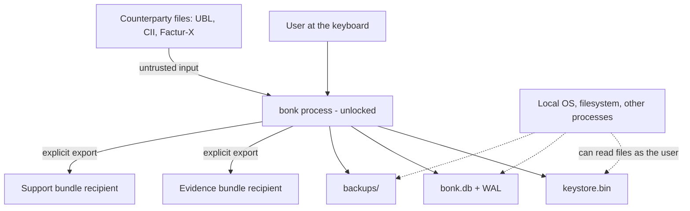

# Threat model

**Status:** v1.0 draft, 2026-10-28. This is the honest version: it names what the
product does not defend against as clearly as what it does.

Scope: the desktop client as built through M6 — local archive, keys, imports,
exported artefacts, backups, evidence and support bundles. The Peppol bridge
(M7), synchronization (M8), and the DRR pipeline (M9) are out of scope and are
not in the binary.

## 1. Assets

| Asset | Why it matters |
|---|---|
| Invoice content | Amounts, counterparts, and payment details of real trade |
| Party data | Names, addresses, VAT identifiers of sole traders are personal data |
| Data encryption key (DEK) | Opens every page of the archive |
| Passphrase and recovery key | The only routes to the DEK |
| Audit chain | Evidence of what was issued, imported, approved, or paid, and when |
| Backups | The same archive, in whatever place the user copied it |
| Evidence bundles | A document plus its proof, by design readable by a third party |

## 2. Actors and trust boundaries

The boundary that matters most: **anything inside the user's account is reachable
by the user's other processes.** Encryption at rest protects a copy that leaves
the machine, not a machine an attacker is already logged into.

## 3. Assumptions

- The operating system is not compromised and disk encryption protects the
  powered-off machine.
- No malicious process runs as the user while the archive is unlocked.
- The user's passphrase is not also written next to the keystore. (A recovery key
  is a second credential and deserves the same care — see R4.)
- The counterparty's document is hostile input; nothing else is.
- The hardware is not being tampered with at the bus or firmware level.

## 4. Threats and mitigations

### 4.1 Stolen files

| Threat | Mitigation | Residual |
|---|---|---|
| Laptop or backup file stolen | SQLCipher page encryption, raw 32-byte key, WAL and journals encrypted too; a test scans the database and its sidecars for a canary string | A stolen keystore plus a weak passphrase is an offline guessing problem |
| Keystore and archive both copied | DEK wrapped by an Argon2id-derived KEK (64 MiB, t=3, p=1); no passphrase means no key | Argon2id raises the cost; it does not make a weak passphrase safe |
| Backup is the only copy and is damaged | `VACUUM INTO` copy, reopened read-only and checked (integrity + chain) before older copies are pruned | A backup that fails verification is kept, not deleted, but it is not a working backup |
| Disk image while unlocked | Out of scope: the process holds the DEK in memory | Suspicious swap and hibernation files can contain key material |

### 4.2 Keys

| Threat | Mitigation | Residual |
|---|---|---|
| Forgotten passphrase | Recovery key: a second wrap of the same DEK under a 160-bit secret, shown once, never stored; `passphrase-reset` uses it and rotates it | If the recovery key is lost too, the archive is unrecoverable. That is the design, not a bug |
| Attacker with a copy of the keystore adds their own route | `recovery-add` requires the passphrase and re-derives it from the file before writing | An attacker who already has the passphrase has nothing left to gain |
| Corrupted or partial keystore write | Rewrites build and unwrap the new bytes in memory, then write a temporary file and rename it into place. Where the OS will not rename over an existing file, the previous keystore is parked as `keystore.old` and removed only after the new one lands, and put back if the rename fails | A crash can leave `keystore.tmp` or `keystore.old` behind; recovery is a manual rename, not a lost key |
| Passphrase left in memory | DEK and KEK live in `Zeroizing` buffers | Passphrase `String`s are not zeroised; they are dropped, not wiped |
| Passphrase on the command line | Flags exist for tests and scripts; the prompt and `BONK_PASSPHRASE` are the documented path | Shell history and process listings are outside our control |

### 4.3 Integrity

| Threat | Mitigation | Residual |
|---|---|---|
| Silent corruption of stored bytes | Every payload is re-hashed by `bonk verify`, the health panel, and evidence export; artefacts are cross-checked against their blobs | Corruption is detected, not repaired. There is no redundancy inside one archive; backups are the answer |
| Rewriting a document or payload | Write-once triggers on `document`, `document_line`, `artefact`, `blob`, and append-only events; status is derived from events | Someone with the key and SQLite can drop the triggers. The chain catches the result, not the act |
| Rewriting the audit chain | SHA-256 chain over canonical event JSON, recomputed from the first event; tampering is caught | **Forking:** an attacker with the key can rebuild a consistent chain from event one. The chain proves consistency with a *known head*, so keep heads elsewhere — evidence bundles, `bonk verify` output, a dated email |
| Restoring an old backup to “undo” a document | Nothing prevents it | A restored archive is a different history with the same shape; the head differs, which is why heads are worth recording |

### 4.4 Untrusted input

| Threat | Mitigation | Residual |
|---|---|---|
| Malicious XML | DTD rejected outright (no entity expansion), size capped at 10 MiB, nesting at 64, root namespace checked, unknown values refused rather than defaulted | A valid document can still be nonsense; that is what conformance findings are for |
| Decompression bomb in a PDF | Bounded decompression at load and on the embedded stream; a stream that would inflate past the limit is refused | CPU time for a large *valid* PDF is unbounded by design |
| Encrypted or malformed PDF | Refused with a reason; page content is never parsed, so a visual-only PDF is simply not an invoice | OCR is out of scope |
| Document with a misleading XMP packet | `fx:DocumentFileName` and `fx:DocumentType` must agree with the attachment | Both are attacker-controlled; the check catches inconsistency, not intent |
| Parser crash on hostile bytes | Property tests and mutation tests assert the readers answer or refuse and never panic; parser paths are also bounded by design | Not yet running libFuzzer (see O4) |
| Imported document triggers network or code | There is no network code in the binary and nothing executes imported content | `typst` is a local binary invoked for PDF rendering only |
| Phishing inside an invoice | Content is displayed as text; nothing auto-opens links or attachments | The user can still be socially engineered by what they read |

### 4.5 Outbound artefacts

| Threat | Mitigation | Residual |
|---|---|---|
| Evidence bundle is forged | Manifest lists a SHA-256 per file; unlisted files are rejected; manifest paths cannot leave the bundle; the chain is recomputed and must end at the recorded head | The verifier trusts the manifest as its root. It proves internal consistency, not that the archive had no other history |
| Wrong document attached to a bundle | The record must name the document and at least one audit event must too | An exporter with write access could construct a lie; the recipient sees a consistent one |
| Support bundle leaks business data | Assembled from typed facts only — counts, versions, sizes, hashes. No names, amounts, numbers, identifiers, or paths. A canary test proves it | The chain head is a digest of event content; it is not reversible, but it correlates two archives that share a history |
| Bundle sent to the wrong person | The command prints exactly what it writes | Human error is not a technical control |

### 4.6 Build and distribution

| Threat | Mitigation | Residual |
|---|---|---|
| Plaintext build shipped by accident | The `plain` feature exists for hosts without OpenSSL; the GUI shows a permanent red banner, the CLI prints the label, and support bundles say `none (test build)` | Nothing prevents a determined packager from shipping it; the release checklist must |
| Vulnerable dependency | `deny.toml` allows permissive licences only (AGPL/SSPL rejected on purpose) and CI runs `cargo deny check` for licences, advisories, and yanked crates | It runs in CI, not on the developer's machine, and advisory data needs the network; `cargo audit` alone is not wired |
| Untrusted code in a template | Typst templates are ours; the world exposes no filesystem or network | M4's template editor must keep that world restricted |

## 5. Residual risks, stated plainly

- **R1 — Unlocked means readable.** While the app runs, the DEK is in memory and
  the archive is readable by any process running as the user. Disk encryption and
  SQLCipher do not change that.
- **R2 — The chain is tamper-evident, not tamper-proof.** Without an outside record
  of a head, a fully rewritten chain is indistinguishable from the original.
- **R3 — One archive, no redundancy.** Verification detects loss; only backups
  survive it.
- **R4 — The recovery key is a second key.** Storing it beside the archive turns
  two credentials into one. The command says so; nothing enforces it.
- **R5 — Passphrase strength is the weak link.** Argon2id makes guessing
  expensive; it cannot make a guessable phrase safe. The strength meter (M6.1) is
  not built yet.
- **R6 — No idle lock yet.** An unlocked workspace stays unlocked until the user
  presses Lock. M6.2 is open.
- **R7 — Secrets in memory are only partly wiped.** DEK and KEK are zeroised;
  passphrases and recovery-key strings are not.
- **R8 — File permissions are the OS default.** Anyone who can read the user's
  profile can copy the keystore and archive.

## 6. Out of scope for v1.0

- Network transmission, Peppol, and the DRR pipeline (M7/M9).
- Multi-device synchronization and conflict resolution (M8).
- Malware running as the user, rootkits, and physical bus attacks.
- Screen capture, shoulder surfing, and keyloggers.
- Multi-user machines and server deployment.
- Recovering a passphrase from a lost recovery key.

## 7. How these claims are tested

| Claim | Test |
|---|---|
| The archive holds no plaintext | `db::tests::the_file_does_not_contain_plaintext` |
| A wrong key cannot open it | `db::tests::a_wrong_key_cannot_open_the_file` |
| Backups are encrypted and verifiable | `backup` integration tests, including a wrong-key refusal |
| A damaged copy is detected | `a_damaged_backup_is_detected` |
| Recovery keys round-trip and refuse typos | `keystore::tests::recovery_keys_round_trip_and_tolerate_transcription` |
| A rewrite leaves no second copy of the key | `keystore::tests::a_rewrite_leaves_no_stray_keystores_behind` |
| Adding a key needs the passphrase | `keystore::tests::adding_a_recovery_key_requires_the_passphrase` |
| The used recovery key is rotated away | CLI `a_lost_passphrase_can_be_reset_with_the_recovery_key` |
| Chain tampering is caught | `tampering_with_the_audit_chain_is_detected` |
| Payload drift is caught | `a_payload_that_no_longer_hashes_to_its_record_is_caught` |
| Evidence forgery is caught | `a_rewritten_chain_is_caught_even_with_a_matching_manifest` |
| Support bundles leak nothing | `a_bundle_has_counts_and_no_business_facts` |
| Parsers survive hostile bytes | `arbitrary_bytes_never_panic`, `a_mutated_container_never_panics`, `a_stream_that_inflates_past_the_limit_is_refused` |

## 8. Open items

- **O1** Passphrase strength meter and the GUI prompts for recovery (M6.1).
- **O2** Idle lock and zeroisation tests (M6.2).
- **O3** Optional OS-keychain wrap of the same DEK, for “remember me”.
- **O4** libFuzzer targets once the runner has nightly and `cargo-fuzz`; the
  property tests are the gate until then.
- **O5** Tighten file permissions on the keystore and archive at creation.
- **O6** Decide whether `bonk verify` should print a head that the user can record
  somewhere durable; today it prints the head and stops there.

Changes to a decision recorded here need an ADR, like any other.
